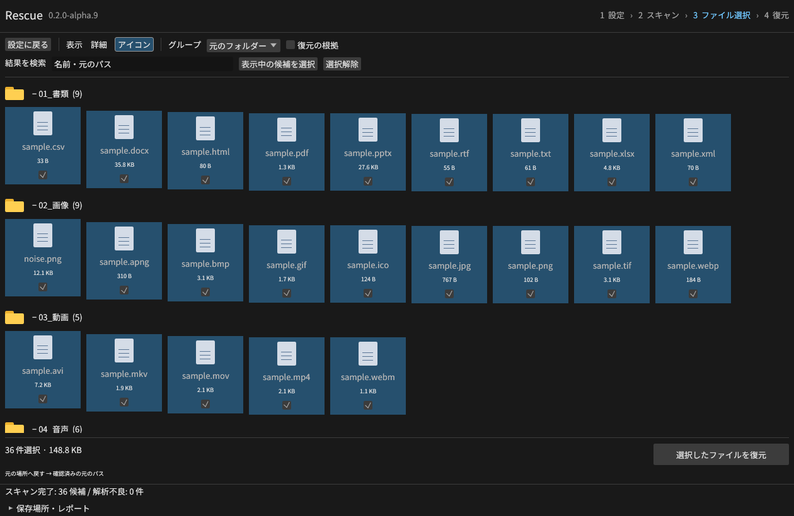
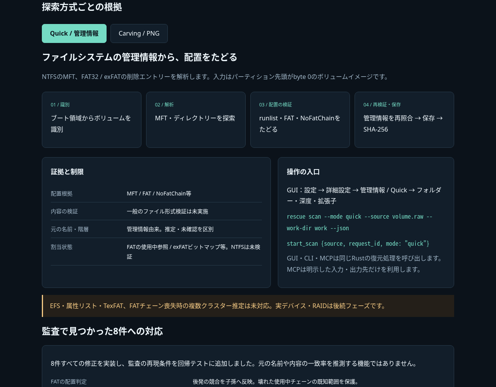

# Rescue

Rust製のファイル復元ソフト。Windows・Linux・macOSでGUI・CLI・MCPが同じ復元エンジンを使います。
復元できるファイル数と内容の完全性を優先して開発しています。

**v0.2.0-alpha.6：詳細・アイコン表示、検索条件、フォルダー／ZIP保存、3 OSのインストール版とポータブル版。**
現在の入力はNTFS・FAT32・exFATボリュームのRAWイメージです。静止PNGのcarvingにも対応します。
実デバイス、RAID、PNG以外のcarvingは未対応です。有料製品との性能比較は未検証です。
[対応範囲](docs/ALPHA.md)・[製品仕様](docs/SPEC.md)・[進捗](docs/GOAL.md)


列の見出しで昇順／降順を切り替え、境界をドラッグして列幅を変更できます。
元のフォルダー、種類、作成日、更新日、サイズ、名前の先頭、復元可否でグループ化できます。
画像はLinux / Xvfb上の実GUIと、35形式の実ファイルを入れた合成NTFSイメージです。表示日時はテスト用の値です。

## ダウンロード

[この版のリリースとSHA-256一覧](https://github.com/Xenoah/rescue-deletedfiles_rust/releases/tag/v0.2.0-alpha.6)

| OS / CPU | インストール版 | ポータブル版 |
| --- | --- | --- |
| Windows x64 | [セットアップEXE](https://github.com/Xenoah/rescue-deletedfiles_rust/releases/download/v0.2.0-alpha.6/rescue-0.2.0-alpha.6-windows-x64-setup.exe) | [ZIP](https://github.com/Xenoah/rescue-deletedfiles_rust/releases/download/v0.2.0-alpha.6/rescue-0.2.0-alpha.6-windows-x64-portable.zip) |
| Linux x64 | [Debian/Ubuntu用DEB](https://github.com/Xenoah/rescue-deletedfiles_rust/releases/download/v0.2.0-alpha.6/rescue-0.2.0-alpha.6-linux-x64.deb) | [tar.gz](https://github.com/Xenoah/rescue-deletedfiles_rust/releases/download/v0.2.0-alpha.6/rescue-0.2.0-alpha.6-linux-x64-portable.tar.gz) |
| macOS Apple Silicon | [PKG](https://github.com/Xenoah/rescue-deletedfiles_rust/releases/download/v0.2.0-alpha.6/rescue-0.2.0-alpha.6-macos-arm64.pkg) | [.app入りZIP](https://github.com/Xenoah/rescue-deletedfiles_rust/releases/download/v0.2.0-alpha.6/rescue-0.2.0-alpha.6-macos-arm64-portable.zip) |
| macOS Intel | [PKG](https://github.com/Xenoah/rescue-deletedfiles_rust/releases/download/v0.2.0-alpha.6/rescue-0.2.0-alpha.6-macos-x64.pkg) | [.app入りZIP](https://github.com/Xenoah/rescue-deletedfiles_rust/releases/download/v0.2.0-alpha.6/rescue-0.2.0-alpha.6-macos-x64-portable.zip) |

Windows版はユーザー単位でインストールし、スタートメニューから起動できます。VCランタイムを静的リンクしています。描画はDirect3D 12（wgpu）を使用します。
Linux版はglibc 2.35以降（Ubuntu 22.04相当）、X11／Wayland・OpenGL環境が必要です。DEBはGUIメニューとCLIを登録します。
macOS版は13以降。PKGはApplicationsにRescue.appを置き、`rescue`コマンドを登録します。
macOSはアドホック署名のみで、Developer ID署名・公証はありません。初回起動時のOSの許可が必要になる場合があります。
[インストール・削除方法](docs/INSTALL.md)を参照してください。

## 操作の流れ

1. **設定**：入力イメージと保存方法を選択。任意のフォルダー、または新しいZIPの保存先を指定します。
2. **詳細設定**：必要なら検索方式、検索フォルダー、深度、拡張子、carvingのバイト範囲を指定します。
3. **スキャン**：処理後に詳細ビューへ進みます。日時が残っていない候補は「—」です。
4. **ファイル選択**：検索・並べ替え・グループ化で絞り、チェックを付けます。アイコン表示にも切り替えられます。
5. **復元**：選択ファイルを保存。ZIPにはファイルと`rescue-report.json`が入り、SHA-256も記録します。


Quickの検索範囲はイメージ内のフォルダーです。深度0は指定フォルダー直下、空欄は追加の深度制限なし。
範囲・深度・拡張子は検出結果を絞り、使用中領域との競合確認はボリューム全体を調べます。
Carvingは指定バイト範囲の静止PNGを探索します。終了位置は範囲に含めず、範囲外へはみ出すPNGを対応済みにしません。



元イメージは読み取り専用です。入力・検索条件を変えると古い候補を無効化します。
出力はUUID付きの名前で平坦に保存し、元の階層はセッションの候補情報に残します。既存ファイル・ZIPは上書きしません。
保存先は別媒体のハードリンク対応ファイルシステムを使用してください。
ZIPはZIP64対応・無圧縮で、作成中は作業領域にも空き容量が必要です。取消・失敗時は一時ファイルの場所を表示します。

## 技術説明のインテリジェンスUI

[通信不要の操作できる技術説明HTML](https://github.com/Xenoah/rescue-deletedfiles_rust/releases/download/v0.2.0-alpha.6/intelligence.html)で、
操作の流れ、実画面、検索と保存の根拠・制限を確認できます。READMEとリリースには毎回、実画面と技術説明を掲載します。
GUIでも「復元の根拠」を開くと、候補の配置・割当状態・警告・保存結果を確認できます。



| 方式 | 根拠と検証 | 分からないこと |
| --- | --- | --- |
| Quick | MFT / FAT / NoFatChainの配置、親参照、一部の割当競合 | 一般の形式の内容の完全性、NTFSの割当競合 |
| PNG carving | 全チャンクCRC、zlib終端・Adler-32・展開長、パレット・画素、再読込ハッシュ | 元の名前・階層・割当・削除状態 |
| 日時表示 | NTFS FILETIME、FAT DOS時刻、exFATのUTCオフセット | 記録のない日時、FATのタイムゾーン |
| ZIP保存 | ファイル別SHA-256、ZIPのCRC、ZIP全体SHA-256、結果レポート | 削除前の内容との一致は正解データの照合が必要 |

## クラウドでの復元検証

35種類・36ファイルを正解データと照合します。管理情報が残る8条件ではCLI/MCP計576件がバイト一致しました。
実際に削除したFAT32では512Bクラスターで14/36件、4KiBで27/36件。管理情報喪失・断片化・上書きで結果は変わります。
公開ポータブルのGUIからZIP保存した36ファイルも、独立したPython ZIP展開で正解バイトと一致しました。
[公開版の保存完了画面](docs/images/public-saved-view-v6.png)と[GUI実行・照合JSON](docs/public-gui-v0.2.0-alpha.6.json)も記録しています。

[全形式と条件の結果表](docs/CLOUD-TESTS.md)、[GUI操作の検証記録](docs/UI-FLOW.md)、[検証履歴](docs/VALIDATION.md)を公開しています。
公開済みalpha.5の実行ファイルそのものを使った[クラウド検証HTML](https://github.com/Xenoah/rescue-deletedfiles_rust/releases/download/v0.2.0-alpha.5/format-verification.html)も参照できます。
実SSDのTRIMや物理障害、有料製品比較を検証した結果ではありません。

## CLI / MCP

PowerShellでの例。`scan`の返すセッションと、`results`の候補IDを使います。

```powershell
.\rescue.exe scan --source 'D:\Images\volume.raw' --work-dir 'E:\RescueWork' --extension jpg,png,docx --path-prefix '写真' --max-depth 2 --json
.\rescue.exe results --session 'E:\RescueWork\<id>.rescue-session.json' --json
.\rescue.exe recover --session 'E:\RescueWork\<id>.rescue-session.json' --all --archive 'E:\Recovered\files.zip' --json
```

フォルダー保存は`--archive`の代わりに`--destination 'E:\Recovered'`。
個別選択は`--all`の代わりに`--id <候補ID>`を繰り返します。
PNG探索は`scan --mode carve --range-start 0 --range-end 10485760`。終了位置を省略するとイメージ末尾です。
Linux/macOSでも同じ引数を`rescue`に渡します。

MCPクライアントから、ローカルstdioサーバーを起動します。

```powershell
.\rescue.exe mcp --stdio --allow-source 'D:\Images\volume.raw' --work-dir 'E:\RescueWork' --allow-output-root 'E:\Recovered'
```

`list_sources`、`start_scan`、`get_job`、`list_candidates`、`recover_files`、`cancel_job`、`get_report`を提供します。
`start_scan`は`mode`、`extensions`配列、`path_prefix`、`max_depth`、`range_start`／`range_end`に対応。
`recover_files`は`output_format: "directory"`または`"zip"`を指定できます。ZIPの`destination`はZIPのフルパスです。
開始操作には`request_id`が必要で、返された`job_id`を`get_job`で確認します。許可済みの入力・出力だけを使用します。

## 開発・配布

Rust 1.99.1、Python 3.12以降。WindowsはMSVC Build Tools、macOSはXcode Command Line Toolsが必要です。
LinuxのGUIビルド依存は[CI設定](.github/workflows/ci.yml)を参照してください。

```sh
cargo build --workspace --locked
cargo test --workspace --locked
cargo clippy --workspace --all-targets --locked -- -D warnings
python scripts/run_integration.py --binary target/debug/rescue
python scripts/e2e_formats.py --binary target/debug/rescue --output format-results/local
cargo run -p rescue-gui --locked
```

Windowsでは実行ファイルを`target/debug/rescue.exe`にします。テストは新しい通常ファイルのイメージだけを変更します。
タグのCIは4つのネイティブ環境で検証し、インストール版・ポータブル版を検査してから公開します。
配布物、検証JSON、実画面、単体HTMLのチェックサムは`SHA256SUMS.txt`に記録します。

[MITライセンス](LICENSE)。各配布物に依存ライブラリの`THIRD_PARTY_NOTICES.txt`を同梱します。
