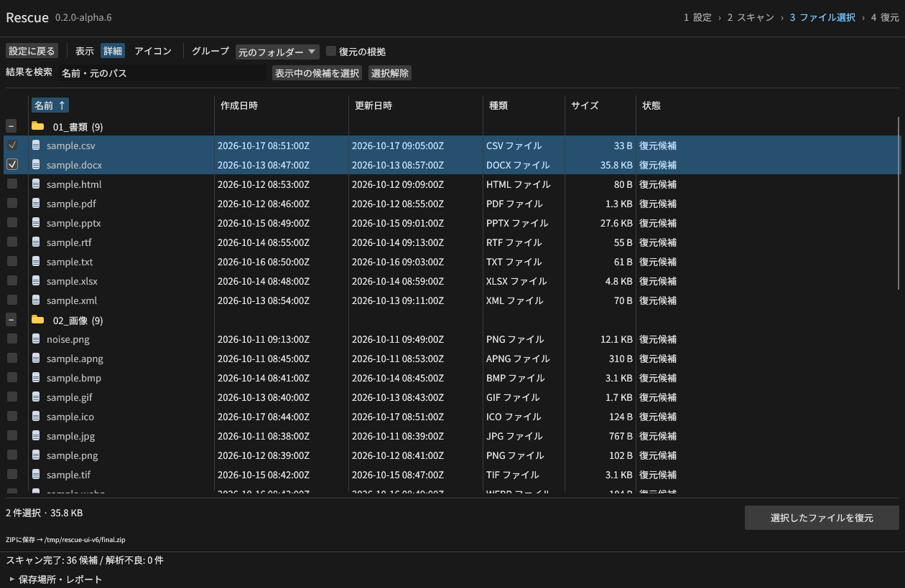
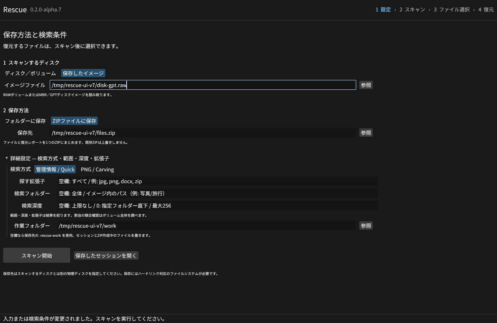
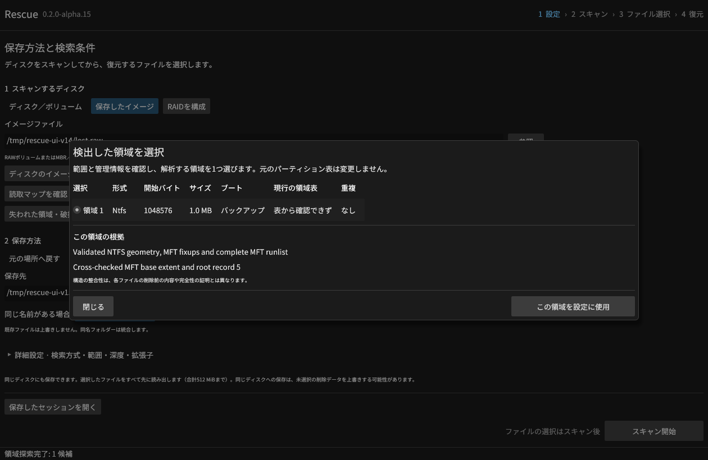
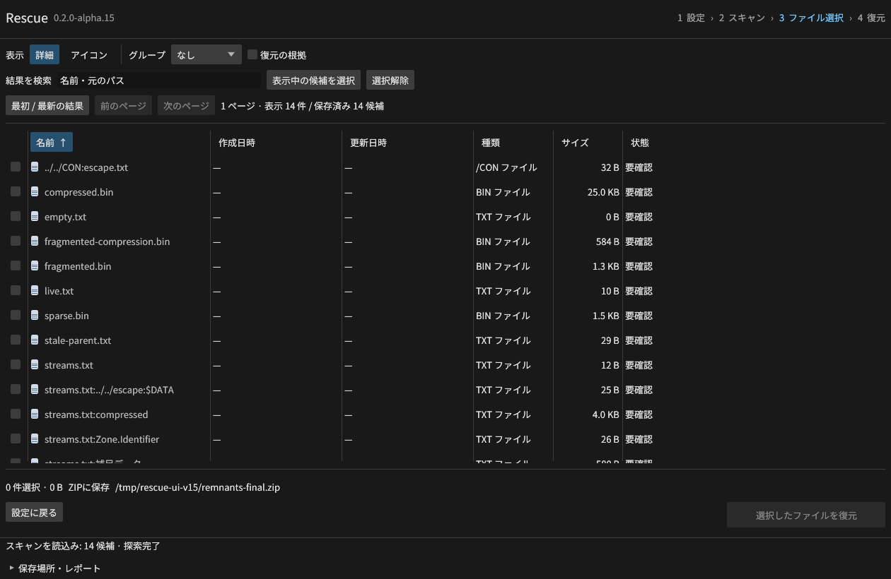
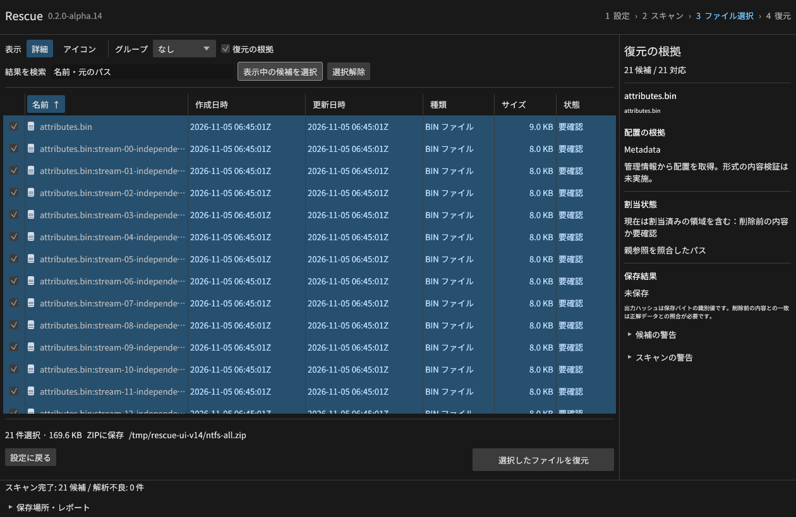
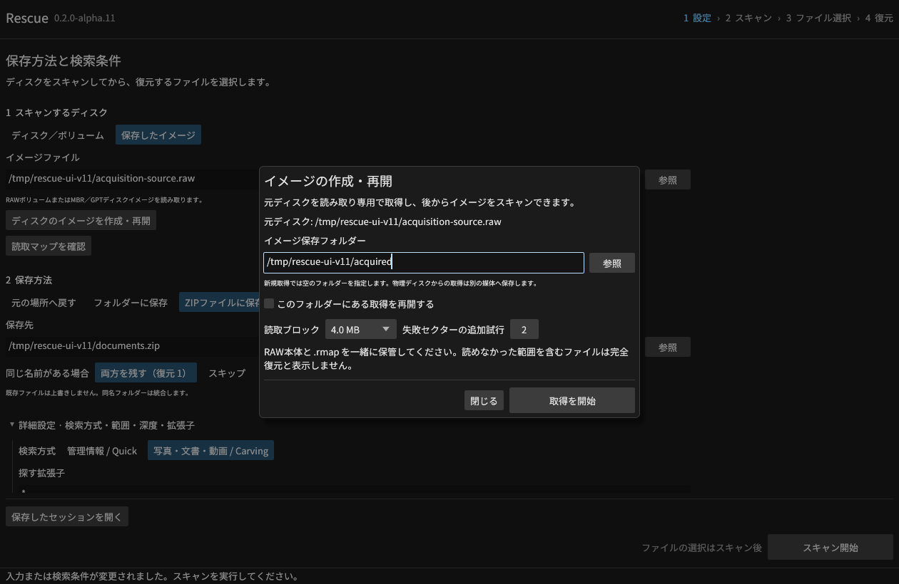
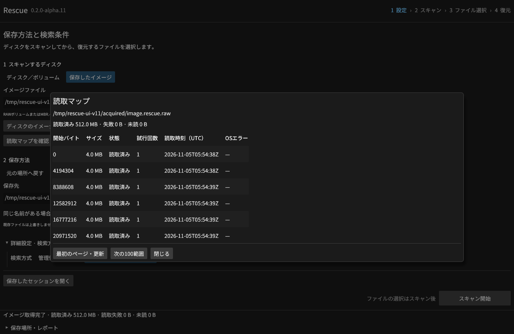
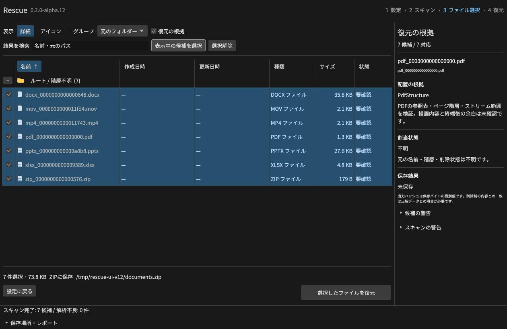
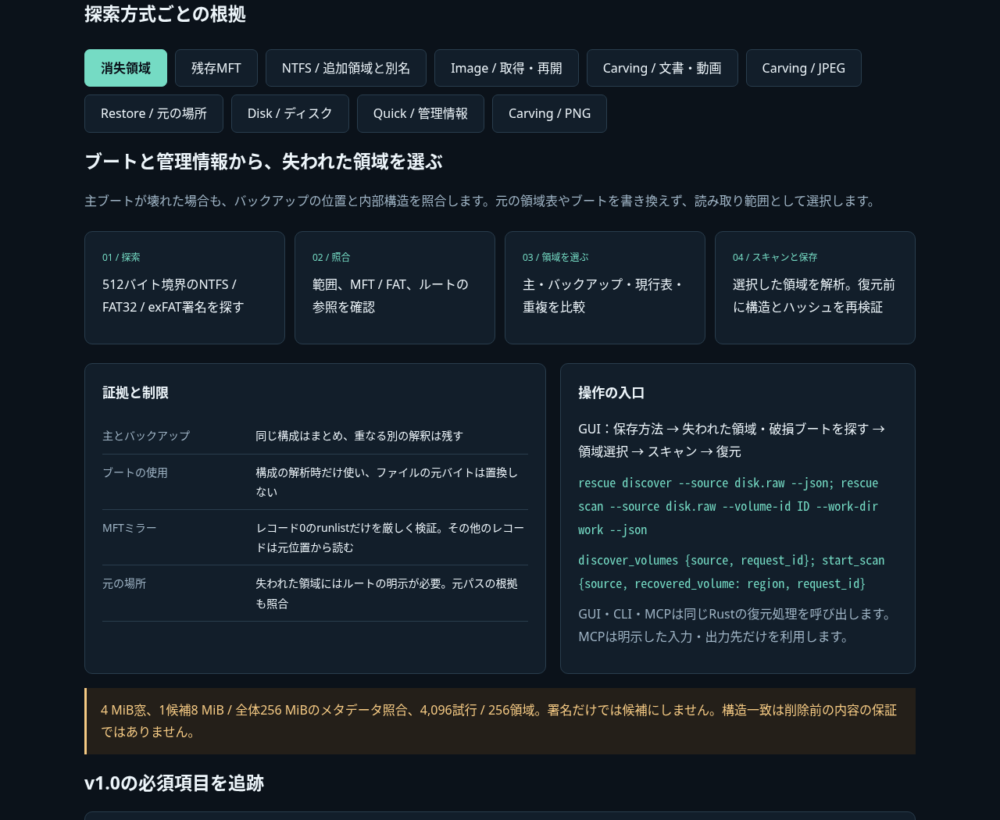

# Rescue

Rust製のファイル復元ソフト。Windows・Linux・macOSでGUI・CLI・MCPが同じ復元エンジンを使います。
復元できるファイルの数と、元データの内容を保つことを優先して開発しています。

**v0.2.0-alpha.13: 消失領域の探索・バックアップブート・残存MFTに対応。**
現在は開発版です。v1.0の全必須機能・レビュー・3 OS試験は [受入台帳](docs/V1_ACCEPTANCE.md) で追跡します。
RAID、大容量索引、隔離プレビュー、Windows権限分離などは未完了です。
有料製品との性能比較は未測定です。



列見出しで並べ替え、境界で列幅を変更し、元フォルダー・種類・日付・サイズ等でグループ化できます。
画像はLinuxの実GUIと人工生成のディスクです。日時や元のフォルダーは試験用の値です。

## ダウンロード

[v0.2.0-alpha.13のリリースとSHA-256一覧](https://github.com/Xenoah/rescue-deletedfiles_rust/releases/tag/v0.2.0-alpha.13)

| OS / CPU | インストール版 | ポータブル版 |
| --- | --- | --- |
| Windows x64 | [setup.exe](https://github.com/Xenoah/rescue-deletedfiles_rust/releases/download/v0.2.0-alpha.13/rescue-0.2.0-alpha.13-windows-x64-setup.exe) | [portable.zip](https://github.com/Xenoah/rescue-deletedfiles_rust/releases/download/v0.2.0-alpha.13/rescue-0.2.0-alpha.13-windows-x64-portable.zip) |
| Linux x64 | [.deb](https://github.com/Xenoah/rescue-deletedfiles_rust/releases/download/v0.2.0-alpha.13/rescue-0.2.0-alpha.13-linux-x64.deb) | [portable.tar.gz](https://github.com/Xenoah/rescue-deletedfiles_rust/releases/download/v0.2.0-alpha.13/rescue-0.2.0-alpha.13-linux-x64-portable.tar.gz) |
| macOS Apple Silicon | [.pkg](https://github.com/Xenoah/rescue-deletedfiles_rust/releases/download/v0.2.0-alpha.13/rescue-0.2.0-alpha.13-macos-arm64.pkg) | [portable.zip](https://github.com/Xenoah/rescue-deletedfiles_rust/releases/download/v0.2.0-alpha.13/rescue-0.2.0-alpha.13-macos-arm64-portable.zip) |
| macOS Intel | [.pkg](https://github.com/Xenoah/rescue-deletedfiles_rust/releases/download/v0.2.0-alpha.13/rescue-0.2.0-alpha.13-macos-x64.pkg) | [portable.zip](https://github.com/Xenoah/rescue-deletedfiles_rust/releases/download/v0.2.0-alpha.13/rescue-0.2.0-alpha.13-macos-x64-portable.zip) |

Linuxはglibc 2.35以降、macOSは13以降。macOSはアドホック署名で、Developer ID署名・公証はありません。
OS対応とファイルシステムの解析対応は別です。APFS/ext4の直接解析は未対応です。

## 操作の流れ

1. ディスク全体・ボリューム、または保存したRAWイメージを選択。
2. 元の場所・任意フォルダー・ZIPと、同名ファイルの処理を設定。
3. 必要なら詳細設定で検索方式・範囲・深度・拡張子を指定してスキャン。
4. 復元するファイルを選択し、復元結果と保存先を確認。



同じディスクにも保存できます。選択データをすべて先に読み出します（合計512 MiBまで）。
同名ファイルは `資料 (復元 1).pdf` のように別名で残すか、スキップ。同名フォルダーは統合します。
元の場所が確認できない候補はフォルダーかZIPへ保存してください。
同じディスクへの保存は、未選択の削除データへ影響する可能性があります。

主要操作はスクロール領域の下に固定し、入力ラベルを常に表示します。
Ctrl+F（macOSはCommand+F）で結果検索へ移動。最小720×520と100%/150%/200%の配置を検査しています。
配置の判断根拠は [Microsoft/W3Cの公式資料と採用ルール](docs/UI_GUIDELINES.md) を参照。

## 消失した領域と残存MFTを探す

「失われた領域・破損ブートを探す」で、ディスク内のNTFS/FAT32/exFAT候補を比較して選択できます。
バックアップブートは解析にだけ利用し、元ディスクへ書き戻しません。



詳細設定の「残存するMFTレコードも探索」で、現行MFTの外や論理末尾に残るレコードを調べます。
旧クラスタ構成や元の階層は未確認と表示し、元の場所への自動復元には使いません。



[対応プロファイル・根拠・上限](docs/DISCOVERY.md)。独立したntfs-3gによる同一構成の実クイックフォーマット後に、
旧100ファイルをCLI/MCPでそれぞれ全バイト一致で復元しました。Windows format.exeやSSD TRIMの実績とは区別します。

## NTFSの追加領域と別名

追加のMFTレコードを属性リストからたどり、シーケンス番号・属性ID・VCN・重複範囲を照合します。
MFT自体の分割、ADS、圧縮・疎領域にも適用し、壊れた参照から別ファイルのデータを結合しません。



`$Bitmap` の割当状況と、保存できた内容を分けて表示します。未割当は削除前の内容との一致保証ではありません。
複数の名前は同じ候補にまとめ、別名・元のフォルダーからも検索できます。復元するデータは1件です。


[対応範囲・照合方法・上限](docs/NTFS-EXTENTS.md)

## イメージを取得して解析する

「ディスクのイメージを作成・再開」から、RAWと読取マップを保存します。
読めた範囲を同期してから記録し、失敗範囲だけセクター単位で再試行。取消・強制終了後は
ソースの識別と保存済みSHA-256を確認して再開します。



取得したRAWと `.rmap` を一緒に保管してください。未読・失敗範囲を含むファイルは不完全とし、
元媒体とファイル内の欠損位置をレポートへ記録します。マップは範囲・状態・UTC時刻・試行回数・エラーを表示します。



物理元ディスクからの取得には別媒体を使用します。選択ファイルの同一場所復元とは別の設定です。
[取得・再開・欠損の扱いと上限](docs/IMAGING.md)

## 復元の根拠

| 方式 | 確認する内容 | 限界 |
| --- | --- | --- |
| Quick | NTFSのMFT/runlist、FAT32/exFATの削除エントリーと配置 | 拡張子を問わずバイトを保存。一般の内容の形式検証は未実施 |
| PNG / JPEG | PNGのCRC・zlib・画素、JPEGの全MCU・係数・画素 | 連続配置、元名・日時・削除状態は不明 |
| PDF | classic xref・間接参照・ページ階層・streamの長さ | 描画未検証、EOFによる範囲推定、xref stream/暗号化は未対応 |
| ZIP / Office | 全エントリーのCRC・展開長・管理情報、OfficeのXML分類 | stored/DEFLATE。Office描画・マクロの安全性は未検証 |
| MP4 / MOV | moov/mdat・トラック・全サンプル位置 | 非fragmented、ftyp必須。映像/音声の全フレーム復号は未実施 |



[文書・動画の具体的な対応と上限](docs/DOCUMENT-CARVING.md) · [JPEGの検証](docs/JPEG-CARVING.md) · [全対応表](docs/ALPHA.md)

[操作できる技術説明UIをダウンロード](https://github.com/Xenoah/rescue-deletedfiles_rust/releases/download/v0.2.0-alpha.13/intelligence.html)。画像を内蔵した単一HTMLで、通信せずに画面と探索方式を切り替えられます。



## 検証

- LinuxのRust 42項目、13統合群。新しい文書/動画の69ケースでは正常23変種、破損/未対応30条件、CLI/MCPの30出力のバイト一致を確認。
- 35形式36ファイルの管理情報復元は8条件×CLI/MCPで576件一致。管理情報を失った連続配置は11/36、512B単位の断片配置は2/36。全900観測中755件が正解一致。上書き済み36件は元データとの一致0件で、管理情報から保存できても内容の同一性を保証しないことも確認。
- NTFS追加27条件で不正参照、分割MFT、圧縮単位、割当3状態、別名検索を確認。独立ntfs-3gの4レコード・21ストリームも全バイト一致し、実GUIから同じ21件と別名の1データをZIP復元しました。
- イメージ取得の15条件では強制終了・再開、マップ破損、元ソース変更、欠損位置、MCP取消・出力制限・ページ取得を検証。
- Linux実GUIで512 MiBを全バイト一致で取得し、128範囲のマップ・再開照合・取得後の36ファイル復元を確認。
- Linux実GUIで、元の場所36件・ZIP36件・JPEG33件・文書/動画7件の出力、既存PDFの保持、入力不変を照合。
- Windows・Linux・macOS Intel/ARMの実VMで同じ試験を実行。各VM内にこの試験専用のVHD/loop/hdiutilディスクを作り、読取専用ディスクと実際のPDF削除・元の場所への復元を確認しました。

alpha.13のローカル試験では、消失領域20条件・64出力、残存MFT12条件・52出力、実クイックフォーマット100件×CLI/MCPを照合しました。
実GUIでは消失領域6件・残存レコード14件をZIP復元し、720×520の候補ダイアログとキーボードで閉じる操作も確認しました。
[4環境のネイティブCI](https://github.com/Xenoah/rescue-deletedfiles_rust/actions/runs/42004653478)でRust42項目・13統合群・8パッケージの組立を通過しました。公開実物の検証は配布後に記録します。
前版alpha.12は[公開パッケージを4環境で実行](https://github.com/Xenoah/rescue-deletedfiles_rust/actions/runs/41999924773)し、計93資産を照合済みです。[公開実物の記録](docs/public-release-v0.2.0-alpha.12.json)。
GUIの自動配置試験・起動試験と、Windows/macOSの手動アクセシビリティ評価は区別します。
人工コーパスの件数は、実SSDのTRIM・上書き・物理故障や、一般的な復元率を示しません。

## CLI / MCP

```sh
rescue sources --json
rescue image --source disk.raw --destination acquired --progress --json
rescue read-map --image acquired/image.rescue.raw --limit 100 --json
rescue discover --source disk.raw --json
rescue scan --source disk.raw --volume-id DISCOVERED_ID --work-dir work --json
rescue scan --source volume.raw --fragments --work-dir work --json
rescue scan --source disk.raw --mode carve --extension pdf,docx,mp4 --work-dir work --json
rescue results --session work/SESSION.rescue-session.json --json
rescue recover --session work/SESSION.rescue-session.json --all --destination recovered --json
rescue restore --source C: --name report.pdf --original --json
rescue mcp --stdio --allow-source volume.raw --work-dir work --allow-output-root recovered
```

MCPは許可した入力・出力先を固定し、長時間処理の開始・進行取得・取消と候補検索・復元を提供します。
詳細は `rescue --help`、[仕様](docs/SPEC.md)、[クラウドセットアップ](docs/CLOUD-TESTS.md) を参照。

## 開発

Rust 1.99.1を固定しています。MITライセンス。

```sh
cargo build --workspace --locked
cargo test --workspace --locked
cargo clippy --workspace --all-targets --locked -- -D warnings
python scripts/run_integration.py --binary target/debug/rescue
```

v1.0は [受入台帳](docs/V1_ACCEPTANCE.md) の必須項目を満たしてから公開します。
未実装を既知の制限へ移して安定版と呼ぶことはしません。
