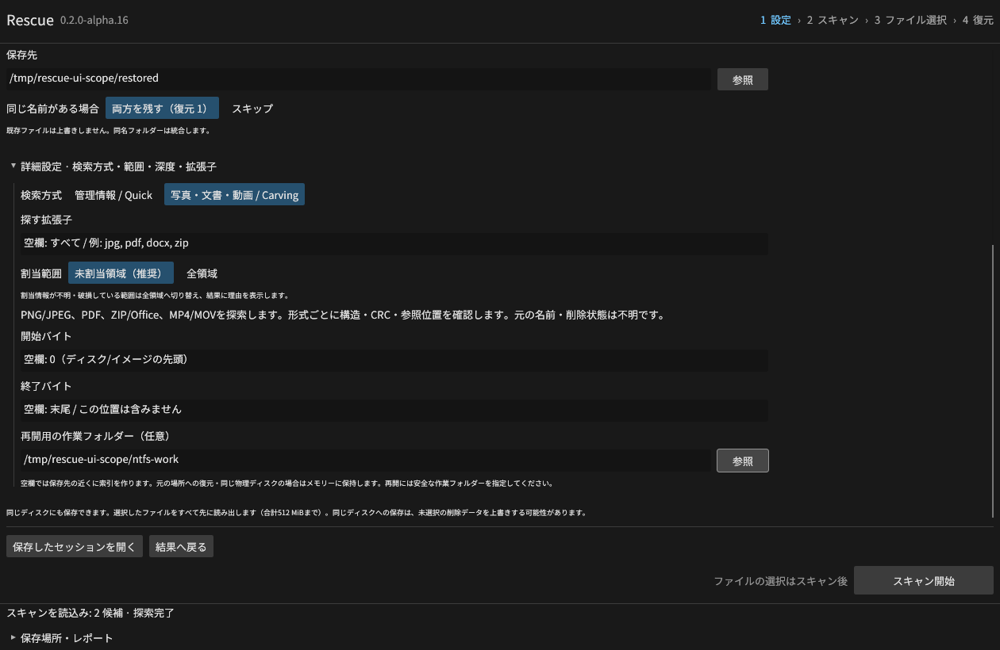
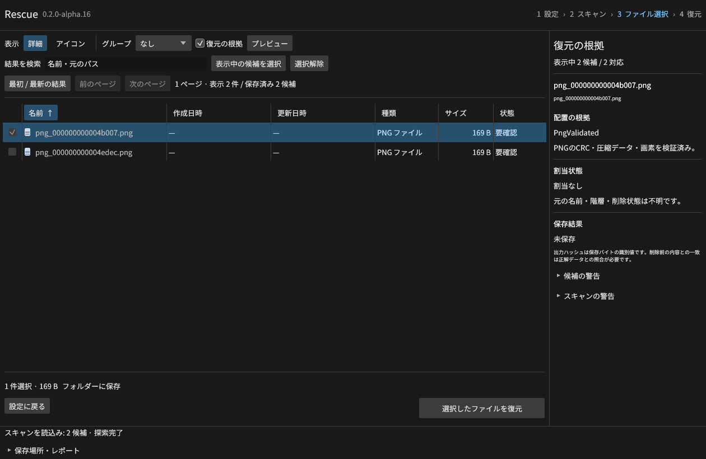
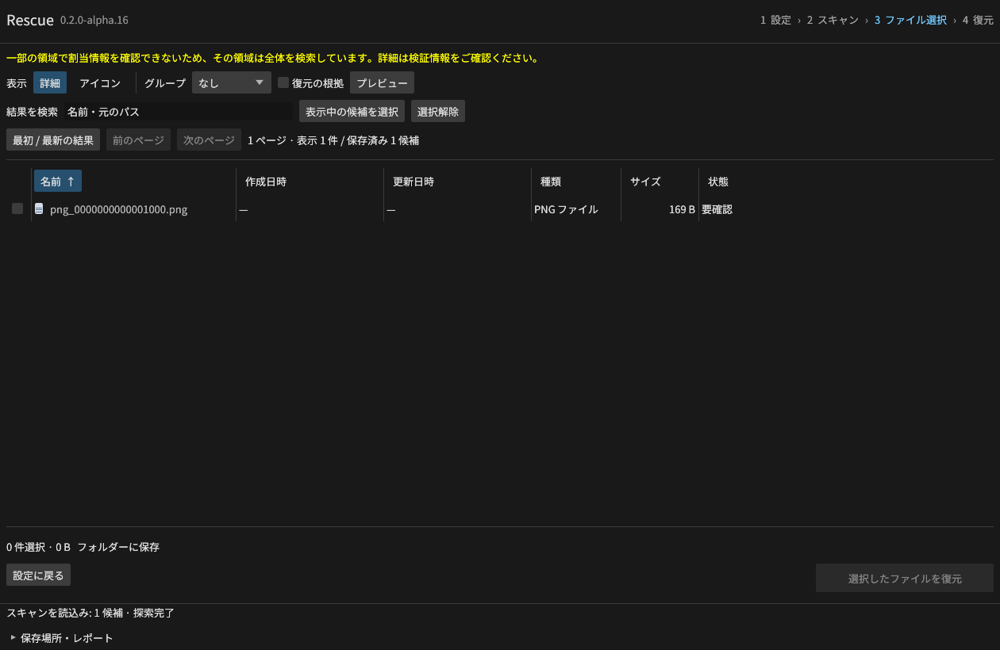
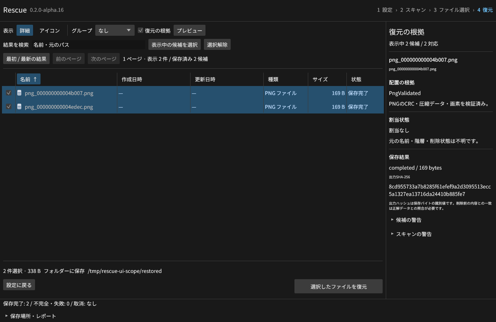

# Carvingの検索範囲

alpha.16開発版では、新しいCarvingスキャンの既定を「未割当領域」にする。
GUIの詳細設定、CLIの `--carve-scope unallocated|all`、MCPの `carve_scope` は同じ設定を使う。
管理情報を解析するQuickスキャンの選別条件には影響しない。

NTFSは `$Bitmap`、FAT32は有効なFATコピー、exFATは割当ビットマップを照合する。
MBR/GPTの各領域はその領域の相対クラスタ位置に変換する。
署名が未割当領域にあっても、検証したファイル内容の途中に割当済みクラスタがあれば除外する。
未割当は現在の管理情報の状態であり、削除されたことや削除前の内容との一致の証明ではない。

不明なファイルシステムや壊れた割当情報では、判定できない範囲の署名も検索対象にする。
結果の割当状態を「不明」とし、セッションに `ALLOCATION_FALLBACK:` で始まる理由を保存する。
GUIでは結果一覧の上部にも切替を表示する。「全領域」を明示した場合は割当による選別を行わない。

探索は引き続き指定バイト範囲を連続して読み取る。割当情報は候補の選別に使い、
割当済み領域のディスクI/Oを省く実装ではない。全領域探索より読取時間が短いとは主張しない。
メモリーには一度に一つのボリュームの解析状態と既存の上限付きキャッシュを保持する。

再開チェックポイントには範囲設定を保存し、設定だけを改変した再開を拒否する。
旧JSONセッションと旧版のCarvingチェックポイントは、当時の「全領域」を維持する。
復元・プレビューの前にも現在の割当情報を確認し、割当済みへの変化や
「未割当」から判定不能への変化があれば再スキャンを要求する。
稼働中媒体全体の瞬間的なスナップショットを保証する機能ではない。

GUIから実際にスキャン・選択・保存した2件/338バイトを独立生成PNGと照合した。
[GUI検証記録](gui-allocation-results.json)にはバイナリ、入力、画像のSHA-256を保存している。
CLI/MCP、3ファイルシステム、壊れた表、跨ぐクラスタ、MBR/GPT、強制終了と旧版再開は
`scripts/e2e_allocation_scope.py` の独立した検体で検証する。
Linuxでは[19条件・24ファイルの照合](allocation-scope-results-linux-development.json)を通過した。

