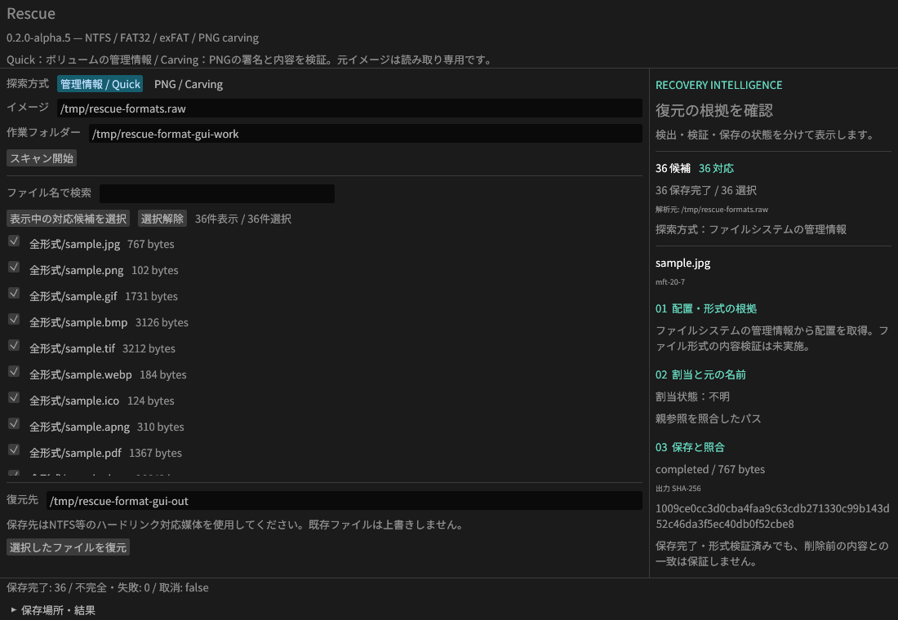

# クラウド復元テスト — v0.2.0-alpha.5

35種類・36ファイルを独立エンコーダーで生成し、元のバイト列・SHA-256と照合した。
対象は仕様の全ファイル形式と、追加の代表形式。世界中の全形式や、全媒体・全破損状態を網羅したという意味ではない。



Linux/Xvfbの実GUIでも36ファイルの保存と正解一致を確認した。Windows GUIの手動操作とは区別する。

## 条件別の結果

| 条件 | このコーパスで全バイト一致 | 注記 |
| --- | --- | --- |
| NTFS 連続・断片化・LZNT1・ADS | 288 / 288 | CLI/MCP、36ファイル×4条件×2経路 |
| FAT32 残存チェーン（連続・断片化） | 144 / 144 | CLI/MCP、削除エントリーを合成 |
| exFAT NoFatChain・断片化チェーン | 144 / 144 | CLI/MCP、削除エントリーを合成 |
| ntfs-3g由来の管理情報 | 72 / 72 | ファイル作成は独立ツール、削除フラグを合成 |
| mkfs.exfat由来の管理情報 | 72 / 72 | 実ブート・bitmap・upcase、削除エントリーを合成 |
| FAT32実削除・512Bクラスター | 14 / 36 | mkfs.fat → mcopy → mdel |
| FAT32実削除・4KiBクラスター | 27 / 36 | mkfs.fat → mcopy → mdel |
| 管理情報喪失・連続配置 | 2 / 36 | 2件のPNGだけが一致。他形式のcarvingは未対応 |
| 管理情報喪失・断片化 | 1 / 36 | 1クラスター内のPNGのみ。大きなPNGの断片再構成は未対応 |
| MBR/GPTを含む全ディスクイメージ | 各2 / 36 | Quickは未対応として拒否。PNGの生バイト探索だけ成功 |
| データ領域を上書き後にスキャン | 0 / 36 | 保存済みでも元の内容と一致しない。実TRIM試験ではない |

FAT32の実削除ではFATチェーンが消える。既知の先頭クラスターだけに収まるファイルは復元できたが、
複数クラスターの位置が不明なファイルは現在復元不可。形式名だけで復元可否は決まらない。

## 形式別の結果

| 形式 | サンプル数 | 管理情報が残る8条件・CLI/MCP | FAT32実削除 512B | FAT32実削除 4KiB | 管理情報なし・連続 |
| --- | ---: | --- | --- | --- | --- |
| AAC/ADTS | 1 | 16 / 16 | 0 / 1 | 1 / 1 | 0 / 1 |
| APNG | 1 | 16 / 16 | 1 / 1 | 1 / 1 | 0 / 1 |
| AVI | 1 | 16 / 16 | 0 / 1 | 0 / 1 | 0 / 1 |
| BMP | 1 | 16 / 16 | 0 / 1 | 1 / 1 | 0 / 1 |
| BZIP2 | 1 | 16 / 16 | 1 / 1 | 1 / 1 | 0 / 1 |
| CSV (UTF-8) | 1 | 16 / 16 | 1 / 1 | 1 / 1 | 0 / 1 |
| DOCX | 1 | 16 / 16 | 0 / 1 | 0 / 1 | 0 / 1 |
| FLAC | 1 | 16 / 16 | 0 / 1 | 0 / 1 | 0 / 1 |
| GIF | 1 | 16 / 16 | 0 / 1 | 1 / 1 | 0 / 1 |
| GZIP | 1 | 16 / 16 | 1 / 1 | 1 / 1 | 0 / 1 |
| HTML | 1 | 16 / 16 | 1 / 1 | 1 / 1 | 0 / 1 |
| ICO | 1 | 16 / 16 | 1 / 1 | 1 / 1 | 0 / 1 |
| JPEG | 1 | 16 / 16 | 0 / 1 | 1 / 1 | 0 / 1 |
| JSON | 1 | 16 / 16 | 1 / 1 | 1 / 1 | 0 / 1 |
| M4A/AAC | 1 | 16 / 16 | 0 / 1 | 1 / 1 | 0 / 1 |
| MKV | 1 | 16 / 16 | 0 / 1 | 1 / 1 | 0 / 1 |
| MOV | 1 | 16 / 16 | 0 / 1 | 1 / 1 | 0 / 1 |
| MP3 | 1 | 16 / 16 | 0 / 1 | 1 / 1 | 0 / 1 |
| MP4 | 1 | 16 / 16 | 0 / 1 | 1 / 1 | 0 / 1 |
| Ogg/Vorbis | 1 | 16 / 16 | 0 / 1 | 1 / 1 | 0 / 1 |
| PDF | 1 | 16 / 16 | 0 / 1 | 1 / 1 | 0 / 1 |
| PNG | 2 | 32 / 32 | 1 / 2 | 1 / 2 | 2 / 2 |
| PPTX | 1 | 16 / 16 | 0 / 1 | 0 / 1 | 0 / 1 |
| RTF | 1 | 16 / 16 | 1 / 1 | 1 / 1 | 0 / 1 |
| SQLite | 1 | 16 / 16 | 0 / 1 | 0 / 1 | 0 / 1 |
| TAR | 1 | 16 / 16 | 0 / 1 | 0 / 1 | 0 / 1 |
| TIFF | 1 | 16 / 16 | 0 / 1 | 1 / 1 | 0 / 1 |
| TXT (UTF-8) | 1 | 16 / 16 | 1 / 1 | 1 / 1 | 0 / 1 |
| WAV | 1 | 16 / 16 | 0 / 1 | 0 / 1 | 0 / 1 |
| WebM | 1 | 16 / 16 | 0 / 1 | 1 / 1 | 0 / 1 |
| WebP | 1 | 16 / 16 | 1 / 1 | 1 / 1 | 0 / 1 |
| XLSX | 1 | 16 / 16 | 0 / 1 | 0 / 1 | 0 / 1 |
| XML | 1 | 16 / 16 | 1 / 1 | 1 / 1 | 0 / 1 |
| XZ | 1 | 16 / 16 | 1 / 1 | 1 / 1 | 0 / 1 |
| ZIP | 1 | 16 / 16 | 1 / 1 | 1 / 1 | 0 / 1 |

## 未対応・未検証のカテゴリ

| 対象 | 現状 |
| --- | --- |
| USBメモリ・SDカード・HDD・SSD実機 | ファイルシステムのイメージで検証。接続・デバイス読取は未実装、実機未検証 |
| RAID 0/1/5/6/10/JBOD | 再構成コマンド未実装を確認。メンバーからの復元は未検証 |
| 消失パーティション・壊れたブートの修復 | 自動修復・領域解析は未実装。拒否と限定的PNG探索を検証 |
| 読取不良媒体・イメージ取得・読取マップ | 未実装 |
| EFS・鍵なしBitLocker | 復号未対応 |
| 属性リストの追加extents・TexFAT | 未対応。既存異常系テストで拒否を確認 |
| 7Z・RAR・HEIC・カメラRAW・旧DOC/XLS/PPT | 今回は形式サンプルを生成していないため未検証 |
| 商用製品比較・実TRIM・物理故障 | 未検証 |

## 再現と証拠

元ファイルの形式を独立ライブラリ／FFmpegで再読込・復号してから、復元テストに使用した。HTML/RTFの確認水準はmanifestに明示。
検証済みの小さな人工コーパスであり、実利用データの完全復元率や競合製品との優劣は示さない。

- [元データのハッシュ・検証方法](../tests/corpus/manifest.json)
- [Linuxの全観測結果・元と出力のSHA-256](cloud-format-results.json)
- [クラウド実行ワークフロー](../.github/workflows/cloud-format-test.yml)
- [操作できる検証レポート](https://github.com/Xenoah/rescue-deletedfiles_rust/releases/download/v0.2.0-alpha.5/format-verification.html)
- [検証一式ZIP](https://github.com/Xenoah/rescue-deletedfiles_rust/releases/download/v0.2.0-alpha.5/format-verification.zip)

Windows Server 2025の[公開済み実行ファイル検証CI](https://github.com/Xenoah/rescue-deletedfiles_rust/actions/runs/41819957577)も成功。公開alpha.5のZIPとSHA-256を照合してから、同梱rescue.exeそのものを実行した。管理情報が残る8方式は576/576ファイルがバイト一致し、LZNT1フィクスチャ37単位はWindowsのネイティブ展開APIとも一致した。実行ファイルSHA-256: `9e53827053a6187c6938fc078b7c1873ad829a93839a75b0d8f05095a0a4add8`。

```bash
python scripts/e2e_formats.py --binary target/debug/rescue --output /tmp/rescue-format-new --independent
```

NTFS/exFATの削除エントリー合成と、mtoolsによる実際のFAT32削除は別の条件。GUI試験はLinuxのみ。
固定データは生成用で、実ユーザーのファイルや媒体イメージは含めていない。


## alpha.6での継続検証

表示・ZIP・検索設定を追加したalpha.6でも同じ固定コーパスを使用する。ローカルLinuxで全形式・独立FSの全条件を再実行し、上表と同じ結果を得た。
新GUIは[UI-FLOW.md](UI-FLOW.md)の通り36ファイルを実ZIPへ保存・照合した。3 OS・4 CPU/OSターゲットのネイティブCIと配布物にも、同じ形式別テストを追加した。
alpha.5の公開バイナリを検証した上記レポートと、新しい版の実行記録は混同せず、各リリースの`format-results-*.json`に版・バイナリSHA-256を残す。

alpha.6も[公開タグの4ターゲットCI](https://github.com/Xenoah/rescue-deletedfiles_rust/actions/runs/41837157548)が成功した。各OSの管理情報が残る8条件は576/576バイト一致。公開ポータブルのCLI・GUI各4本は検証時のバイナリSHA-256と一致し、公開Linux CLIで検索・日時・ZIP・MCP60項目を再実行して成功した。[公開物照合の記録](public-release-v0.2.0-alpha.6.json)も参照できる。
