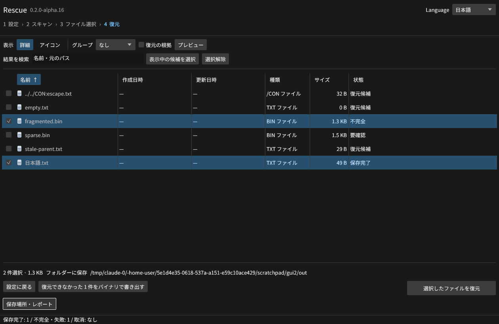
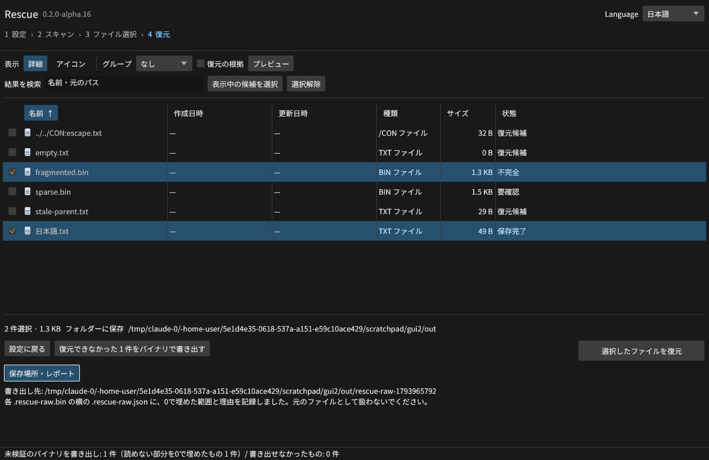

# 破損したUSBメモリ・SDカードからの復元

alpha.16で追加。読めないセクターや壊れた管理情報がある媒体から、根拠のある範囲で復元し、
それでも復元できないデータは未検証のバイナリとして書き出せます。

## 推奨する手順

1. **先にイメージを取得する**（「ディスクのイメージを作成・再開」）。読めた範囲と失敗した範囲を読取マップへ記録し、
   失敗範囲だけを再試行します。故障した媒体へ何度も読取を繰り返さないためです。[取得と読取マップ](IMAGING.md)
2. **取得したイメージをスキャンする**。読めなかった範囲は、ファイルごとの欠損位置として報告されます。
3. ブート領域が壊れている場合は「失われた領域・破損ブートを探す」で、バックアップブートや別の候補を選びます。[探索](DISCOVERY.md)
4. 通常の復元で「不完全」になったファイルは、下記の **バイナリ書き出し** で、読めた部分だけを取り出せます。

## FATの片方のコピーが壊れている場合

FAT32の2つのFATコピーが食い違う・片方が読めない場合、従来はボリューム全体または該当ファイルを拒否していました。
alpha.16では、食い違ったチェーンについて **各コピーを単独で試し、次の条件をすべて満たすコピーが1つだけのとき** に採用します。

- ループがなく、終端まで有効なクラスター番号である
- ファイルでは、ディレクトリーに記録されたサイズと同じクラスター数で終わる
- 読めないFATセクターは、読めるコピーだけで判断する

複数のコピーがそれぞれ有効な別のチェーンを示す場合は推測せず、理由（`none is chosen`）を付けて復元対象外にします。
採用したコピーはスキャンの警告（`Damaged FAT mirror: ... FAT copy N ...`）に記録します。

検証：`scripts/e2e_damaged_fat.py` の5条件。片方のコピーで根クラスターを不良指定・削除ファイルのチェーンを切断・
2番目の根クラスターをループさせた3条件で、全5ファイル×3条件を正解とバイト照合し、選択したコピーの報告を確認。
両コピーが別の有効チェーンを示す条件は拒否。取得イメージでFATコピー1の先頭セクターを読取不能にした条件も、
コピー2だけで5ファイルを正解と照合しました（合計20出力）。

## 復元できなかったデータのバイナリ書き出し

GUIでは復元後に「復元できなかった N 件をバイナリで書き出す」、CLIは `rescue export-raw`、MCPは `export_unrecovered` です。

```sh
rescue export-raw --session work/SESSION.rescue-session.json --id mft-21-7 --destination raw-out --json
```

- 管理情報は通常の復元と同じく元媒体から再検証します。データの位置を特定できない候補は `not_exportable` と理由を返します。
- 読めた部分はそのまま、読めない512バイト単位の部分は0で埋めて `.rescue-raw.bin` に書き出します。
- 横の `.rescue-raw.json` に、0で埋めた範囲（ファイル内の位置と長さ）・警告・配置の根拠を記録します。
- 書き出したものは **元のファイルとして扱いません**。結果は常に `verified_recovery: false` です。既存ファイルは上書きせず、
  元媒体上への書き出しは拒否します。





検証：`scripts/e2e_export_raw.py` の6条件。取得イメージで断片化ファイルの1セクターを読取不能にし、通常の復元が
データを作らないこと、書き出しでそのセクターだけが0・他の全バイトが正解と一致し、範囲が正確に記録されることを確認。
読める候補は全バイト一致、既存ファイルの上書き拒否、未知の候補の拒否、元イメージの無変更。
実GUI（Linux/Xvfb）でも同じ条件で書き出しを操作し、[記録](gui-raw-export-results.json)を残しました。

## 制限

- FAT12/16、exFATのFATコピー（exFATは通常1つ）は対象外です。FAT12/16は[後続課題](BACKLOG_V1_1.md)の課題3です。
- 署名探索（carving）の候補は形式検証を再実行するため、データ内の読めない範囲があると書き出せません（`not_exportable`）。
- 物理的に読めない媒体の修理、TRIM・上書き済みデータの復元はできません。
