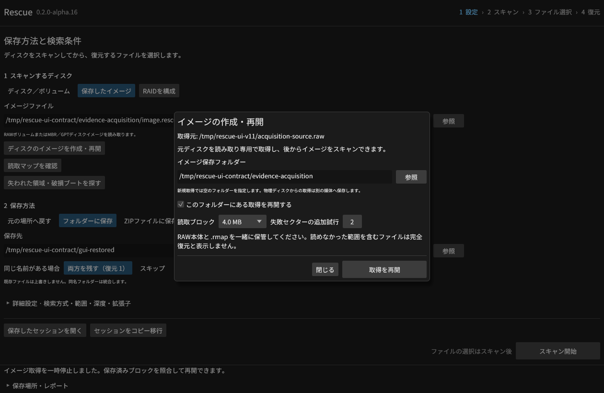
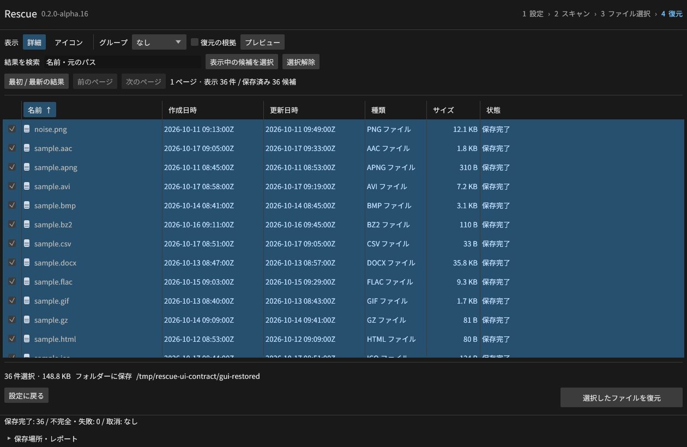

# 共通ジョブとJSON契約（alpha.16開発版）

[機械可読スキーマ](../schemas/v1.json) はJSON Schema 2020-12を使う。
`#/$defs/Job`、`Session`、`Candidate`、`Source`、`RecoveryResult`、`OperationError` を参照できる。
形の検査と、元媒体・管理情報・出力先の実際の再検証は別に行う。

MCPの `get_job` は `schema_version`、`job_id`、`kind`、`state`、`phase`、
`progress`、`details`、`result`、`error` を返す。候補IDは親セッションまたは索引のIDと組み合わせる。
進捗の数値フィールドは互換性のため `scanned_records` / `total_records` のままとし、
`unit` でレコードとバイトを区別する。

`pause_job` は `details.pause_supported` がtrueの工程で受け付ける。
受付直後は `pausing`、保存完了後は `paused` になる。取消は `cancelling` から `cancelled` になる。
`resume_job` は履歴を保持して新しいジョブIDを作る。終了した復元ファイルへの追記は行わない。
取消後に再開できるのは、耐久性のあるスキャン索引またはイメージ取得マップを持つ処理に限る。
非対応工程は理由を返し、プレビューや復元の再試行は新しい処理として始める。

エラーは `code`、`message`、`retryable`、`affected_scope` を持つ。
CLIの終了エラー、MCPのツールエラーと非同期ジョブエラーで同じ型を使う。
復元結果は既存の `error` 文字列に加えて `error_details` を持ち、旧レポートの読み込みを維持する。
RPCの構文エラーはJSON-RPCで定義された数値コードを使う。

`retryable` は一時的なI/O停止、タイムアウト、空き容量不足、SQLiteのロック競合に対する情報である。
自動再試行を許可する指示ではなく、同じ保存途中ファイルを完成できるという意味でもない。
ソース変更、破損、非対応、設定不備、取消はfalseとする。必要な再スキャンや設定変更を行う。

旧JSON・旧SQLiteは新しいコピーへ移行する。元の記録を変更せず、移行完了前の索引を
再開可能なセッションとして公開しない。MCPは明示した作業フォルダー内の記録だけを移行対象にする。
`request_id` の同一要求は同じジョブを返し、引数が異なる再利用を拒否する。

GUIは「保存したセッションを開く」「セッションをコピー移行」でパスを入力または参照する。
移行先を省略すると元の記録の隣の `rescue-session-copies` に作る。
CLIは `index-import`、MCPは `import_session {path, request_id}` を使う。
移行中に取り消した作業コピーは残る場合があるが、完了したセッションとして登録しない。

イメージ取得では最初の耐久性のあるマップ以降に一時停止できる。GUIは元の入力を保持し、
作成途中のRAWを取得元と取り違えず再開する。MCPは同じプロセスでは `resume_job {session_id}`、
再起動後は明示した元の入力・出力先を `start_image {source,destination,resume:true}` に渡す。
再開時は保存済みブロックのSHA-256を再検証する。
`Job.state=paused` の結果中の取得状態は既存互換のため `cancelled` を保持する。

## 検証

Linuxの[専用統合試験](../scripts/e2e_job_contract.py)は12条件・6ファイルの正解一致を通過。
実プロセスの途中停止、再送、再起動後の再開、旧JSON/SQLiteの保持、20,000候補の移行中取消、
許可範囲の拒否、同期・非同期・候補別のエラーを含む。実際のJSON応答をスキーマでも検査する。
既存の全23統合群・56 Rust項目、Windows向け型検査とClippyも通過した。

[実GUI検証](gui-job-results.json)では512 MiBの取得を8 MiBで停止してから再開し、
全体のSHA-256一致を確認。元JSONを変えず36候補を移行し、GUIから36ファイル
152,325バイトを復元して独立コーパスと照合した。720×520の移行画面も確認した。

このファイルは契約の定義であり、全受入条件を完了したという記録ではない。
この追加機能の3 OSネイティブ実行と公開配布物の検証は継続中。
