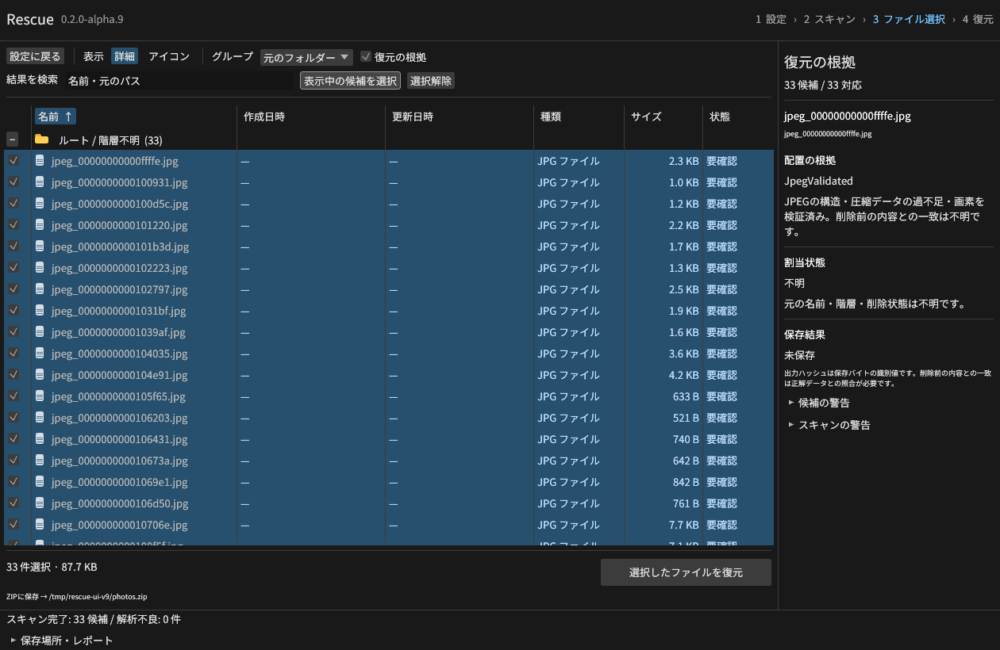
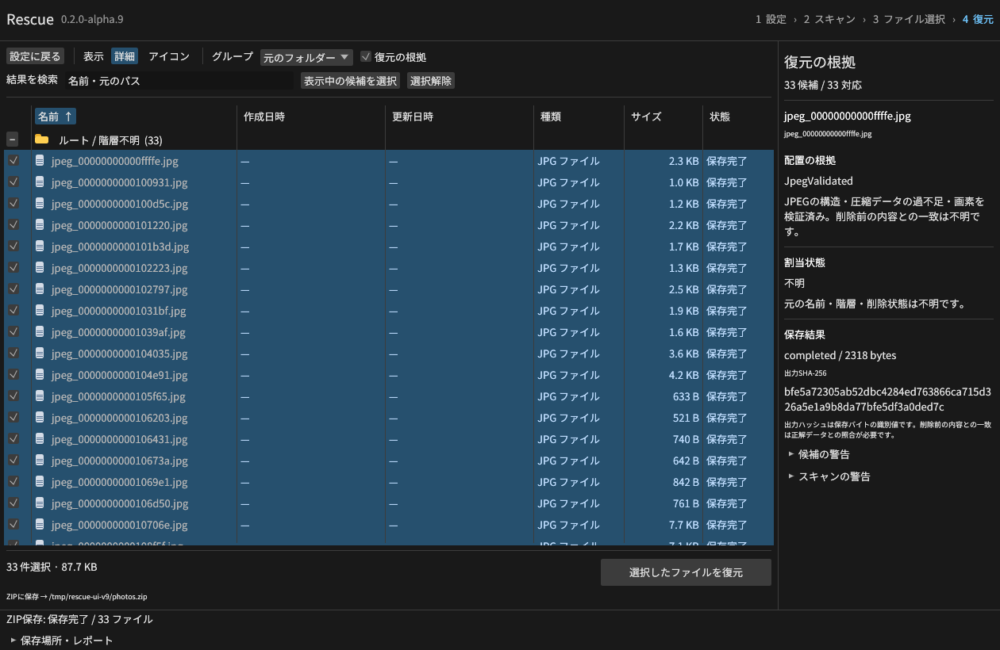

# alpha.9：管理情報のないJPEGを探す

JPEGの連続したデータが残っていれば、ファイルシステムの管理情報がなくても画像を取り出せます。通常のJPEGとプログレッシブJPEGを、GUI・CLI・MCPの共通エンジンで探索します。PNGと同じスキャンで探せます。



## 操作

GUIはディスク／ボリュームを選択し、保存方式をフォルダーまたはZIPに設定します。詳細設定で **PNG・JPEG / Carving** を選び、必要なら拡張子に `jpg` または `jpeg` を指定します。空欄はPNGとJPEGの両方です。範囲は開始以上・終了未満で、画像が終了位置を超える場合は復元可にしません。

```powershell
.\rescue.exe scan --source '\\.\PhysicalDrive1' --mode carve --extension jpg,png --work-dir 'E:\RescueWork' --json
.\rescue.exe results --session 'E:\RescueWork\<id>.rescue-session.json' --json
.\rescue.exe recover --session 'E:\RescueWork\<id>.rescue-session.json' --all --archive 'E:\Recovered\photos.zip' --json
```

CLIの `scan --work-dir` には別媒体を指定します。GUIとMCPではセッションをメモリーに保持できます。保存時は既存の共通仕様に従い、選択した全データを先に読み出します（合計512 MiBまで）。[同じディスク・同名処理](SAME-LOCATION.md)も利用できます。

MCPは `start_scan {source, mode: "carve", extensions: ["jpeg"], request_id}` を呼び、`get_job` → `list_candidates` → `recover_files` の順です。`jpg`・`jpeg`・`jpe`はJPEG探索の同義語です。拡張子の選別は形式検証より先に行います。

## 判定の仕組み

1. 1 MiBの窓で全バイトの署名を探します。窓をまたぐ署名も探索します。
2. SOIからEOIまでセグメントの長さ、量子化表、Huffman表、フレーム、スキャンの順序と範囲を検査します。APP／COM内の偽EOIで画像を切りません。
3. 各ブロックの圧縮データを独立して解釈し、画像寸法から求めた全MCU、ゼロの連続数、EOBの連続数、プログレッシブ係数の順序、リスタート位置・番号、末尾のパディングを検証します。足りないビットを補いません。
4. 安全なRustの画素デコーダーで画像を展開します。構造と圧縮データの検査に通っても、画素展開が失敗すれば復元可にしません。
5. 復元直前に同じ構造・圧縮データ・画素とJPEG全体のSHA-256を再検証し、確認したEOIまでの元バイトを保存します。再圧縮はしません。

`extent_evidence: "jpeg_validated"` はこの検証を通過したことを表します。JPEGにはPNGのような全体のCRCはありません。破損していても別の有効な画像になる場合があり、検証成功は削除前の内容との一致を保証しません。出力ハッシュは保存したデータの識別値です。

## 対応範囲と上限

| 項目 | alpha.9 |
| --- | --- |
| 符号化 | 8ビットHuffman DCT、SOF0／SOF1／SOF2 |
| 色・配置 | グレースケール、RGB／YCbCr、CMYK、一般的な4:4:4／4:2:2／4:2:0、成分別の逐次スキャン |
| プログレッシブ | DC／ACの初回・差分スキャン。全成分・全係数帯を最終ビットまで含む画像 |
| 補助情報 | APP、COM、Exif等を元バイトのまま保持。メタデータの意味、ICCやExifの妥当性は未検証 |
| リスタート | DRIとRST0〜7の位置・順序を確認 |
| 大きさ | 符号化データ64 MiB、画素用予約 `幅×高さ×4` は64 MiB、DCT係数128 MiBまで |
| 処理量 | 1画像256スキャン・65,536マーカーまで。PNGと共有で1探索4 GiBの検証予算（読取・係数・画素・ブロック処理） |
| 取消 | 読取窓、マーカー、256 MCUごと、画素展開の前後で確認。画素デコーダーの1呼出し中は完了を待つ |
| 未対応 | 断片の再構成、12ビット、算術符号化、可逆・階層JPEG、DNL、未完了のプログレッシブ画像 |

元の名前・フォルダー・日時・割当・削除状態は分かりません。名前は `jpeg_<バイト位置>.jpg` になります。確認できるパスがないため「元の場所へ戻す」は使わず、フォルダーまたはZIPへ保存します。使用中の画像や文書内のサムネイルも候補になります。別位置の同じ画像を一つの元ファイルとして数えません。

新しいcarvingセッションはスキーマ6です。alpha.9は従来の1〜5も読めます。古いアプリでJPEG候補を含むスキーマ6を開くことはできません。

## 検証

独立したPillow／libjpegと小さな別実装のエンコーダーで32枚を生成・再読込し、固定した正解と照合します。埋込サムネイルを含む33候補がCLI・MCP・Linux実GUIで全バイト一致しました。PNGとの混在、拡張子、範囲、ZIP、同名処理、保存済みJSONの改変、ソースの途中変更も検証します。追加統合58項目には破損33条件が含まれます。



[GUI照合JSON](gui-jpeg-results.json)・[コーパス](../tests/jpeg/manifest.json)・[統合テスト](../scripts/e2e_jpeg.py)。入力は人工生成した通常ファイルのイメージです。物理HDD／SSDでの一般的な復元率、TRIM、有料製品との比較を示しません。Windows・Linux・macOS Intel／Apple SiliconのネイティブCIで同じ試験をリリース必須条件にしています。
