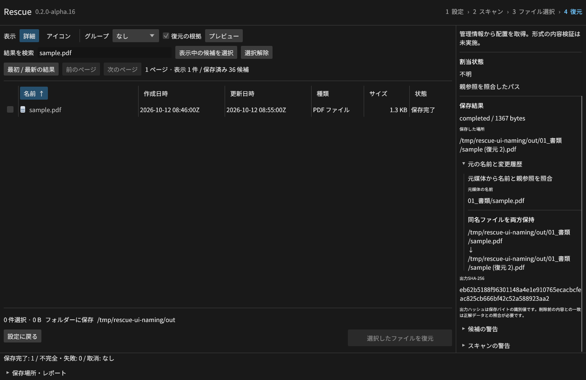

# 元の名前と保存時の変更履歴

復元結果の `naming` に、元媒体から再取得した名前・階層・表示名・ADS名と、保存時の変更理由を記録します。
GUIの「復元の根拠 → 保存結果 → 元の名前と変更履歴」、CLI/MCPの結果、ZIP内のレポートで確認できます。

`basis` は親参照を照合できた管理情報、階層未確認の管理情報、生成名を区別します。
署名探索で生成した名前は元の名前と表示せず、`original_name` と `original_path` を `null` にします。
FATの削除マークや残存レコードなど、名前の情報自体が不完全な場合は候補の警告も確認してください。
元媒体の再検証に失敗した候補や旧版の結果には、信頼できる履歴を後付けしません。

| `reason` | 保存時の処理 |
| --- | --- |
| `file_collision` / `directory_collision` | 同名ファイル・フォルダーとの衝突で連番等を付加 |
| `archive_collision` | ZIP内の同名や `rescue-report.json` との衝突を解消 |
| `portable_name` | 使用できない文字、予約名、長さを調整 |
| `alternate_stream` | NTFSの代替ストリームを通常ファイル名に変換 |
| `unverified_hierarchy` / `hierarchy_limit` | 未確認・長すぎる階層を省略 |
| `partition_namespace` | ディスク内の各パーティションを別のフォルダーに分離 |
| `streaming_flat_output` / `unique_output_name` | CLIの大容量保存で階層を省略し識別名を付加 |
| `partial_output` | 保存未完了を表すファイル名へ変更 |

各履歴は変更前の `from` と変更後の `to` を持ちます。変更が発生しなければ記録しません。
衝突箇所の絶対パスと元媒体内の相対名が含まれるため、共有時はレポートの保存先情報も確認してください。
履歴の文字列を保存先として信頼する処理はありません。作成は従来のディレクトリー検証と排他的作成を通します。
スキップしたファイルには架空の連番を記録しません。同名フォルダーは既存ディレクトリーなら統合します。

レビューでCLIの `--stream` 経路に再検証の不足を見つけ、保存前に元媒体の管理情報と割当範囲を再確認するよう修正しました。
保存したJSON内の名前や範囲を改変しても、出力先や名前の根拠に使われません。
割当情報がスキャン後に変わった場合は通常保存・ストリーミング保存・プレビューのすべてで拒否します。

独立した14条件で13出力をバイト照合し、通常保存・ZIP・CLIストリーミング・MCPを検証しました。
Linuxの24統合群と56 Rust項目、Linux/Windows向けClippyを通過しています。
実GUIでも既存PDFを保持し、復元した1,367バイトを正解と照合しました。
720×520では履歴をスクロールし、閉じる操作を画面内に保持します。
[GUIの記録](gui-naming-results.json) · [機械可読契約](../schemas/v1.json)
