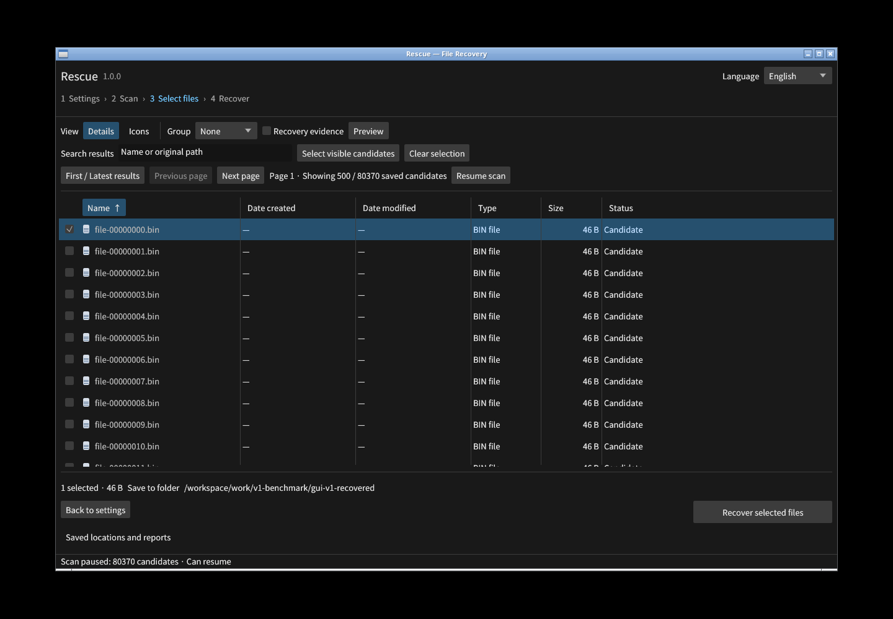
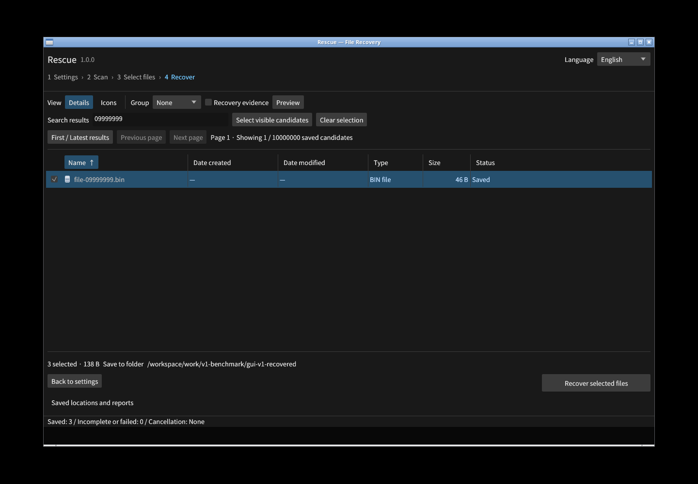

# v1.0 大容量・操作応答・取消の実測

2026-11-06、Linux x64の実GUIで、論理1 TiB・削除候補1,000万件を
新しくスキャンし、3回取消・再開して最後まで完了した。
各候補は46バイトのresidentファイルで、入力は約9.54 GiBだけ実領域を持つ疎ファイル。
物理ディスク1 TiBの全読出し速度や、一般的な復元率を示す試験ではない。

| 測定 | v1.0.0の結果 | 仕様の目標案 |
| --- | ---: | ---: |
| GUI全件スキャン、3回の取消・再開を含む経過時間 | 630.131秒 | 時間の固定目標なし |
| スキャン中のGUIと子プロセスのピークRSS | 140,394,496 B（133.9 MiB） | 1 GiB以下 |
| ポインター取消から`cancelled`チェックポイントの保存 | 105.18 / 108.82 / 107.41 ms | 通常I/Oで2秒以内に新規読取停止 |
| 選択操作から画面の選択件数が描画されるまで、p95 | 117.04 ms | 200 ms以下 |
| 検索入力から絞込行が描画されるまで、p95 | 150.99 ms | 200 ms以下 |
| CLIの11検索条件、各20回のp95の最大 | 21.52 ms | GUIの200 msとは別の観測 |
| CLI検索と同時に開いているGUIの合計ピークRSS | 148,381,696 B（141.5 MiB） | 1 GiB以下 |

GUI応答は各条件40操作。xdotoolの入力送信時間、画面取得・比較の待ち時間も含む。
入力APIが戻っただけでは完了にせず、事前に確認した2種類の画面領域と画素が一致するまで測定した。
測定時はOSキャッシュと既存索引を利用しており、コールドキャッシュの値とはしない。
GUI応答の測定は以前に生成した同じ1,000万候補の索引で行い、続く全件スキャンは
1.0.0が新しく生成した別索引で行った。バイナリSHA-256は両方一致している。

CLIは名前・サイズ・更新日時・種類/フォルダーのグループ・部分文字列・日本語の該当なし・
中間位置カーソルを測定した。全220回の候補IDと順序が独立した生成規則に一致した。
初回の希少文字列検索は35.18 msで、初回値も生データへ保存している。
CLI結果には起動・JSON生成が含まれ、画面の描画時間は含まれない。

取消のたびに25,000件以上進んだこと、保存後500 ms経っても候補数が増えないこと、
GUIが選択状態と再開ボタンを保持することを確認した。
全件完了後、先頭・中間・末尾の3件をGUIから保存し、138バイトと名前を正解照合した。
これは通常応答するファイルI/Oの試験で、応答しない故障デバイスの取消上限を保証しない。
RSSは製品のプロセスツリーを5 msごとに測定し、表示サーバーや試験ドライバーは含めない。

索引はスキャン直後12,132,921,344バイト。入力の全1 TiBハッシュ照合は行っていない。
CLI検索の前後は入力サイズ・mtimeを照合し、通常サイズの全回帰試験と商用比較では
入力全体のSHA-256不変を別に検証する。

## 証拠と再現

- [GUI全件スキャンと取消の生データ](v1-gui-full-scan.json)
- [入力から描画までの全80測定](v1-gui-latency.json)
- [CLI検索の全220測定](v1-index-queries.json)
- [GUIで選択した3件の実出力照合](v1-gui-recovery.json)
- [ホスト・CPU割当・表示環境](performance-host-v1.json)

`scripts/make_large_fixture.py`で入力を作り、GUIの保存先と作業フォルダーを別の通常ファイル領域へ設定する。
`benchmark_gui_scan.py`は確認済みの座標設定から実操作とチェックポイントを測定する。
`benchmark_gui.py`は確認済みの画面テンプレートで入力から描画までを測定し、
`benchmark_index.py --queries-only`は完成した索引の候補ID・順序・3件の実出力を照合する。
異なる画面サイズで座標やテンプレートをそのまま流用しない。

物理HDD/SSD、故障I/O、Windows/macOSの同じ大容量測定、商用製品との速度比較は未測定。
このLinuxの条件での目標達成を、すべての媒体やOSで達成したようには表現しない。
