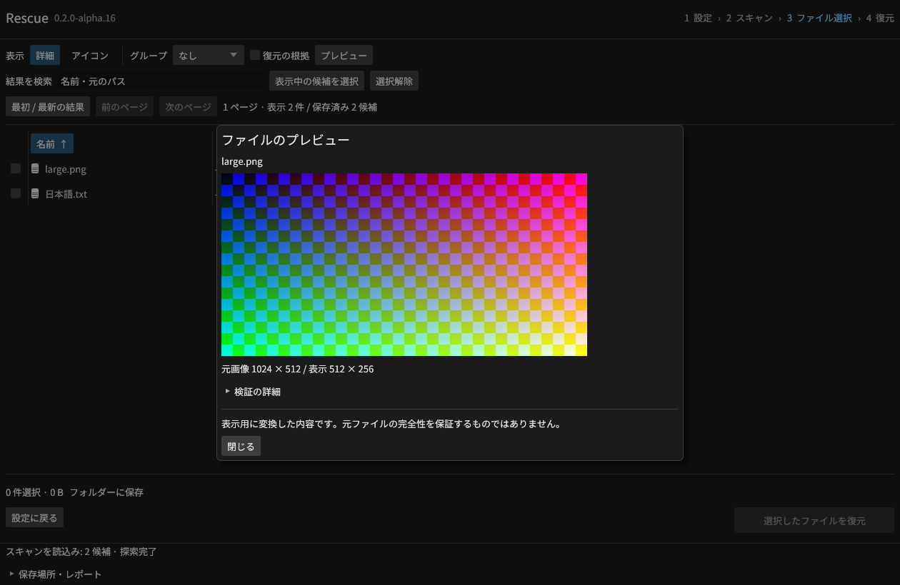
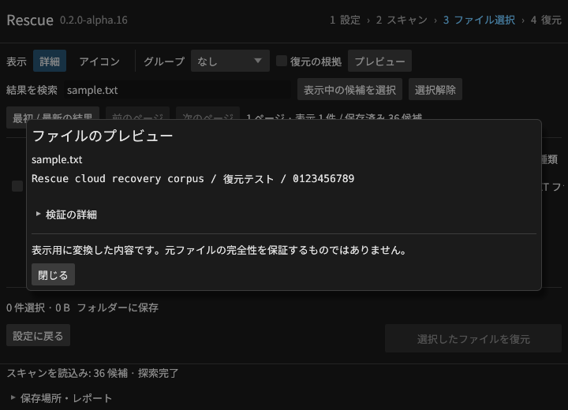

# 隔離プレビュー





[実GUIの検証記録](gui-preview-results.json)。画像はalpha.16のLinux実GUIで、合成RAWと独立した画素・文字列の正解を使っています。

alpha.16の開発ブランチでGUI・CLI・MCPへ接続しました。公開前のOS検証を続けています。
プレビューは表示用の派生データです。元ファイルの保存や、削除前の内容との一致を意味しません。

GUIは結果のファイル名をクリックして「プレビュー」を押します。PNG/JPEGの画像と、UTF-8または
BOM付きUTF-16のテキストを表示できます。PDF・Office・動画のプレビューは後続対象です。
プレビューできない場合も、そのファイルの復元対応とは別に扱います。

```sh
rescue preview --session work/ID.rescue-index/session.sqlite --id mft-21-7 --destination previews --json
```

MCPは`preview_candidate {session_id, candidate_id, destination, request_id}`でジョブを開始します。
`get_job`は保存した派生PNG/テキストのパス、サイズ、SHA-256、表示情報を返します。
ファイル内容や画素はツール結果に含めません。保存先には起動時の出力ルートの許可が必要です。
同じrequest_idは再利用し、引数が異なれば拒否します。取消は可能ですが途中からの再開は行いません。

GUI/CLIの実行ファイルを専用の子プロセスとして起動し、上限付きのパイプだけで要求と結果を交換します。
子プロセスが元媒体を読み取り専用で開き、選択した管理情報・データの配置・ソース指紋を再検証します。
MCPのソース許可は子にも引き継ぎ、RAIDの各メンバーにも適用します。
署名探索の候補は、上限内の元バイトと記録したSHA-256を照合してから表示用のデコーダーへ渡します。
元の名前や保存済みサイズを、出力ファイル名や信頼できるデータ配置として使いません。

| 制限 | 値と適用範囲 |
| --- | --- |
| 入力の管理情報 | 1候補、JSON最大2 MiB |
| 圧縮画像の入力 | 8 MiB |
| 画像 | 16,777,216画素、各辺65,535以下。表示画像は各辺512以下 |
| テキスト | 先頭64 KiB。途中までの場合は明示。スクリプトやリンクは文字として表示 |
| 元媒体の読取 | 合計64 MiB。位置合わせや読取マップのブロック検証も加算 |
| 子プロセスのメモリー | Linuxはアドレス空間512 MiB、WindowsはJob Objectのプロセスメモリー512 MiB |
| macOSのメモリー | 親が10 msごとにRSSを監視し、512 MiB超過で終了。サンプル間の一時的な超過はあり得る |
| CPU・経過時間 | CPU 3秒、親プロセスの経過時間5秒。超過・取消で子を終了 |
| 結果の通信 | JSON最大5 MiB。親側でも画素数・文字数・要求IDを検査 |

Linuxでは子にno-new-privilegesを設定します。外部ビューア、ブラウザー、シェル、マクロは起動せず、
GUIもテキストをHTMLとして解釈しません。この実装はプロセスと資源の隔離であり、
すべてのOS操作を禁止するセキュリティサンドボックスという意味ではありません。
ドライバー内部で停止したI/Oの即時取消は保証できません。

正解付きNTFS/FAT32/exFATと署名探索から画像10件・テキスト12件を検証しました。
PNGは独立したデコーダーと全RGBA一致、JPEGは丸め差を許容して各チャンネル差3以内を照合します。
画素数が巨大な画像、破損JPEG、バイナリーを装ったテキスト、改変した管理情報、許可外出力を拒否します。
Unixでは試験専用FIFOを使って実際に読取が停止した子を作り、時間上限と取消を試験します。
OS別の結果と実行ファイルSHA-256はCIの`preview-results-OS-CPU.json`に保存します。
