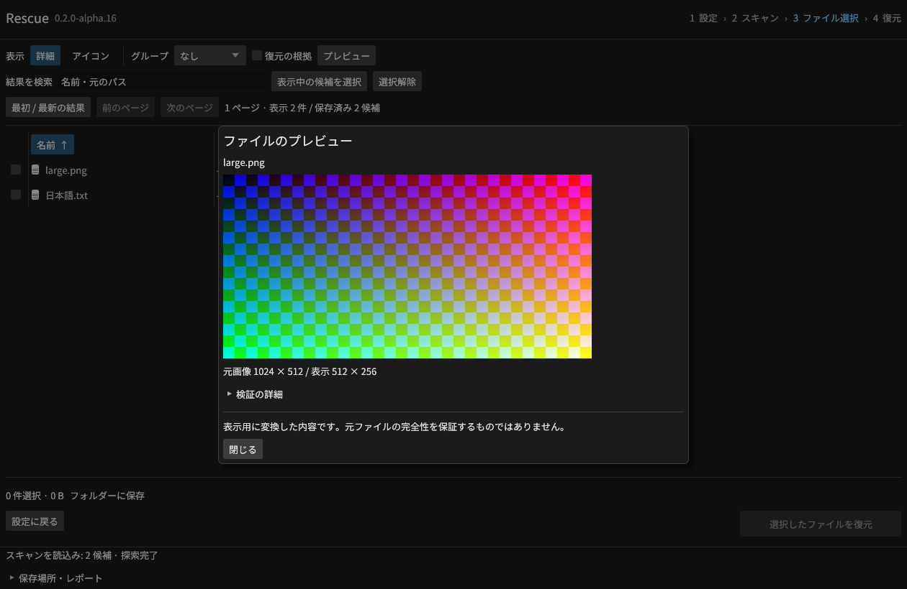
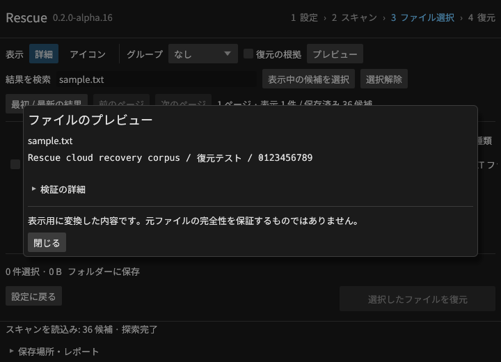
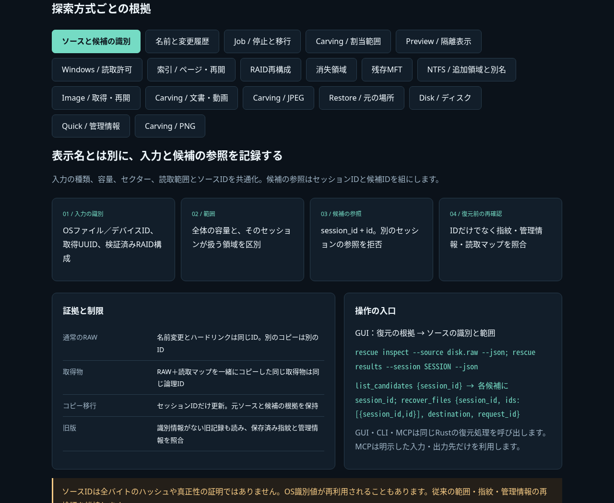
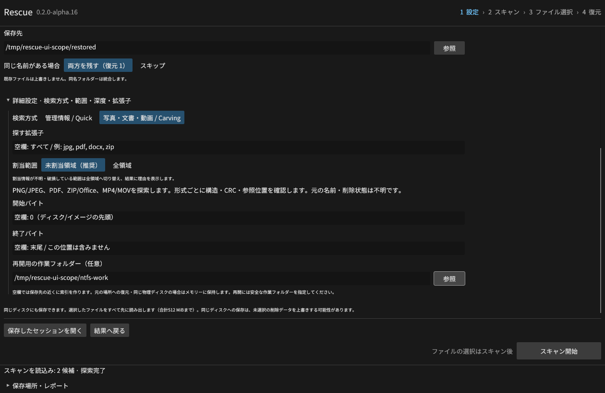
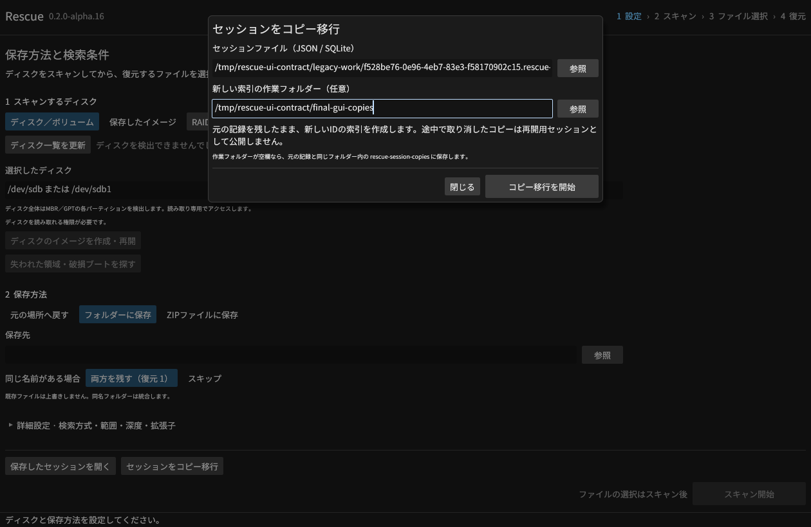
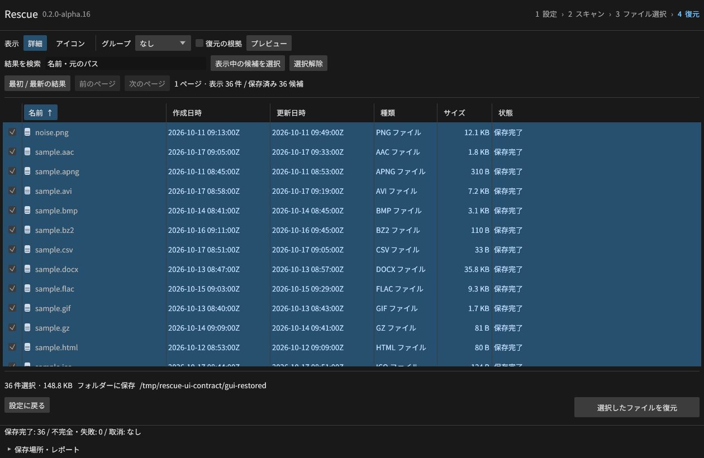
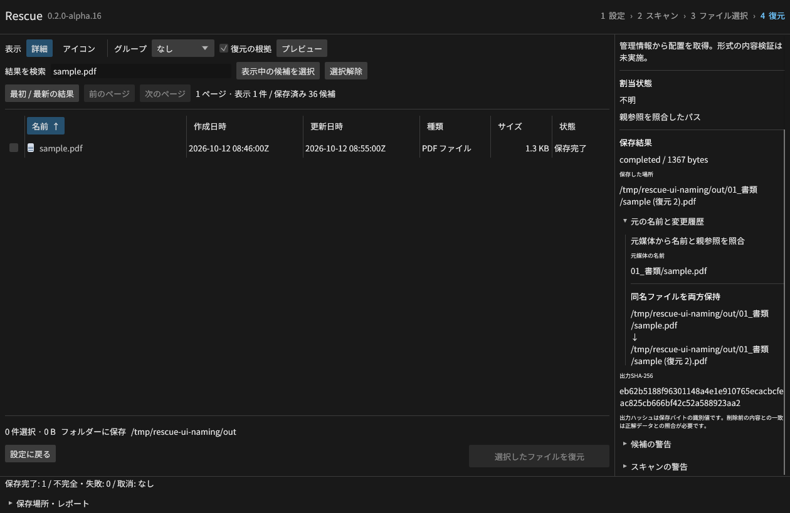
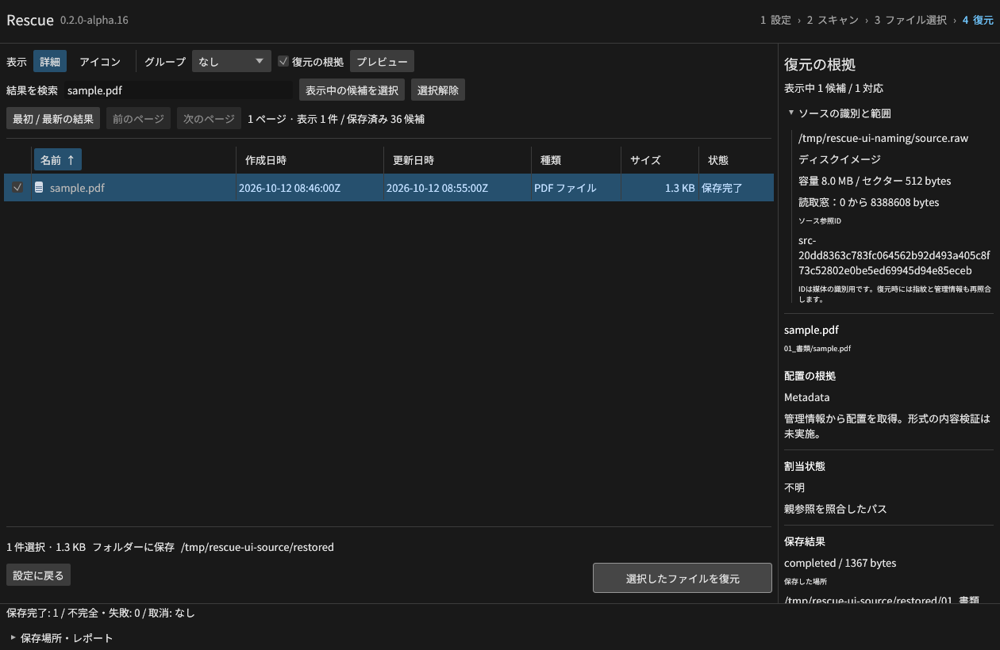

# Rescue v0.2.0-alpha.16 — リリース準備中

候補のPNG・JPEG・テキストを別プロセスでプレビューできるようにしました。
GUI、CLI、MCPで同じ再検証と制限を使います。Windowsではディスクの読取許可を補助プロセスへ分離し、
受け取ったハンドルに書込・削除・ACL変更権限がないことと、補助プロセスの終了を確認します。

画像入力8 MiB、1,677万画素、表示512px、文字列先頭64 KiB、読取64 MiB、5秒を上限とします。
プレビュー非対応のPDF等も復元候補として保持します。表示用の変換結果は元バイトの完全性保証ではありません。

[操作できる技術説明UI](intelligence.html)には、55枚の実画面と18方式の説明を収録しました。
プレビュー8画面・割当範囲5画面・停止と移行8画面・名前の履歴2画面・ソース識別2画面はalpha.16、以前の画面はalpha.15として明記しています。
390px幅を含む全切替操作、JavaScriptエラー0件、外部通信0件を確認しました。

CarvingはNTFS/FAT32/exFATの未割当領域を既定にしました。候補の全内容の割当を確認し、
割当情報がない範囲の全領域検索は一覧上に表示します。全領域の指定と旧セッションの再開も維持します。
独立試験は19条件・24ファイルの内容一致、実GUIのスキャン・選択・復元は2件338バイトを照合しました。

イメージ取得の一時停止・再開とセッションのコピー移行をGUI・MCPに追加しました。
ジョブの種類、工程、進捗、構造化エラーを共通契約にし、JSON Schemaも同梱します。
独立した12条件に加え、実GUIで512 MiBの停止・再開と、移行後36ファイル152,325バイトの一致を確認しました。

元の名前と名前変更の履歴を、GUI・CLI・MCP・ZIPのレポートに追加しました。
同名の保持、使用できない文字、ADS、生成名を区別し、14条件・13出力をバイト照合しました。
CLIの `--stream` にも保存直前の管理情報・割当範囲の再検証を適用しています。

[名前の根拠と変更理由](NAMING.md)

ソースの種類・ID・範囲を共通化し、MCPはセッションを明示した候補参照も受け付けます。
旧記録を維持し、改変IDや別セッションの参照を復元前に拒否します。

[ソースと候補の契約](SOURCE_CONTRACT.md)

Linuxでは56 Rust項目と25統合群を通過。プレビューの独立検査は画像10件・テキスト12件、
破損画像・画素上限・改変した管理情報・取消・タイムアウト・MCP許可範囲を含む11条件です。
Windows・macOSの実VMと公開実物の検証、通常権限のGUIのUAC操作は継続中です。
このファイルは公開完了の記録ではありません。

[プレビュー](PREVIEW.md) · [検索範囲](ALLOCATION_SCOPE.md) · [共通ジョブ](JOB_CONTRACT.md) · [Windows権限分離](READ_ACCESS.md) · [受入台帳](V1_ACCEPTANCE.md)
