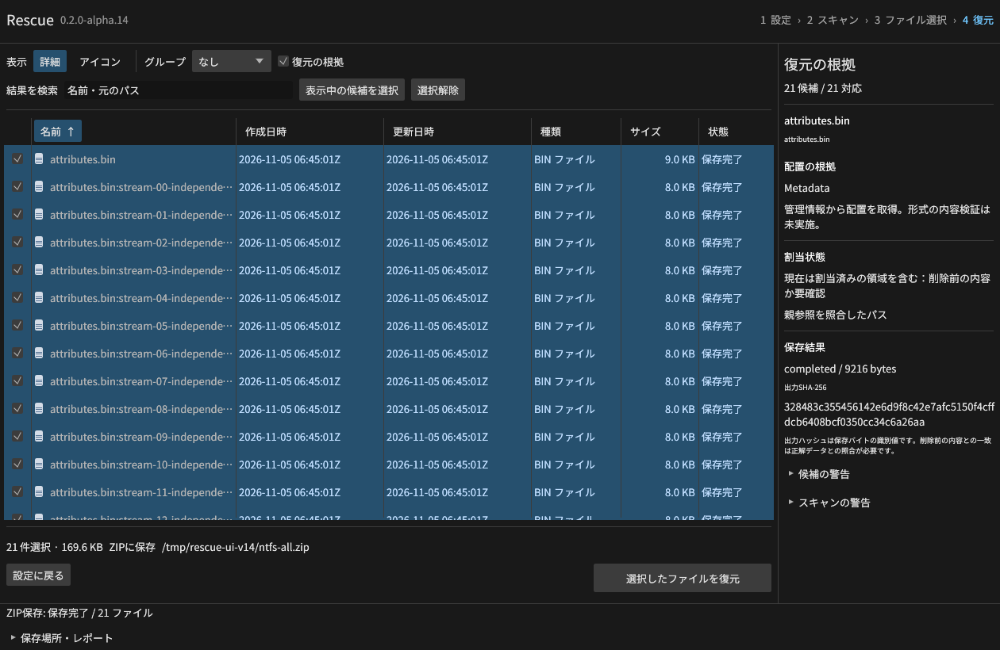
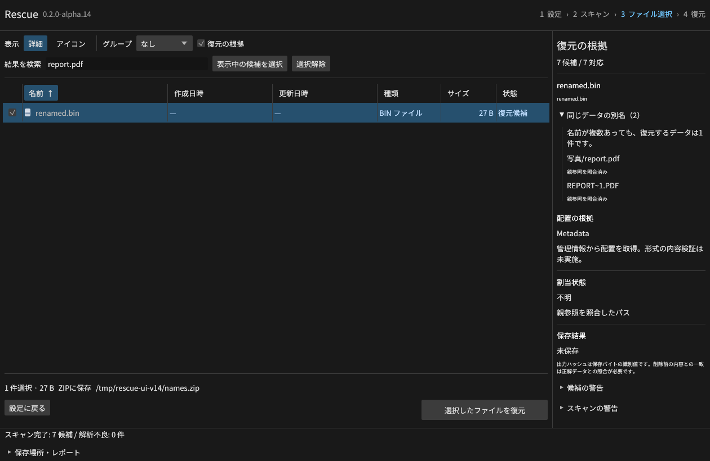
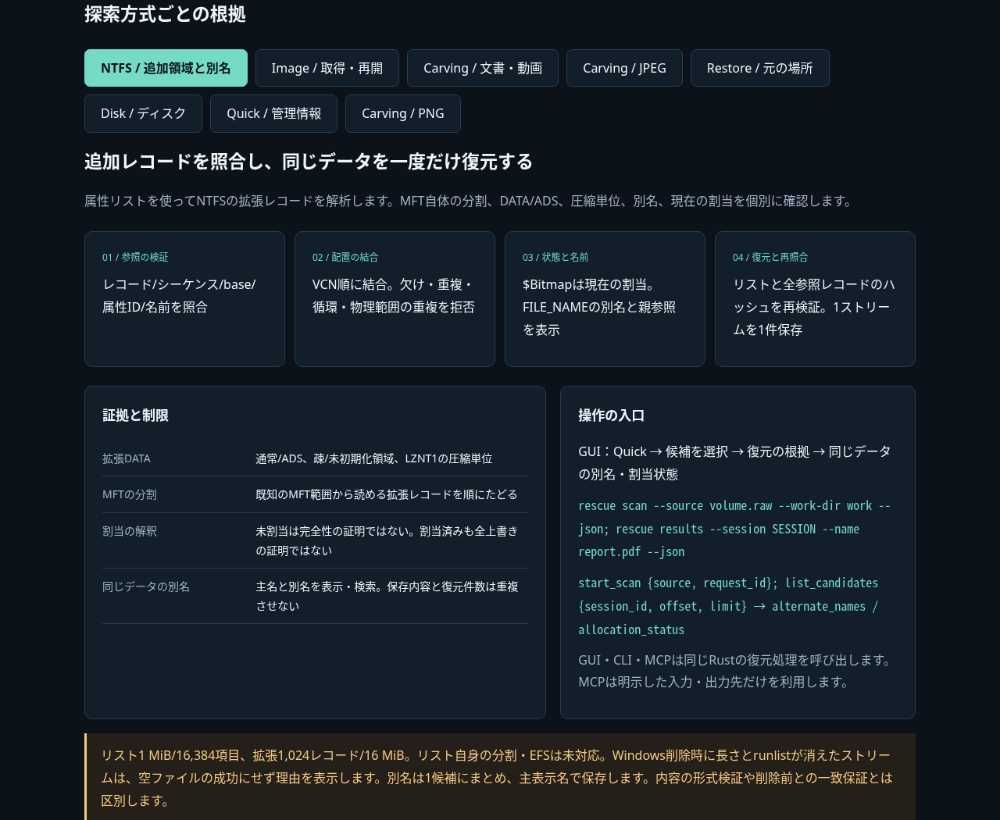

# Rescue v0.2.0-alpha.12

NTFSの属性リストと拡張MFTレコードを読み、分割されたファイル本体・ADSを復元できるようにしました。
割当ビットマップを根拠として表示し、ハードリンクやDOS名を含む別名でも検索できます。
v1.0に向けた開発版です。残る必須項目は [受入台帳](https://github.com/Xenoah/rescue-deletedfiles_rust/blob/v0.2.0-alpha.12/docs/V1_ACCEPTANCE.md) で管理しています。

## NTFSの根拠と復元

- resident/nonresidentの`$ATTRIBUTE_LIST`を解析。参照先の番号・シーケンス・元レコード・属性ID・VCNを照合します。
- 分割DATA/ADSのVCNを連結し、欠落・重複・循環・再利用された参照を拒否します。拡張MFT、疎領域、LZNT1も同じ照合を通します。
- `$Bitmap`から未割当・現在の割当競合・不明を区別。競合したNTFSデータは注意表示付きで取得し、削除前との一致を保証する表示にはしません。
- 複数の`$FILE_NAME`を親ディレクトリのシーケンスと照合し、別名・元のパスをGUI/CLI/MCPへ公開します。同じデータは1候補として扱います。
- 復元直前にも属性リストと参照レコードを検証し、スキャン後の差替えを検出します。

詳細と資源上限は [NTFS実装仕様](https://github.com/Xenoah/rescue-deletedfiles_rust/blob/v0.2.0-alpha.12/docs/NTFS-EXTENTS.md) を参照。
属性リスト自体が複数レコードに分割された形式とEFS暗号化は未対応です。

## 検証

Rust40項目、11統合群、NTFSの27条件を通過しました。
独立ツールntfs-3gで作成した4レコード・21ストリームのイメージでは、各ストリームの内容が全バイト一致しました。
このイメージの削除フラグは試験で変更しており、Windows上の実削除とは区別します。
実GUIでも同じ21ストリームと、別名検索からの1データ復元を検証。元イメージ全体のSHA-256は不変でした。

既存GUIの元の場所36件・ZIP36件・JPEG33件・文書/動画7件に加え、512 MiBの取得・再開照合・128範囲の読取マップ・取得後の36件復元を再検証しました。
すべて正解データと照合し、ZIP CRCも確認しています。
4環境のネイティブCIと、Windowsの実削除NTFS/ADS試験を実行してから公開します。Windowsのresidentストリームの復元と、non-residentストリームの削除時に長さ・runlistが消える条件を別々に検証します。後者を空ファイルの復元成功にしない保護を追加しました。

`ntfs-results-*.json`、`ntfs-native-windows-x64.json`、`gui-ntfs-results.json`を検証結果として添付します。

## 技術説明UI

[画像内蔵の技術説明UI](https://github.com/Xenoah/rescue-deletedfiles_rust/releases/download/v0.2.0-alpha.12/intelligence.html) は単一HTMLです。
13実画面・8方式をオフラインで切り替えられます。390px幅、画像の表示、全切替、外部通信なしをChromiumで検証しました。
[Microsoft/W3Cの公式資料と配置ルール](https://github.com/Xenoah/rescue-deletedfiles_rust/blob/v0.2.0-alpha.12/docs/UI_GUIDELINES.md) に基づき、主要操作の固定・入力ラベル・折り返し・キーボード移動を実装しています。

## ダウンロード

| OS / CPU | インストール版 | ポータブル版 |
| --- | --- | --- |
| Windows x64 | [setup.exe](https://github.com/Xenoah/rescue-deletedfiles_rust/releases/download/v0.2.0-alpha.12/rescue-0.2.0-alpha.12-windows-x64-setup.exe) | [portable.zip](https://github.com/Xenoah/rescue-deletedfiles_rust/releases/download/v0.2.0-alpha.12/rescue-0.2.0-alpha.12-windows-x64-portable.zip) |
| Linux x64 | [.deb](https://github.com/Xenoah/rescue-deletedfiles_rust/releases/download/v0.2.0-alpha.12/rescue-0.2.0-alpha.12-linux-x64.deb) | [portable.tar.gz](https://github.com/Xenoah/rescue-deletedfiles_rust/releases/download/v0.2.0-alpha.12/rescue-0.2.0-alpha.12-linux-x64-portable.tar.gz) |
| macOS Apple Silicon | [.pkg](https://github.com/Xenoah/rescue-deletedfiles_rust/releases/download/v0.2.0-alpha.12/rescue-0.2.0-alpha.12-macos-arm64.pkg) | [portable.zip](https://github.com/Xenoah/rescue-deletedfiles_rust/releases/download/v0.2.0-alpha.12/rescue-0.2.0-alpha.12-macos-arm64-portable.zip) |
| macOS Intel | [.pkg](https://github.com/Xenoah/rescue-deletedfiles_rust/releases/download/v0.2.0-alpha.12/rescue-0.2.0-alpha.12-macos-x64.pkg) | [portable.zip](https://github.com/Xenoah/rescue-deletedfiles_rust/releases/download/v0.2.0-alpha.12/rescue-0.2.0-alpha.12-macos-x64-portable.zip) |

`SHA256SUMS.txt` で照合できます。Linuxはglibc 2.35以降、macOSは13以降。
macOSはアドホック署名で、Developer ID署名・公証はありません。

同じディスクへの選択ファイル保存は全選択データを先に読み出します（合計512 MiBまで）。未選択の削除データには影響する可能性があります。
TRIMや上書きで失われたバイトは復元できません。有料製品比較は未測定です。
RAID、消失領域探索、大容量索引、隔離プレビュー、Windows権限分離などはv1.0の残る必須工程です。

[対応表](https://github.com/Xenoah/rescue-deletedfiles_rust/blob/v0.2.0-alpha.12/docs/ALPHA.md) · [検証履歴](https://github.com/Xenoah/rescue-deletedfiles_rust/blob/v0.2.0-alpha.12/docs/VALIDATION.md)
