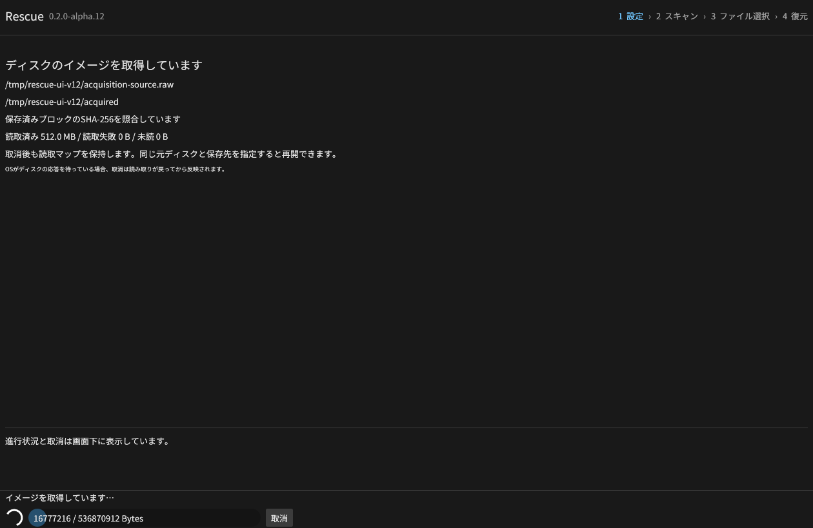
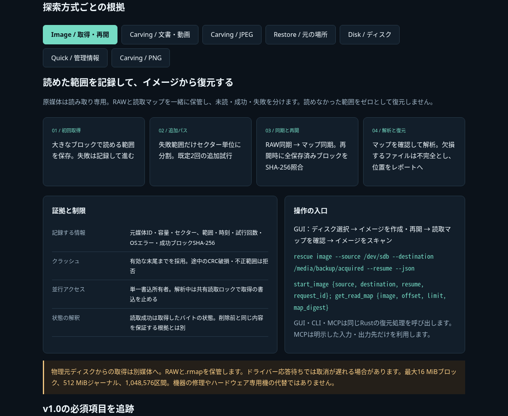

# Rescue v0.2.0-alpha.11

読取マップ付きのイメージ取得・取消・再開をGUI・CLI・MCPへ追加しました。
読めた範囲をRAWへ同期してからマップへ記録し、未読・失敗範囲を復元レポートへ伝えます。
これはv1.0に向けた開発版です。[受入台帳](https://github.com/Xenoah/rescue-deletedfiles_rust/blob/v0.2.0-alpha.11/docs/V1_ACCEPTANCE.md) で必須機能の残作業を公開しています。

## 取得・再開と欠損の扱い

- 元ディスクを読取専用で開き、大きなブロックで取得。失敗した範囲だけセクター単位で再試行します。
- 各範囲の状態・試行回数・UTC時刻・OSエラー・SHA-256を記録。読取マップは100範囲ずつ表示します。
- 取消・強制終了後はソース識別と保存済みデータの全SHA-256を確認して再開します。
- 保存失敗時は未保存の範囲を完了扱いしません。データとマップの同期、単一書込ロック、保存先差替えの検出を行います。
- 未読・失敗範囲のデータは正常なゼロと区別し、その範囲にかかるファイルを不完全として位置を記録します。
- MCPの `start_image` / `get_read_map` とCLIの `image` / `read-map` はGUIと同じエンジンを使用します。

RAWと `.rmap` を一緒に保管してください。物理元ディスクからの取得は別媒体を使用します。
選択ファイルを同じディスクや元の場所へ復元する既存機能も利用できます。
詳細は [イメージ仕様と上限](https://github.com/Xenoah/rescue-deletedfiles_rust/blob/v0.2.0-alpha.11/docs/IMAGING.md) を参照。

## 検証

ローカルのRust 38項目・10統合群を通過。取得の15条件で強制終了、破損末尾からの再開、
元データ変更、保存済みデータ改変、マップ破損、欠損の論理位置、MCP取消・許可範囲・ページ取得を確認しました。
読取不良と再試行は障害注入テストで、実機の物理故障を再現したものではありません。

Linuxの実GUIで512 MiBを取得し、全バイト一致、128範囲のマップ、2ページの操作、
再開照合、取得イメージからの36ファイルのZIP復元とCRCを検証しました。
元の場所36件・ZIP36件・JPEG33件・文書/動画7件の既存GUIシナリオも全バイト一致しました。

[4環境のネイティブCI](https://github.com/Xenoah/rescue-deletedfiles_rust/actions/runs/41979409874) が7分8秒で成功しました。Windows・Linux・macOS Intel/Apple Siliconで、試験専用ボリュームの容量不足・空き解放後の再開・権限拒否を検証。読取専用の実仮想ディスクからの取得と、そのイメージの108ファイル復元も全バイト一致しました。Rust38項目・10統合群・35形式・864ディスク観測・実削除PDF・GUI起動・8配布物を通過。公開パッケージの再取得検証は別途追記します。
`imaging-results-*.json`、`imaging-native-*.json`、`gui-imaging-results.json` に結果を収録します。

## 技術説明UI

[画像内蔵の技術説明UI](https://github.com/Xenoah/rescue-deletedfiles_rust/releases/download/v0.2.0-alpha.11/intelligence.html) は単一HTMLです。11実画面・7方式を通信せずに切り替えられます。
[Microsoft/W3Cの公式資料と配置ルール](https://github.com/Xenoah/rescue-deletedfiles_rust/blob/v0.2.0-alpha.11/docs/UI_GUIDELINES.md) に基づき、主要操作の固定・入力ラベル・折り返し・キーボード移動を実装しています。

## ダウンロード

| OS / CPU | インストール版 | ポータブル版 |
| --- | --- | --- |
| Windows x64 | [setup.exe](https://github.com/Xenoah/rescue-deletedfiles_rust/releases/download/v0.2.0-alpha.11/rescue-0.2.0-alpha.11-windows-x64-setup.exe) | [portable.zip](https://github.com/Xenoah/rescue-deletedfiles_rust/releases/download/v0.2.0-alpha.11/rescue-0.2.0-alpha.11-windows-x64-portable.zip) |
| Linux x64 | [.deb](https://github.com/Xenoah/rescue-deletedfiles_rust/releases/download/v0.2.0-alpha.11/rescue-0.2.0-alpha.11-linux-x64.deb) | [portable.tar.gz](https://github.com/Xenoah/rescue-deletedfiles_rust/releases/download/v0.2.0-alpha.11/rescue-0.2.0-alpha.11-linux-x64-portable.tar.gz) |
| macOS Apple Silicon | [.pkg](https://github.com/Xenoah/rescue-deletedfiles_rust/releases/download/v0.2.0-alpha.11/rescue-0.2.0-alpha.11-macos-arm64.pkg) | [portable.zip](https://github.com/Xenoah/rescue-deletedfiles_rust/releases/download/v0.2.0-alpha.11/rescue-0.2.0-alpha.11-macos-arm64-portable.zip) |
| macOS Intel | [.pkg](https://github.com/Xenoah/rescue-deletedfiles_rust/releases/download/v0.2.0-alpha.11/rescue-0.2.0-alpha.11-macos-x64.pkg) | [portable.zip](https://github.com/Xenoah/rescue-deletedfiles_rust/releases/download/v0.2.0-alpha.11/rescue-0.2.0-alpha.11-macos-x64-portable.zip) |

`SHA256SUMS.txt` で照合できます。Linuxはglibc 2.35以降、macOSは13以降。
macOSはアドホック署名で、Developer ID署名・公証はありません。

取得マップは最大512 MiB、分割範囲は最大1,048,576、取得ブロックは最大16 MiBです。
長い不良領域で上限に達すると理由を示して停止します。OSの読取呼出しが戻るまでは取消を待つ場合があります。
外部アプリによる元媒体の同時書換えは防止しません。

同じディスクへの選択ファイル保存は全選択データを先に読み出します（合計512 MiBまで）。未選択の削除データには影響する可能性があります。
TRIMや上書きで失われたバイトは復元できません。有料製品比較は未測定です。
RAID、消失領域探索、大容量索引、隔離プレビュー、Windows権限分離などはv1.0の残る必須工程です。

[対応表](https://github.com/Xenoah/rescue-deletedfiles_rust/blob/v0.2.0-alpha.11/docs/ALPHA.md) · [検証履歴](https://github.com/Xenoah/rescue-deletedfiles_rust/blob/v0.2.0-alpha.11/docs/VALIDATION.md)
