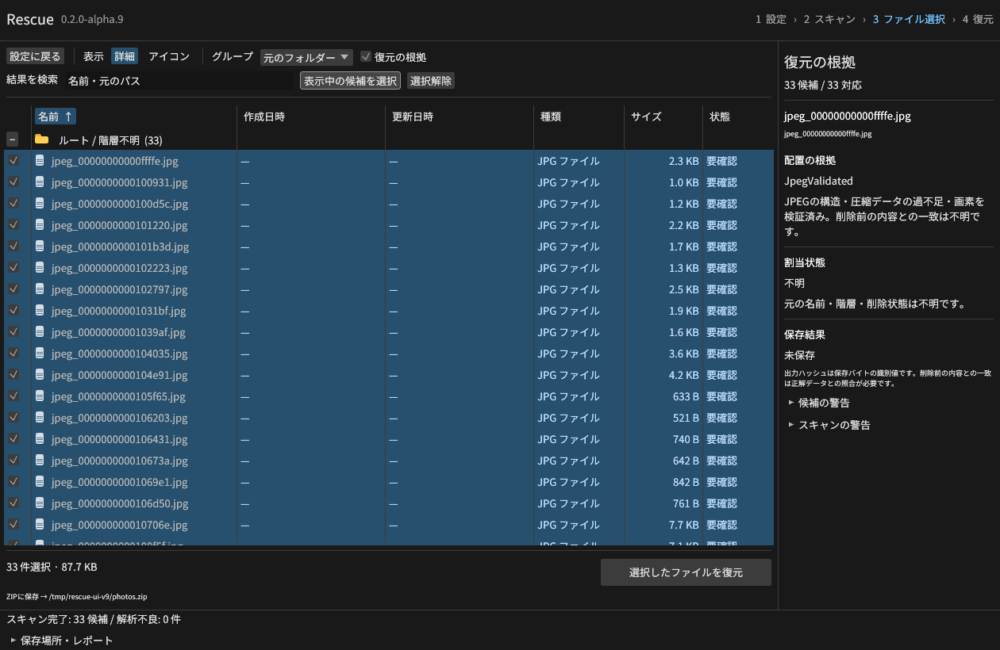
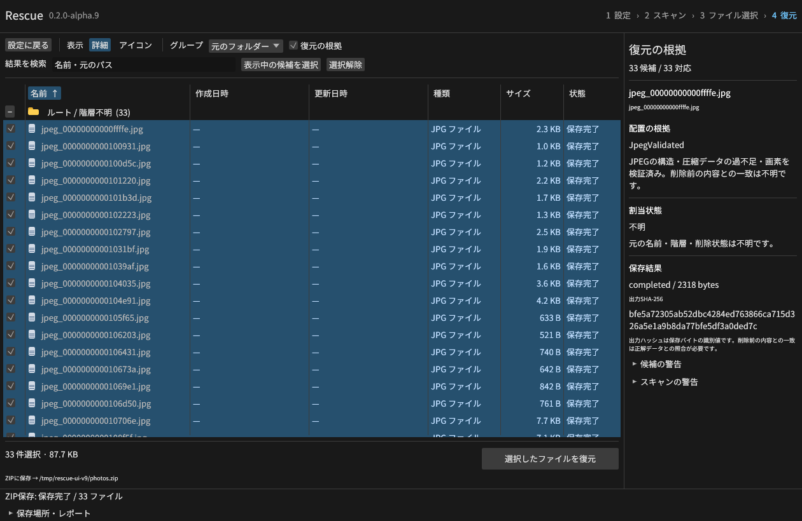
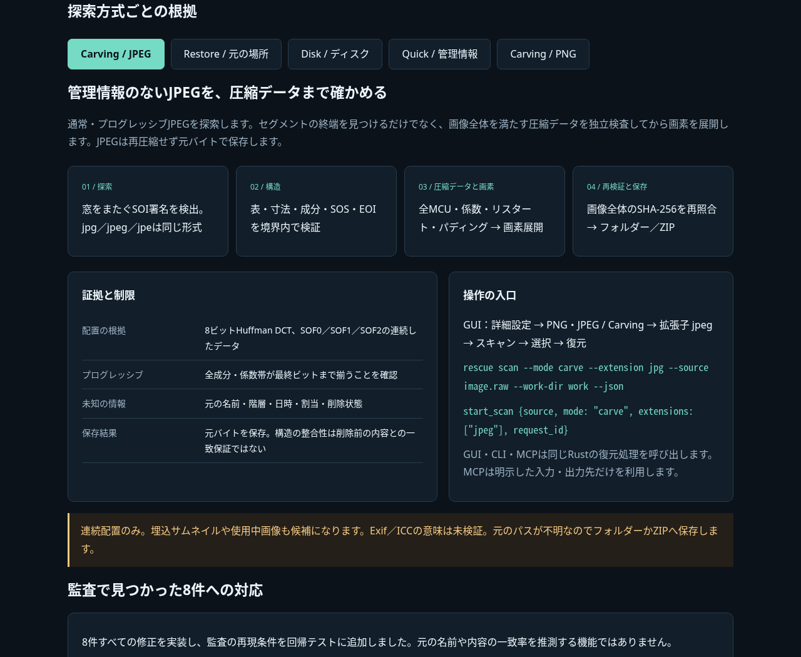

# Rescue v0.2.0-alpha.9

**管理情報が失われたJPEG写真を、構造・圧縮データ・画素まで検証して復元できるようになりました。** 通常のJPEGとプログレッシブJPEGをGUI・CLI・MCPで探索します。

## 変更

- 詳細設定に「PNG・JPEG / Carving」。拡張子の `jpg`・`jpeg`・`jpe` はJPEGを選び、空欄はPNGとJPEGの両方を探索。指定バイト範囲内だけを解析します。
- SOF0／SOF1／SOF2の8ビットHuffman DCT。グレースケール、RGB／YCbCr、CMYK、一般的なサブサンプリング、成分別スキャン、リスタートマーカーに対応します。
- 全MCU、Huffman符号、ゼロ／EOBの連続数、プログレッシブ係数帯・差分、リスタート位置・順序、パディングを独立検査。欠損ビットを補うデコーダーの動作で成功扱いにしません。
- 画素展開も通過した候補を `jpeg_validated` と表示。保存直前に構造と全JPEGハッシュを再検証し、再圧縮せず元バイトを保存します。
- 既存の詳細列・グループ表示、元の場所への復元、同じディスクへの保存、連番／スキップ、同名フォルダー統合、ZIP保存も利用できます。
- 新しいcarvingセッションはスキーマ6。従来の1〜5も読み込めます。

## 技術説明と実行結果

独立したPillow／libjpegと小さな別エンコーダーで32枚を生成・再読込。埋込サムネイルを含む33候補をCLI／MCPで全バイト照合しました。追加58項目には、途中切断・余剰データ・リスタート不正等の破損33条件、拡張子、範囲、ZIP、同名処理、改変セッション、ソース変更の再検証を含みます。

Linux実GUIでも33候補をZIP保存し、元バイト・CRC・SHA-256と入力無変更を確認。既存35形式36ファイルの元の場所／ZIP保存、既存PDF保持、36日時も再照合しました。

4ネイティブ環境でRustテスト・8統合群・35形式・読み取り専用仮想ディスク864件・新規仮想媒体の実削除PDF復元・GUI起動・8配布物を検証して公開します。添付の `jpeg-results-*.json`、`gui-jpeg-results.json`、`restore-native-*.json`、`disk-results-*.json`、`verification-*.json` に結果を収録。公開実行ファイルそのものの追加検証は完了後に追記します。

[通信不要の操作できる技術説明UI](https://github.com/Xenoah/rescue-deletedfiles_rust/releases/download/v0.2.0-alpha.9/intelligence.html)では、6つの実画面と5つの探索・保存方式を切り替えられます。

## ダウンロード

| OS / CPU | インストール版 | ポータブル版 |
| --- | --- | --- |
| Windows x64 | [setup.exe](https://github.com/Xenoah/rescue-deletedfiles_rust/releases/download/v0.2.0-alpha.9/rescue-0.2.0-alpha.9-windows-x64-setup.exe) | [portable.zip](https://github.com/Xenoah/rescue-deletedfiles_rust/releases/download/v0.2.0-alpha.9/rescue-0.2.0-alpha.9-windows-x64-portable.zip) |
| Linux x64 | [.deb](https://github.com/Xenoah/rescue-deletedfiles_rust/releases/download/v0.2.0-alpha.9/rescue-0.2.0-alpha.9-linux-x64.deb) | [portable.tar.gz](https://github.com/Xenoah/rescue-deletedfiles_rust/releases/download/v0.2.0-alpha.9/rescue-0.2.0-alpha.9-linux-x64-portable.tar.gz) |
| macOS Apple Silicon | [.pkg](https://github.com/Xenoah/rescue-deletedfiles_rust/releases/download/v0.2.0-alpha.9/rescue-0.2.0-alpha.9-macos-arm64.pkg) | [portable.zip](https://github.com/Xenoah/rescue-deletedfiles_rust/releases/download/v0.2.0-alpha.9/rescue-0.2.0-alpha.9-macos-arm64-portable.zip) |
| macOS Intel | [.pkg](https://github.com/Xenoah/rescue-deletedfiles_rust/releases/download/v0.2.0-alpha.9/rescue-0.2.0-alpha.9-macos-x64.pkg) | [portable.zip](https://github.com/Xenoah/rescue-deletedfiles_rust/releases/download/v0.2.0-alpha.9/rescue-0.2.0-alpha.9-macos-x64-portable.zip) |

`SHA256SUMS.txt`で照合できます。Linuxはglibc 2.35以降。macOSは13以降、アドホック署名でDeveloper ID署名・公証はありません。

JPEGは連続配置のみ。符号化データ64 MiB、画素用予約（幅×高さ×4）64 MiB、DCT係数128 MiB、256スキャンまで。12ビット、算術・可逆・階層JPEG、DNL、未完了のプログレッシブ係数帯、断片再構成は未対応です。PNG・JPEG共通で1探索4 GiBの検証予算を使い、上限到達は未探索領域を明示します。

JPEGには全体CRCがなく、検証成功は削除前の内容との一致保証ではありません。元の名前・日時・削除状態は不明で、使用中画像や埋込サムネイルも候補になります。carvingの候補はフォルダーかZIPへ保存してください。同じディスクへの保存は全選択データを先に読み出します（合計512 MiBまで）。未選択の削除データに影響する可能性があります。

PDF／ZIP／MP4等のcarving、読取マップ・イメージ取得、RAID、有料製品比較は後続工程です。TRIMや上書きで失われたバイトは復元できません。

[JPEGの仕様とテスト](https://github.com/Xenoah/rescue-deletedfiles_rust/blob/v0.2.0-alpha.9/docs/JPEG-CARVING.md) · [対応範囲](https://github.com/Xenoah/rescue-deletedfiles_rust/blob/v0.2.0-alpha.9/docs/ALPHA.md) · [検証](https://github.com/Xenoah/rescue-deletedfiles_rust/blob/v0.2.0-alpha.9/docs/VALIDATION.md)
