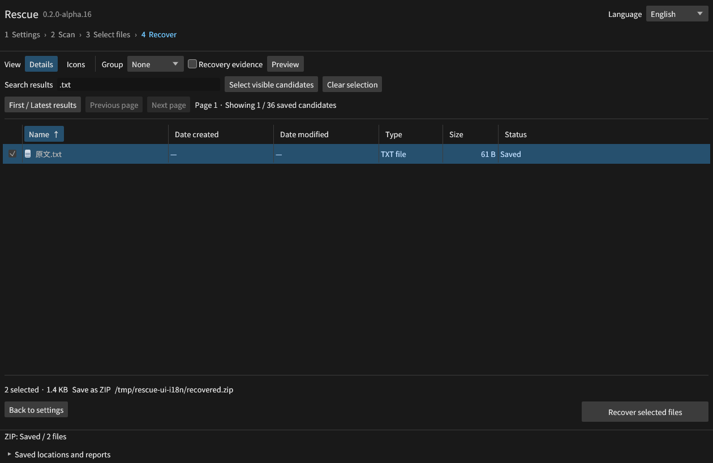
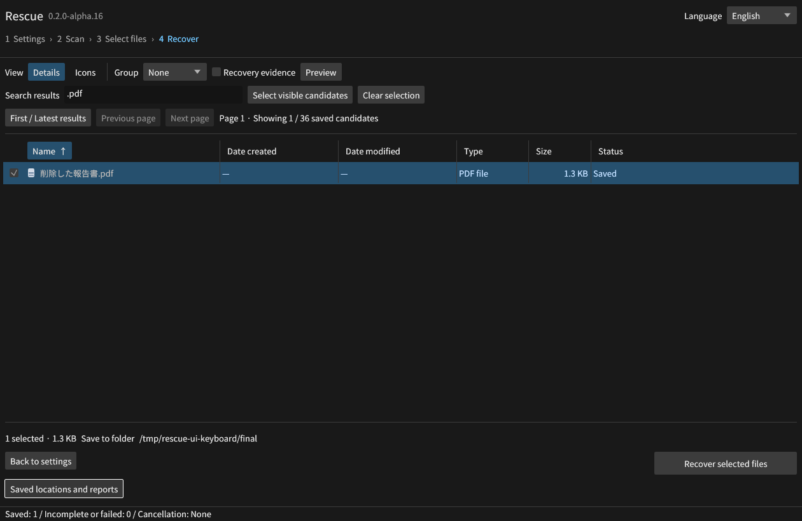
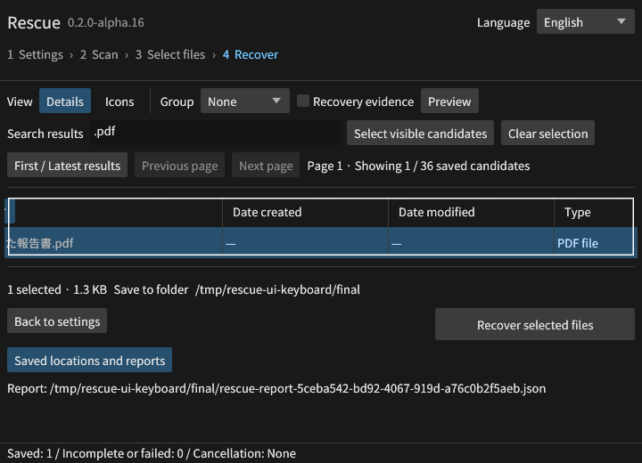

# Rescue v0.2.0-alpha.16

候補のPNG・JPEG・テキストを別プロセスでプレビューできるようにしました。
GUI、CLI、MCPで同じ再検証と制限を使います。Windowsではディスクの読取許可を補助プロセスへ分離し、
受け取ったハンドルに書込・削除・ACL変更権限がないことと、補助プロセスの終了を確認します。

画像入力8 MiB、1,677万画素、表示512px、文字列先頭64 KiB、読取64 MiB、5秒を上限とします。
プレビュー非対応のPDF等も復元候補として保持します。表示用の変換結果は元バイトの完全性保証ではありません。

[操作できる技術説明UI](https://github.com/Xenoah/rescue-deletedfiles_rust/releases/download/v0.2.0-alpha.16/intelligence.html)には、67枚の実画面と20方式の説明を収録しました。
プレビュー8画面・割当範囲5画面・停止と移行8画面・名前の履歴2画面・ソース識別2画面はalpha.16、以前の画面はalpha.15として明記しています。
390px幅を含む全切替操作、JavaScriptエラー0件、外部通信0件を確認しました。

CarvingはNTFS/FAT32/exFATの未割当領域を既定にしました。候補の全内容の割当を確認し、
割当情報がない範囲の全領域検索は一覧上に表示します。全領域の指定と旧セッションの再開も維持します。
独立試験は19条件・24ファイルの内容一致、実GUIのスキャン・選択・復元は2件338バイトを照合しました。

イメージ取得の一時停止・再開とセッションのコピー移行をGUI・MCPに追加しました。
ジョブの種類、工程、進捗、構造化エラーを共通契約にし、JSON Schemaも同梱します。
独立した12条件に加え、実GUIで512 MiBの停止・再開と、移行後36ファイル152,325バイトの一致を確認しました。

元の名前と名前変更の履歴を、GUI・CLI・MCP・ZIPのレポートに追加しました。
同名の保持、使用できない文字、ADS、生成名を区別し、14条件・13出力をバイト照合しました。
CLIの `--stream` にも保存直前の管理情報・割当範囲の再検証を適用しています。

[名前の根拠と変更理由](https://github.com/Xenoah/rescue-deletedfiles_rust/blob/v0.2.0-alpha.16/docs/NAMING.md)

ソースの種類・ID・範囲を共通化し、MCPはセッションを明示した候補参照も受け付けます。
旧記録を維持し、改変IDや別セッションの参照を復元前に拒否します。

[ソースと候補の契約](https://github.com/Xenoah/rescue-deletedfiles_rust/blob/v0.2.0-alpha.16/docs/SOURCE_CONTRACT.md)

日本語と英語の操作表示を切り替えられます。`--language en` でも起動できます。
日本語の元名、検索語、選択を保持して、実GUIでPDFとテキストの2件1,428バイトを復元・照合しました。
完了メッセージも切り替わります。[実装と検証範囲](https://github.com/Xenoah/rescue-deletedfiles_rust/blob/v0.2.0-alpha.16/docs/LANGUAGE.md)

列幅変更の見えないTab停止を修正し、見出しの左右キーと境界のドラッグを両立しました。
狭い画面のスクロール領域にも名前、フォーカス枠、キー操作を追加しています。
実GUIでPDFをキーボードから復元して1,367バイトを照合し、完了後のSpaceで保存レポートを開きました。

[操作基準](https://github.com/Xenoah/rescue-deletedfiles_rust/blob/v0.2.0-alpha.16/docs/UI_GUIDELINES.md) · [実GUIの照合記録](https://github.com/Xenoah/rescue-deletedfiles_rust/blob/v0.2.0-alpha.16/docs/gui-keyboard-results.json)

## 破損したUSB・SDとバイナリ書き出し

FAT32の片方のFATコピーが破損・読取不能でも、有効なチェーンを示すコピーが1つだけなら採用します。
両方が別の有効なチェーンを示す場合は推測せず拒否し、採用したコピーを警告に記録します。
5条件を検査し、4つの破損条件で5ファイルずつ、計20出力の全バイトを正解と照合します。

通常の復元で不完全になった候補は、GUIの「復元できなかった N 件をバイナリで書き出す」、
CLIの `export-raw`、MCPの `export_unrecovered` から取り出せます。
読めない範囲は0で埋めてJSONに位置を記録し、常に未検証のデータとして扱います。
既存ファイルの上書きと元媒体への書き出しを拒否します。保存先と元媒体の検証をフォルダー作成より先に行い、拒否時の不要な書込みも防ぎます。[手順と制限](https://github.com/Xenoah/rescue-deletedfiles_rust/blob/v0.2.0-alpha.16/docs/DAMAGED_MEDIA.md)

## 検証

Rustテストと復元エンジンの27統合群を3 OS・4ネイティブ環境のリリースCIで検証してから公開します。
各環境でパーサーの変異試験400件も実行し、パニックがないことを確認します。
プレビューの独立検査は画像10件・テキスト12件、
破損画像・画素上限・改変した管理情報・取消・タイムアウト・MCP許可範囲を含む11条件です。
Windowsの権限分離はネイティブVMで実UAC分離トークンの8条件・VHD36ファイル・3プレビュー・64 MiB取得を照合しました。
Windows実VMのUI Automation（Invoke/Value）で設定〜検索〜選択〜ZIP復元を操作し、2件1,428バイトを照合しました（リリースCIの必須試験）。
UIAが画面の要素を取得する前にAccessKitの接続を待つよう試験手順を修正しています。テスト用の制限アカウントからのUIA操作と、人が操作するUAC画面の評価は継続中です。
公開後はダウンロードした実行ファイルで、プレビュー・割当範囲・ジョブ契約・名前の履歴・ソース識別・バイナリ書き出し・破損FATを含めて再検証します。

## 持ち越した画面記録

変更していない既存の流れ（36ファイル復元、JPEG/文書、イメージ取得、NTFS、消失領域、RAID、索引、1,000万候補）の
実GUI記録と索引の性能測定はalpha.15のビルドのものです。[持ち越し台帳](https://github.com/Xenoah/rescue-deletedfiles_rust/blob/v0.2.0-alpha.16/docs/gui-evidence-carryover.json)に版を明記しています。

[プレビュー](https://github.com/Xenoah/rescue-deletedfiles_rust/blob/v0.2.0-alpha.16/docs/PREVIEW.md) · [検索範囲](https://github.com/Xenoah/rescue-deletedfiles_rust/blob/v0.2.0-alpha.16/docs/ALLOCATION_SCOPE.md) · [共通ジョブ](https://github.com/Xenoah/rescue-deletedfiles_rust/blob/v0.2.0-alpha.16/docs/JOB_CONTRACT.md) · [Windows権限分離](https://github.com/Xenoah/rescue-deletedfiles_rust/blob/v0.2.0-alpha.16/docs/READ_ACCESS.md) · [受入台帳](https://github.com/Xenoah/rescue-deletedfiles_rust/blob/v0.2.0-alpha.16/docs/V1_ACCEPTANCE.md)

## ダウンロード

| OS / CPU | インストール版 | ポータブル版 |
| --- | --- | --- |
| Windows x64 | [setup.exe](https://github.com/Xenoah/rescue-deletedfiles_rust/releases/download/v0.2.0-alpha.16/rescue-0.2.0-alpha.16-windows-x64-setup.exe) | [portable.zip](https://github.com/Xenoah/rescue-deletedfiles_rust/releases/download/v0.2.0-alpha.16/rescue-0.2.0-alpha.16-windows-x64-portable.zip) |
| Linux x64 | [.deb](https://github.com/Xenoah/rescue-deletedfiles_rust/releases/download/v0.2.0-alpha.16/rescue-0.2.0-alpha.16-linux-x64.deb) | [portable.tar.gz](https://github.com/Xenoah/rescue-deletedfiles_rust/releases/download/v0.2.0-alpha.16/rescue-0.2.0-alpha.16-linux-x64-portable.tar.gz) |
| macOS Apple Silicon | [.pkg](https://github.com/Xenoah/rescue-deletedfiles_rust/releases/download/v0.2.0-alpha.16/rescue-0.2.0-alpha.16-macos-arm64.pkg) | [portable.zip](https://github.com/Xenoah/rescue-deletedfiles_rust/releases/download/v0.2.0-alpha.16/rescue-0.2.0-alpha.16-macos-arm64-portable.zip) |
| macOS Intel | [.pkg](https://github.com/Xenoah/rescue-deletedfiles_rust/releases/download/v0.2.0-alpha.16/rescue-0.2.0-alpha.16-macos-x64.pkg) | [portable.zip](https://github.com/Xenoah/rescue-deletedfiles_rust/releases/download/v0.2.0-alpha.16/rescue-0.2.0-alpha.16-macos-x64-portable.zip) |

`SHA256SUMS.txt`で照合できます。Linuxはglibc 2.35以降、macOSは13以降。
macOSはアドホック署名です。Developer ID署名・公証はありません。

索引とイメージ取得の作業先は元の物理ディスクから分離します。選択ファイルの同一場所保存は、全選択データを先に読み出します。
未選択の削除データには影響する可能性があります。TRIMや上書きで失われた元バイトは生成しません。有料製品比較は未測定です。
