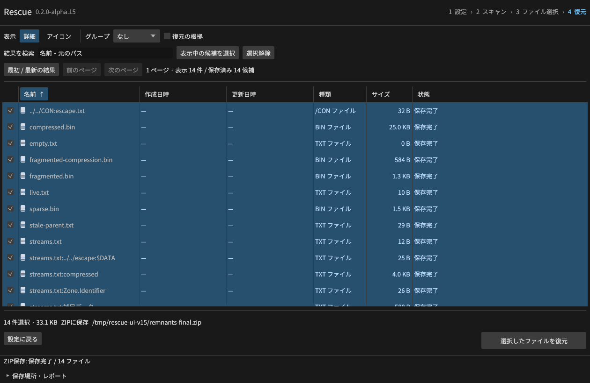

# Rescue v0.2.0-alpha.13

消失したNTFS/FAT32/exFAT領域を、ブートと内部構造の照合から選択できるようにしました。
バックアップブートとMFTミラーの検証、現行MFTの外に残るレコードの探索をGUI・CLI・MCPに追加しました。
v1.0に向けた開発版です。残る必須項目は[受入台帳](https://github.com/Xenoah/rescue-deletedfiles_rust/blob/v0.2.0-alpha.13/docs/V1_ACCEPTANCE.md)で管理しています。

## 探索と復元の根拠

- 主ブートとバックアップの配置・幾何情報を照合し、内部のMFT/FAT/Bitmap/Upcaseも検証。偽署名や範囲外を拒否します。
- 重なる別候補は比較して選択できます。元ディスクの領域表やブートには書き戻しません。
- MFTミラーはレコード0の初期読取に限定し、元MFTのrunlistとルートの整合性を確認します。
- 残存MFTの探索は詳細設定から有効にします。旧クラスタ構成と元の階層が未確認であることを表示し、元の場所への自動復元を拒否します。
- 復元直前にもブート・残存レコード・ソースの照合を行います。上限到達、欠損、取消は未探索として記録します。

[対応プロファイルと資源上限](https://github.com/Xenoah/rescue-deletedfiles_rust/blob/v0.2.0-alpha.13/docs/DISCOVERY.md)。
旧属性リストを現行MFTへ接続する推測はしません。TRIMや上書きで失われた内容は復元できません。

## 検証

ローカルのRust42項目・13統合群を実行。消失領域20条件で64出力、残存MFT12条件で52出力が正解と一致しました。
独立したmkntfsで新規試験イメージを実クイックフォーマットし、旧100ファイル（resident/non-resident各50）をCLI/MCPでそれぞれ全バイト一致で復元しました。
同一クラスタ構成のntfs-3gプロファイルであり、Windows format.exeやSSD TRIMの試験とは区別します。

実GUIでは消失領域6件・残存レコード14件をZIP復元。720×520で全ボタンが見えることと、キーボードで閉じる操作も確認しました。
既存の元の場所36件・ZIP36件・JPEG33件・文書/動画7件・NTFS21ストリーム・別名検索1件も正解と照合しました。
512 MiBの取得・128範囲のマップ・再開照合・取得後の36件復元も実操作で検証しています。
Windows・Linux・macOS Intel/ARMのネイティブCIと公開実物の結果は配布工程で記録します。

`discovery-results-*.json`、`remnant-results-*.json`、`quickformat-results-linux-x64.json`、`gui-discovery-results.json`を添付します。

## 技術説明UI

[画像内蔵の技術説明UI](https://github.com/Xenoah/rescue-deletedfiles_rust/releases/download/v0.2.0-alpha.13/intelligence.html)は単一HTMLです。
16実画面・10方式を通信なしで切り替えられます。390px幅、全切替、画像表示をChromiumで確認しています。
[Microsoft/W3Cの公式資料と配置ルール](https://github.com/Xenoah/rescue-deletedfiles_rust/blob/v0.2.0-alpha.13/docs/UI_GUIDELINES.md)に従い、主要操作を画面下部に配置し、ラベルとキーボード操作を用意しています。

## ダウンロード

| OS / CPU | インストール版 | ポータブル版 |
| --- | --- | --- |
| Windows x64 | [setup.exe](https://github.com/Xenoah/rescue-deletedfiles_rust/releases/download/v0.2.0-alpha.13/rescue-0.2.0-alpha.13-windows-x64-setup.exe) | [portable.zip](https://github.com/Xenoah/rescue-deletedfiles_rust/releases/download/v0.2.0-alpha.13/rescue-0.2.0-alpha.13-windows-x64-portable.zip) |
| Linux x64 | [.deb](https://github.com/Xenoah/rescue-deletedfiles_rust/releases/download/v0.2.0-alpha.13/rescue-0.2.0-alpha.13-linux-x64.deb) | [portable.tar.gz](https://github.com/Xenoah/rescue-deletedfiles_rust/releases/download/v0.2.0-alpha.13/rescue-0.2.0-alpha.13-linux-x64-portable.tar.gz) |
| macOS Apple Silicon | [.pkg](https://github.com/Xenoah/rescue-deletedfiles_rust/releases/download/v0.2.0-alpha.13/rescue-0.2.0-alpha.13-macos-arm64.pkg) | [portable.zip](https://github.com/Xenoah/rescue-deletedfiles_rust/releases/download/v0.2.0-alpha.13/rescue-0.2.0-alpha.13-macos-arm64-portable.zip) |
| macOS Intel | [.pkg](https://github.com/Xenoah/rescue-deletedfiles_rust/releases/download/v0.2.0-alpha.13/rescue-0.2.0-alpha.13-macos-x64.pkg) | [portable.zip](https://github.com/Xenoah/rescue-deletedfiles_rust/releases/download/v0.2.0-alpha.13/rescue-0.2.0-alpha.13-macos-x64-portable.zip) |

`SHA256SUMS.txt` で照合できます。Linuxはglibc 2.35以降、macOSは13以降。
macOSはアドホック署名で、Developer ID署名・公証はありません。

同じディスクへの選択ファイル保存は全選択データを先に読み出します（合計512 MiBまで）。未選択の削除データには影響する可能性があります。
TRIMや上書きで失われたバイトは復元できません。有料製品比較は未測定です。
RAID、大容量索引、隔離プレビュー、Windows権限分離などはv1.0の残る必須工程です。

[対応表](https://github.com/Xenoah/rescue-deletedfiles_rust/blob/v0.2.0-alpha.13/docs/ALPHA.md) · [検証履歴](https://github.com/Xenoah/rescue-deletedfiles_rust/blob/v0.2.0-alpha.13/docs/VALIDATION.md)
