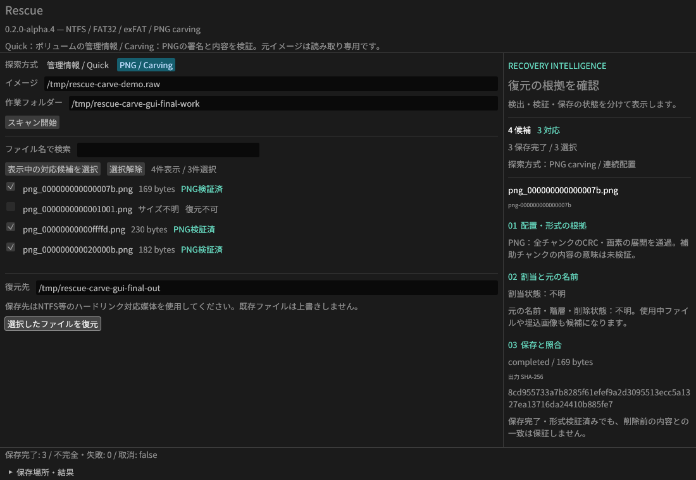
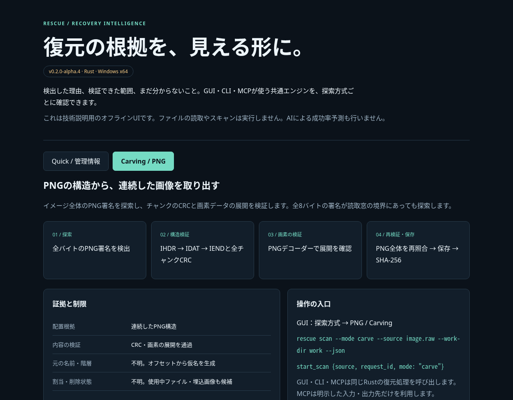

# Rescue v0.2.0-alpha.4

PNG carvingと、復元の根拠を示すRecovery Intelligence UIを追加しました。
GUI・CLI・MCPで同じPNG検出・検証・保存処理を利用できます。

Linux / Xvfbで合成イメージを操作した実画面です。3件の保存結果を正解データとバイト単位で照合。
Windows GUIの手動試験を示すものではありません。

## 技術説明のインテリジェンスUI

添付の **intelligence.html** を保存してブラウザーで開くと、Quick / Carvingの手順・根拠・制限を切り替えて確認できます。
通信不要の単体HTMLです。配布ZIPにもdocs/intelligence.htmlとスクリーンショットを同梱しています。
GitHubのリリース本文には静止画を掲載し、操作可能なUIは添付HTMLで提供します。

| 表示 | 示すこと | 示さないこと |
| --- | --- | --- |
| PNG検証済み | 全チャンクCRC・画素データ展開の成功 | 削除前の内容との一致、補助チャンクの意味 |
| 割当状態：不明 | carvingは割当や削除状態を判定していない | 未使用領域であるという保証 |
| completed / SHA-256 | 保存完了と出力バイト列の識別 | 元データとの一致率・商用製品との優劣 |

## 追加した機能

- `scan --mode carve`、MCPの`start_scan`で`mode: "carve"`、GUIの「PNG / Carving」。Quickが既定です。
- 1MiB窓と7バイトの重なりで署名を探索し、窓をまたぐPNGも検出。
- チャンク順序・CRC、zlib/Adler-32、画素展開を検証。合法な色形式・ビット深度、Adam7、分割IDATに対応。
- 復元時にPNGの構造と全体SHA-256を再照合。セッション内のサイズ・名前から任意の保存範囲やパスを採用しません。
- GUIで配置・形式の根拠、割当と名前の確認状況、保存結果・出力ハッシュを表示。
- PNGのセッションはv4（Quickはv3）。v1〜v4を読み込みます。MCPの進捗にrecords / bytesの単位を追加。
- 今後のREADME・リリースにも実画面と技術説明を掲載する運用を記録し、配布時の必須ファイルにしました。

## 検証

PNGのCLI/MCP統合23項目、23ファイルの正解バイト一致をローカルで確認しました。
CRC・Adler-32不一致、途中切断、不正フィルター、過大サイズ、APNG、改変セッションの拒否を含みます。
サンプル照合範囲外のPNGを変更し更新日時を戻した場合も、PNG全体のハッシュ再照合で拒否することを確認。
既存のNTFS・圧縮/ADS・FAT32/exFAT・独立ツール検証、Rust 16テストも成功しました。
技術説明HTMLはChromiumで両方式の切替、日本語表示、モバイル幅、JavaScriptエラーなしを確認。

このリリースはWindows / Linux CIの成功後に公開します。Windowsではdebug / release両方で4つの統合テスト群を実行します。
詳しい条件はZIP内のdocs/VALIDATION.mdと公開タグのActionsログを参照してください。

## 対応範囲

静止PNGの連続配置に限定し、元の名前・階層・割当・削除状態は不明です。使用中ファイルや埋込画像も検出します。
PNGは符号化データ・画素各64MiB、65,536チャンク、スキャン全体の検証予算4GiBまで。
APNG・断片再構成・PNG以外のcarving、実デバイス、RAID、EFS、TexFAT、属性リストの追加extentsは未対応です。
有料ソフトとの比較や実媒体での復元率は未検証です。

Windows x64用ZIPはGUI・CLI・MITライセンス・依存通知を含みます。Microsoft Visual C++ v14 x64ランタイムが必要です。
入力は読み取り専用の通常ファイル。復元先はNTFS等のハードリンク対応媒体を使用してください。
ZIP・単体HTML・スクリーンショットのSHA-256は添付のSHA256SUMS.txtで確認できます。
