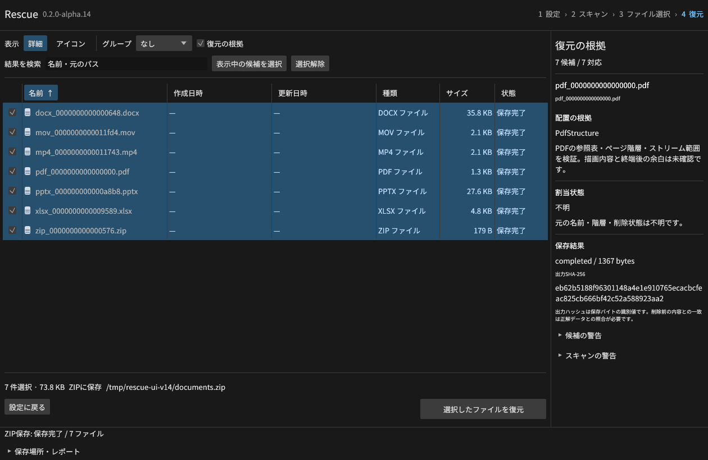
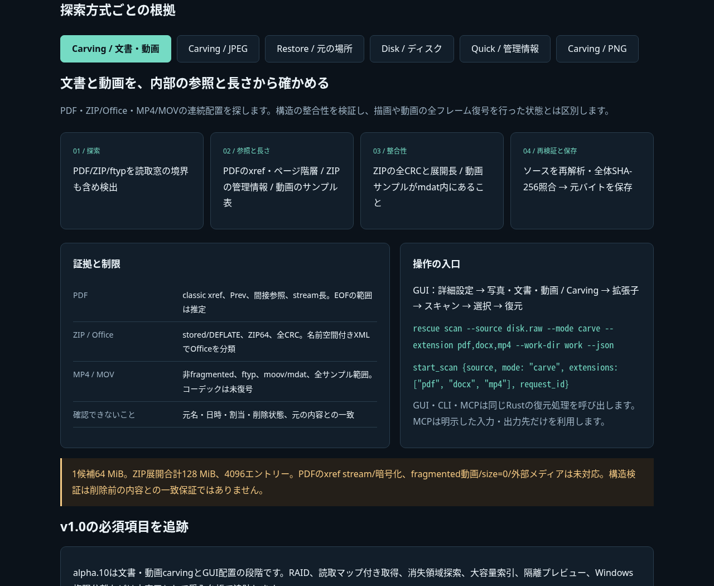

# Rescue v0.2.0-alpha.10

PDF・ZIP/Office・MP4/MOVの連続配置探索をGUI・CLI・MCPに追加しました。
操作欄を画面下に固定し、小さい画面ではフォームとツールバーを折り返します。
これはv1.0に向けた開発版です。必須機能の残作業は [受入台帳](https://github.com/Xenoah/rescue-deletedfiles_rust/blob/v0.2.0-alpha.10/docs/V1_ACCEPTANCE.md) に公開しています。

## 変更と検証範囲

- PDF: classic xref、間接参照、ページ階層、streamの宣言長。増分更新のPrevも照合。
- ZIP/ZIP64: 中央/ローカルレコード、展開長、全エントリーCRC。stored/DEFLATE、data descriptorを扱います。
- DOCX/XLSX/PPTX: ZIP検証に加え、名前空間を解釈したContent Types XMLと主文書エントリーで分類。
- MP4/MOV: ftyp、moov/mdat、トラックとサンプル表、全サンプル位置を検証。
- 新形式のセッションはスキーマ7。従来1〜6の読込も維持します。保存直前に再解析と全バイトハッシュを照合。
- 入力欄に常時ラベル、主要操作は高さ36px、Tabで操作、Ctrl/Command+Fで検索へ移動。3幅×3倍率×3画面状態を測定。

新しい69ケースで正常23変種・破損/未対応30条件を検証し、CLI/MCPで30出力が正解バイトと一致。
既存8統合群も継続実行し、決定的な改変・切断入力1,024種の資源上限も検査します。
35形式の管理情報復元8条件×CLI/MCPは576件一致。管理情報喪失時は連続11/36、断片2/36です。

実Linux GUIから文書/動画7件、JPEG33件、元の場所36件、ZIP36件を復元し、正解バイト・CRC・入力不変を確認しました。

[3 OS/4 CPU環境のネイティブCI](https://github.com/Xenoah/rescue-deletedfiles_rust/actions/runs/41971886923)がすべて成功しました。Rust・9統合群・35形式・読取専用仮想ディスク864件・実削除PDFの元の場所復元・GUI起動・8配布物と全体アセンブルを確認済みです。
`document-results-*.json`、`gui-document-results.json`、`restore-native-*.json`、`disk-results-*.json`、`verification-*.json` に証拠を収録。
[公開パッケージの4環境試験](https://github.com/Xenoah/rescue-deletedfiles_rust/actions/runs/41974636495)も成功しました。配布71資産を照合し、公開Linux GUIで7形式の復元を再確認しました。

## 技術説明UIと配置ルール

[画像内蔵の技術説明UI](https://github.com/Xenoah/rescue-deletedfiles_rust/releases/download/v0.2.0-alpha.10/intelligence.html) は単一HTMLです。8実画面・6方式を通信せずに切り替えられます。
[公式資料と配置の判断基準](https://github.com/Xenoah/rescue-deletedfiles_rust/blob/v0.2.0-alpha.10/docs/UI_GUIDELINES.md) も公開しています。

## ダウンロード

| OS / CPU | インストール版 | ポータブル版 |
| --- | --- | --- |
| Windows x64 | [setup.exe](https://github.com/Xenoah/rescue-deletedfiles_rust/releases/download/v0.2.0-alpha.10/rescue-0.2.0-alpha.10-windows-x64-setup.exe) | [portable.zip](https://github.com/Xenoah/rescue-deletedfiles_rust/releases/download/v0.2.0-alpha.10/rescue-0.2.0-alpha.10-windows-x64-portable.zip) |
| Linux x64 | [.deb](https://github.com/Xenoah/rescue-deletedfiles_rust/releases/download/v0.2.0-alpha.10/rescue-0.2.0-alpha.10-linux-x64.deb) | [portable.tar.gz](https://github.com/Xenoah/rescue-deletedfiles_rust/releases/download/v0.2.0-alpha.10/rescue-0.2.0-alpha.10-linux-x64-portable.tar.gz) |
| macOS Apple Silicon | [.pkg](https://github.com/Xenoah/rescue-deletedfiles_rust/releases/download/v0.2.0-alpha.10/rescue-0.2.0-alpha.10-macos-arm64.pkg) | [portable.zip](https://github.com/Xenoah/rescue-deletedfiles_rust/releases/download/v0.2.0-alpha.10/rescue-0.2.0-alpha.10-macos-arm64-portable.zip) |
| macOS Intel | [.pkg](https://github.com/Xenoah/rescue-deletedfiles_rust/releases/download/v0.2.0-alpha.10/rescue-0.2.0-alpha.10-macos-x64.pkg) | [portable.zip](https://github.com/Xenoah/rescue-deletedfiles_rust/releases/download/v0.2.0-alpha.10/rescue-0.2.0-alpha.10-macos-x64-portable.zip) |

`SHA256SUMS.txt`で照合できます。Linuxはglibc 2.35以降、macOSは13以降。
macOSはアドホック署名で、Developer ID署名・公証はありません。

新しいcarvingは1候補64 MiB、ZIP展開合計128 MiB/4,096エントリー、PDF65,536オブジェクト、動画1,048,576サンプルまで。
PDFのxref stream/暗号化、fragmented動画/外部メディア/size=0は未対応。
PDF描画、Office描画、動画全フレーム復号は行わず、構造検証と区別します。
元名・日時・削除状態は不明で、PDFのEOFと動画boxによる範囲には推定が含まれます。

同じディスクへの保存は全選択データを先に読み出します（合計512 MiBまで）。未選択の削除データには影響する可能性があります。
TRIMや上書きで失われたバイトは復元できません。有料製品比較は未測定です。
RAID、読取マップ付き取得、消失領域探索、大容量索引などは次の必須工程として残っています。

[形式別の詳細](https://github.com/Xenoah/rescue-deletedfiles_rust/blob/v0.2.0-alpha.10/docs/DOCUMENT-CARVING.md) · [対応表](https://github.com/Xenoah/rescue-deletedfiles_rust/blob/v0.2.0-alpha.10/docs/ALPHA.md) · [検証履歴](https://github.com/Xenoah/rescue-deletedfiles_rust/blob/v0.2.0-alpha.10/docs/VALIDATION.md)
