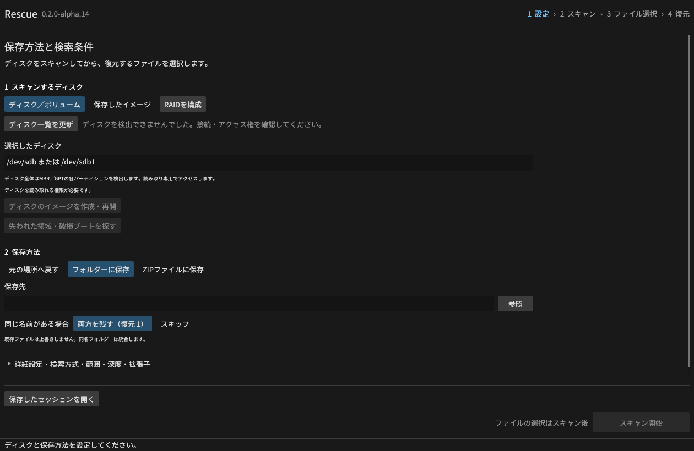
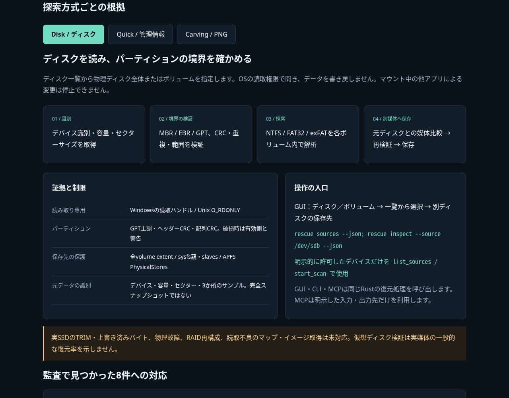

# Rescue v0.2.0-alpha.7

**スキャン対象をディスクに変更しました。** 起動時のディスク一覧から物理ディスク全体またはボリュームを選択し、**設定 → スキャン → ファイル選択 → 復元**へ進みます。
保存方法は任意のフォルダー、または実際のZIPファイル。Windows・Linux・macOSのインストール版とポータブル版を配布します。

## ディスクの読み取り

- WindowsのPhysicalDrive／ドライブ文字／Volume GUID、Linuxブロックデバイス、macOSのdisk／rdiskを読み取り専用で開きます。Windowsは管理者権限が必要です。
- MBR／EBR／GPTからNTFS・FAT32・exFATを各パーティション内で解析し、候補を一つの一覧に集約。`pN:`のIDと`PN/`の元パスで区別します。
- GPTの主副ヘッダー・配列CRC・境界・重複を検証。一方が壊れた場合は有効側を警告付きで使用し、ディスクを修復しません。
- 作業フォルダー・復元先・ZIPは別の物理ディスクに限定。同じ媒体の別パーティションも拒否し、保存先媒体を特定できない場合は停止します。
- CLIに`sources`／`inspect`／`check-destination`を追加。MCPは明示的に許可したデバイスだけを扱います。RAWイメージは補助モードとして残しています。

このLinuxクラウド環境ではデバイスが公開されていないため一覧は空です。各OSでの直接アクセスは、下記の読み取り専用仮想ディスク試験で確認しています。

## 表示と操作

- 名前・作成日時・更新日時・種類・サイズ・状態の列。見出しで昇順／降順、境界で幅を変更。
- 元のフォルダー、種類、作成日、更新日、サイズ、名前の先頭、復元可否のグループ化と折り畳み。
- アイコン表示へ切り替えても選択を保持。結果の名前・元パスで検索可能。
- スキャン前に保存方式と保存先を指定。詳細設定で方式・フォルダー範囲・深度・拡張子、PNG探索の開始／終了バイトを設定。
- 日時は残った管理情報から取得。不明な日時やFATのタイムゾーンを推測しません。
- CLI・MCPも同じ検索設定とZIP保存を使用します。

画像はLinux / Xvfbで実際に操作したGUIです。35形式・36ファイルを含むGPTディスクイメージ内の合成NTFSで、日時・フォルダーはフィクスチャ値です。
Windows/macOSの手動GUI操作を示す画像ではありません。

## ダウンロード

| OS / CPU | インストール版 | ポータブル版 |
| --- | --- | --- |
| Windows x64 | [セットアップEXE](https://github.com/Xenoah/rescue-deletedfiles_rust/releases/download/v0.2.0-alpha.7/rescue-0.2.0-alpha.7-windows-x64-setup.exe) | [ZIP](https://github.com/Xenoah/rescue-deletedfiles_rust/releases/download/v0.2.0-alpha.7/rescue-0.2.0-alpha.7-windows-x64-portable.zip) |
| Linux x64 | [DEB](https://github.com/Xenoah/rescue-deletedfiles_rust/releases/download/v0.2.0-alpha.7/rescue-0.2.0-alpha.7-linux-x64.deb) | [tar.gz](https://github.com/Xenoah/rescue-deletedfiles_rust/releases/download/v0.2.0-alpha.7/rescue-0.2.0-alpha.7-linux-x64-portable.tar.gz) |
| macOS Apple Silicon | [PKG](https://github.com/Xenoah/rescue-deletedfiles_rust/releases/download/v0.2.0-alpha.7/rescue-0.2.0-alpha.7-macos-arm64.pkg) | [.app ZIP](https://github.com/Xenoah/rescue-deletedfiles_rust/releases/download/v0.2.0-alpha.7/rescue-0.2.0-alpha.7-macos-arm64-portable.zip) |
| macOS Intel | [PKG](https://github.com/Xenoah/rescue-deletedfiles_rust/releases/download/v0.2.0-alpha.7/rescue-0.2.0-alpha.7-macos-x64.pkg) | [.app ZIP](https://github.com/Xenoah/rescue-deletedfiles_rust/releases/download/v0.2.0-alpha.7/rescue-0.2.0-alpha.7-macos-x64-portable.zip) |

Windowsはユーザー単位のインストールで、VCランタイムを静的リンク。GUIはOpenGLに依存せずDirect3D 12（wgpu）で描画し、GPUのない環境のWARPにも対応します。Linuxはglibc 2.35以降、DEBはDebian/Ubuntu系向けです。
macOSは13以降で、アドホック署名のみ。Developer ID署名・公証はありません。Windowsも発行者署名はありません。
[インストール方法](https://github.com/Xenoah/rescue-deletedfiles_rust/blob/v0.2.0-alpha.7/docs/INSTALL.md)を参照してください。

## 技術説明のインテリジェンスUI

添付の **intelligence.html** は通信不要の単体HTML。ディスク選択・設定・詳細・アイコン画面の切り替え、Disk / Quick / PNG carvingの根拠と制限を確認できます。
各配布物にも文書、実画面、MITライセンス、ターゲット別の依存ライセンスを同梱します。

ZIP復元は作業領域へ復元してから、無圧縮ZIP64と結果レポートを作成します。既存ZIPは上書きしません。
CRC、各ファイルのSHA-256、ZIP全体のSHA-256を記録。取消・失敗時は完了にせず、一時保存場所を残します。
出力ハッシュやPNGの形式検証は、削除前の内容との一致率ではありません。

## 検証

4つのネイティブ環境すべてで、Rustテスト・debug/releaseのCLI/MCP統合・形式別復元・配布パッケージを検証するCIを公開条件にしました。

- Rust 28テスト（Windowsは29）：ZIPの取消・保存先差替え、日時変換、GUIの入力同期・検索条件・選択・数値／日時の並べ替え等。
- 新規統合60項目：35形式の実ZIP出力、CRC・正解バイト・SHA-256、範囲・深度・拡張子、SI日時、FAT/exFAT時刻、MCP、旧セッション互換、既存保護。
- 既存のNTFS、LZNT1/ADS、FAT32/exFAT、PNG30項目、監査回帰16項目を継続。
- 35形式・36ファイル、管理情報が残る8条件×CLI/MCPの576照合、さらにMBR／GPT全ディスクで144照合。
- 各OSで新規fixtureを読み取り専用のloop／VHD／hdiutilディスクとして接続。NTFS・FAT32・exFATの3パーティションでCLI／MCP計216ファイルが一致。MBR・512/4096セクターGPTイメージの648件と合わせ、各環境864件を照合。元データの全体SHA-256が不変であることも確認。
- GPTの主副破損、両方不正、重複、セッション境界の改変を検査。同一媒体への作業ファイル作成を保存前に拒否することを確認。
- Linuxでは独立ツール由来のNTFS/exFAT、実際にmcopy+mdelしたFAT32も検証。削除後のFAT32は512Bクラスターで14/36、4KiBで27/36が一致。
- 新GUIからZIP保存した36ファイルも、独立したPythonで全ファイルの正解SHA-256と一致。元イメージの全体SHA-256も操作前後で一致。
- Windowsセットアップは実際にインストールしてバイト・バージョンを確認し削除。Linux DEBは展開、macOS PKGは展開とアドホック署名検証。ポータブル内CLIの再実行とGUIの起動維持も確認。

添付の`verification-*.json`に配布物の検査結果、`format-results-*.json`に形式別、`disk-results-*.json`に仮想ディスクの実行結果を収録します。
`SHA256SUMS.txt`は全配布物と実画面・単体HTMLの照合に使用できます。

直接スキャンは読み取り専用ですが、マウント中の元ディスクを他のアプリが変更することは防げません。可能ならオフライン化・アンマウントしてください。
RAID再構成、APFS/ext4の管理情報復元、読取不良のイメージ取得、PNG以外のcarving、実物のSSD/HDD・TRIM・有料製品との比較は未対応または未検証です。仮想ディスクの結果は一般的な復元率を示しません。
[対応範囲](https://github.com/Xenoah/rescue-deletedfiles_rust/blob/v0.2.0-alpha.7/docs/ALPHA.md)と[全形式の検証条件](https://github.com/Xenoah/rescue-deletedfiles_rust/blob/v0.2.0-alpha.7/docs/CLOUD-TESTS.md)を明記しています。
