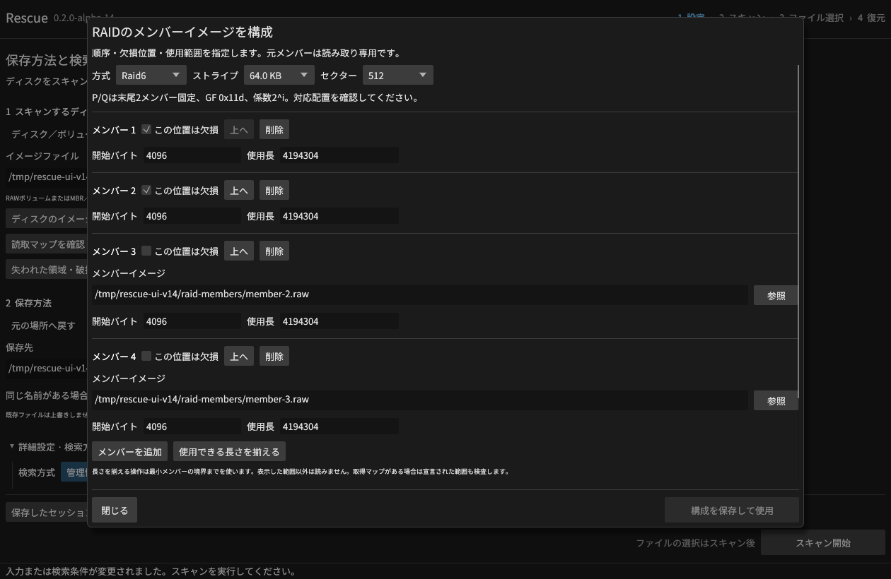
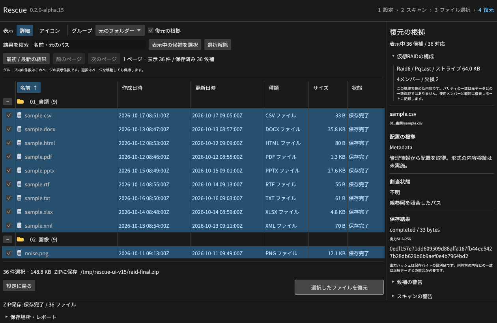
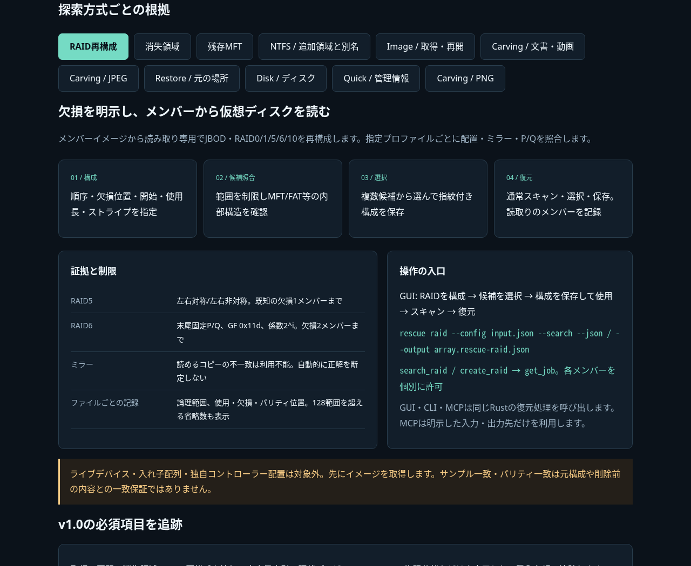

# Rescue v0.2.0-alpha.14

メンバーイメージからJBOD・RAID 0/1/5/6/10を読み取り専用で再構成できるようにしました。
GUI・CLI・MCPで構成を検査し、候補から選んで通常のスキャン・選択・復元へ進めます。
v1.0に向けた開発版です。[受入台帳](https://github.com/Xenoah/rescue-deletedfiles_rust/blob/v0.2.0-alpha.14/docs/V1_ACCEPTANCE.md)の必須項目を継続しています。

## 配置と復元の根拠

- 順序、欠損位置、開始バイト、使用長、セクター、ストライプを明示します。構成にメンバーの指紋を保持します。
- RAID5は左右対称・左右非対称。RAID6は末尾固定P/Q、GF 0x11d、係数2^i。RAID10は隣接ミラーペアです。
- 自動探索は最大128構成/5秒を既定とし、ファイルシステム内部構造を照合した複数候補を表示。使用する構成を明示して選びます。
- 読めるコピーや残存パリティが一致しない範囲は利用不能として扱い、ゼロを正解データとして出力しません。
- 各ファイルのJSON/ZIPレポートに使用メンバー・欠損・P/Q位置・論理読取範囲を記録します。上限による省略数も残ります。
- 開いたまま縮小してもダイアログが画面内に収まるよう修正しました。主要操作は右、閉じるは左に固定しています。

[対応プロファイル・探索上限・読取記録](https://github.com/Xenoah/rescue-deletedfiles_rust/blob/v0.2.0-alpha.14/docs/RAID.md)。
ライブメンバー、入れ子の配列、独自コントローラー配置は受け付けません。先にイメージを取得します。
パリティやサンプルが一致しても、元の構成や削除前の内容との一致は保証しません。

## 検証

Rust45項目・14統合群を実行。独立エンコーダーによる22条件で44論理像、NTFS/FAT32/exFATの73復元ファイルを照合しました。
全対応配置、欠損位置、P/Q、コピー不一致、4 KiBセクター、オフセット、読取マップ、構成改変、MCPの個別メンバー許可を検証。
実GUIでもデータメンバー2台欠損のRAID6から36件をZIP復元し、読取り記録・CRC・SHA-256・メンバー無変更を照合しました。

Windows・Linux・macOS Intel/ARMの全4ネイティブVMを通過。Linuxカーネルmdadmの5配列を作成し、欠損条件を含む12論理像・72ファイルを照合しました。
既存の実削除PDF・元の場所・衝突・全形式・イメージ取得・消失領域・残存MFTも回帰試験に含みます。
公開・署名後の実物検証は別途添付します。

`raid-results-*.json`、`raid-native-linux-x64.json`、`gui-raid-results.json`を添付します。

## 技術説明UI

[画像内蔵の技術説明UI](https://github.com/Xenoah/rescue-deletedfiles_rust/releases/download/v0.2.0-alpha.14/intelligence.html)は単一HTMLです。
RAID構成・欠損からの復元を含む19実画面・11方式を通信なしで切り替えられます。390px幅と全切替を実ブラウザーで検証します。
[Microsoft/W3Cの配置ルール](https://github.com/Xenoah/rescue-deletedfiles_rust/blob/v0.2.0-alpha.14/docs/UI_GUIDELINES.md)に従い、主要操作を固定し、ラベル・キーボード・幅に応じた配置を用意しています。

## ダウンロード

| OS / CPU | インストール版 | ポータブル版 |
| --- | --- | --- |
| Windows x64 | [setup.exe](https://github.com/Xenoah/rescue-deletedfiles_rust/releases/download/v0.2.0-alpha.14/rescue-0.2.0-alpha.14-windows-x64-setup.exe) | [portable.zip](https://github.com/Xenoah/rescue-deletedfiles_rust/releases/download/v0.2.0-alpha.14/rescue-0.2.0-alpha.14-windows-x64-portable.zip) |
| Linux x64 | [.deb](https://github.com/Xenoah/rescue-deletedfiles_rust/releases/download/v0.2.0-alpha.14/rescue-0.2.0-alpha.14-linux-x64.deb) | [portable.tar.gz](https://github.com/Xenoah/rescue-deletedfiles_rust/releases/download/v0.2.0-alpha.14/rescue-0.2.0-alpha.14-linux-x64-portable.tar.gz) |
| macOS Apple Silicon | [.pkg](https://github.com/Xenoah/rescue-deletedfiles_rust/releases/download/v0.2.0-alpha.14/rescue-0.2.0-alpha.14-macos-arm64.pkg) | [portable.zip](https://github.com/Xenoah/rescue-deletedfiles_rust/releases/download/v0.2.0-alpha.14/rescue-0.2.0-alpha.14-macos-arm64-portable.zip) |
| macOS Intel | [.pkg](https://github.com/Xenoah/rescue-deletedfiles_rust/releases/download/v0.2.0-alpha.14/rescue-0.2.0-alpha.14-macos-x64.pkg) | [portable.zip](https://github.com/Xenoah/rescue-deletedfiles_rust/releases/download/v0.2.0-alpha.14/rescue-0.2.0-alpha.14-macos-x64-portable.zip) |

`SHA256SUMS.txt` で照合できます。Linuxはglibc 2.35以降、macOSは13以降。
macOSはアドホック署名で、Developer ID署名・公証はありません。

同じディスクへの選択ファイル保存は全選択データを先に読み出します（合計512 MiBまで）。未選択の削除データには影響する可能性があります。
TRIMや上書きで失われたバイトは復元できません。有料製品比較は未測定です。
大容量索引、隔離プレビュー、Windows権限分離などはv1.0の残る必須工程です。

[対応表](https://github.com/Xenoah/rescue-deletedfiles_rust/blob/v0.2.0-alpha.14/docs/ALPHA.md) · [検証履歴](https://github.com/Xenoah/rescue-deletedfiles_rust/blob/v0.2.0-alpha.14/docs/VALIDATION.md)
