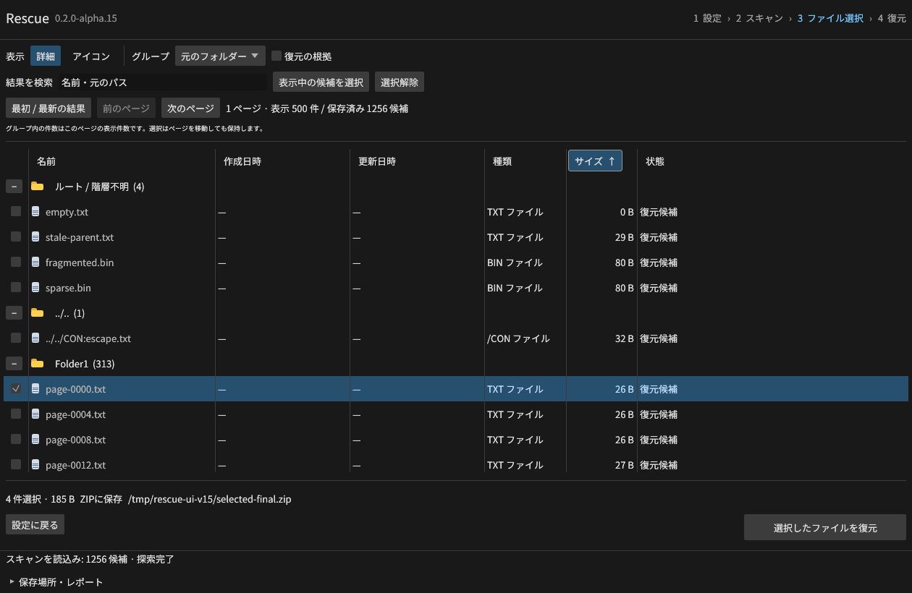
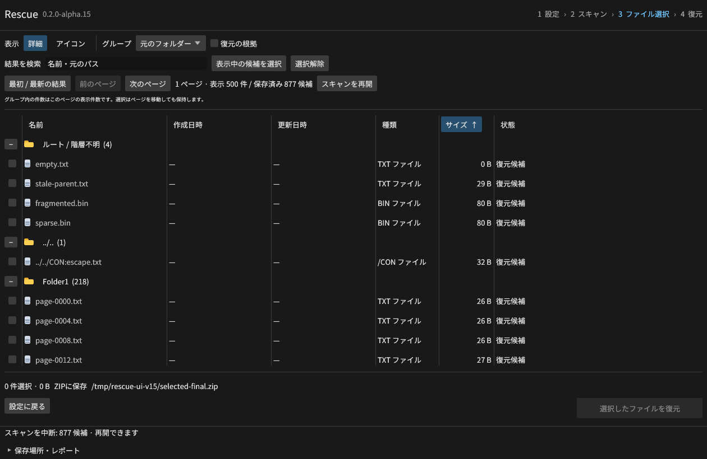
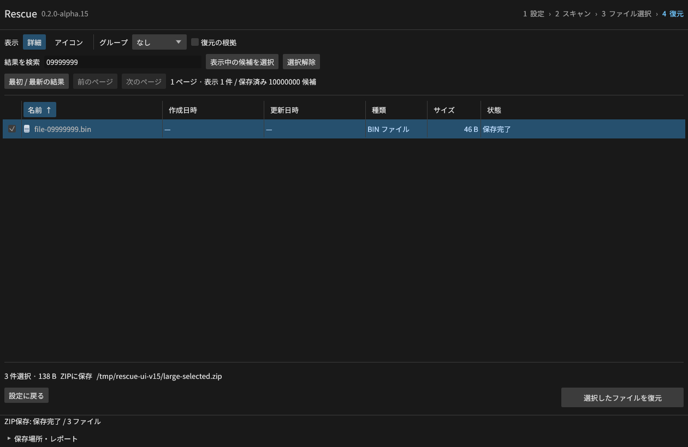
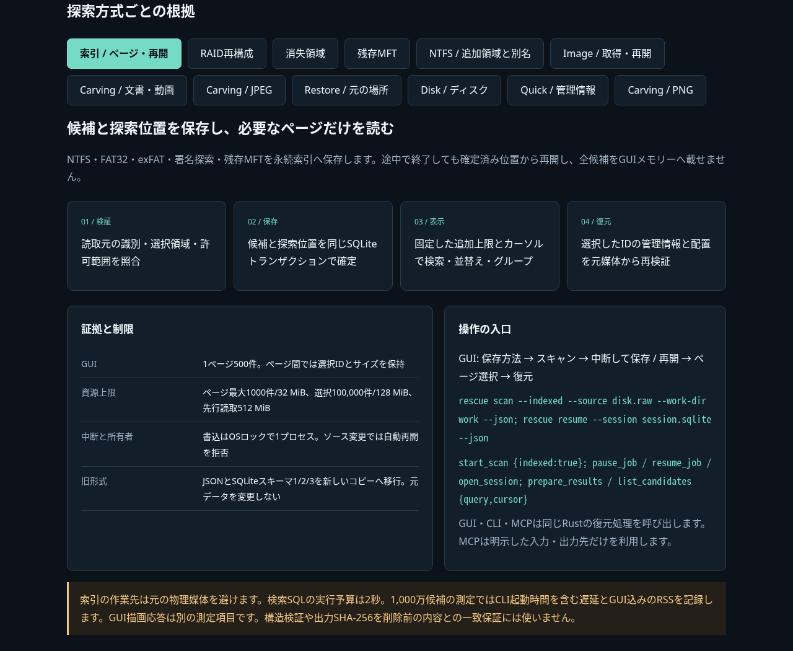

# Rescue v0.2.0-alpha.15

NTFS・FAT32・exFAT・署名探索・残存MFTをディスク上の索引へ保存し、GUIから中断・再開できるようにしました。
候補を500件ずつ表示し、ページ・検索・並替え・グループが変わっても選択IDを保持します。
v1.0へ向けた開発版で、隔離プレビュー・Windows権限分離等の必須工程を継続しています。

## 保存と再開

- 候補と探索位置を同じSQLiteトランザクションで確定。OSロックで書込み所有者を1プロセスに制限します。
- MFTのレコード・ストリーム、FATのフォルダー走査と未検証エントリー、署名のバイト位置・検証予算を保存します。
- 再開時にソースの識別と領域を照合。変更時は自動再開を拒否し、旧JSON/SQLiteは新しいコピーへ移行します。
- 検索・並替えはGUIとは別スレッドで実行。ページのカーソルは追加候補の上限を保持し、表示途中の入替わりを防ぎます。
- 復元前の再スキャンが旧10万候補/200万レコードで止まる問題を修正。選択した管理情報だけを保持して再検証します。
- 保存済みの名前・階層・サイズを信頼せず、元媒体から再取得します。先行読取512 MiBと同名ファイルの保持を継続します。

[索引・コピー移行・資源上限](https://github.com/Xenoah/rescue-deletedfiles_rust/blob/v0.2.0-alpha.15/docs/INDEX.md)

## 検証

Rust53項目と20統合群を通過。各FSで100,010候補より後、NTFSでは200万レコードより後のファイルを
CLI/MCPから復元して6出力をバイト照合しました。強制終了、複数プロセスの競合、コピー移行、予算保持、
ソース変更、MCPの再送・履歴・許可範囲も検証しています。
実GUIでは1,256候補の3ページから選んだ4件をZIPへ復元し、877件での中断から再開・選択保持を確認しました。
Ctrl+F・Tab・720×520を実画面で検証。Windows/macOSの手動スクリーンリーダー評価とは区別します。

1,000万候補を開いた実GUIから3ファイル/138バイトをZIPへ復元し、正解とCRCを照合しました。
消失領域の指紋と復元対象領域の不一致も修正し、GUIの6ファイルとCLI/MCPの76出力を再検証しました。

最終CLI測定は11条件×20回でID・順序が一致。p95は16.5〜263.6 ms、500万件目の降順は28.1 ms。
まれな部分一致の200 ms目標は未達です。GUI込みのRSSは走査時約169.4 MB、ページ取得時約159.4 MB。
1 TiBは合成疎ファイルの論理容量で、実媒体の全読取速度やGUI描画応答を測った値ではありません。
[測定の生値・バイナリーSHA-256・旧測定の失敗](https://github.com/Xenoah/rescue-deletedfiles_rust/blob/v0.2.0-alpha.15/docs/index-benchmark-results.json)。

タグのCIではWindows・Linux・macOS Intel/ARMの4ネイティブVMで検証してから8パッケージを公開します。
公開後はダウンロードした実行ファイルで索引6群を含む再検証を実行します。

## 技術説明UI

[画像を内蔵した単一HTML](https://github.com/Xenoah/rescue-deletedfiles_rust/releases/download/v0.2.0-alpha.15/intelligence.html)で、
30実画面と12方式を通信なしで切り替えられます。索引の保存・検索・再開・選択復元の仕組みを追加しています。
[Microsoft/W3Cの配置基準](https://github.com/Xenoah/rescue-deletedfiles_rust/blob/v0.2.0-alpha.15/docs/UI_GUIDELINES.md)を適用しています。

## ダウンロード

| OS / CPU | インストール版 | ポータブル版 |
| --- | --- | --- |
| Windows x64 | [setup.exe](https://github.com/Xenoah/rescue-deletedfiles_rust/releases/download/v0.2.0-alpha.15/rescue-0.2.0-alpha.15-windows-x64-setup.exe) | [portable.zip](https://github.com/Xenoah/rescue-deletedfiles_rust/releases/download/v0.2.0-alpha.15/rescue-0.2.0-alpha.15-windows-x64-portable.zip) |
| Linux x64 | [.deb](https://github.com/Xenoah/rescue-deletedfiles_rust/releases/download/v0.2.0-alpha.15/rescue-0.2.0-alpha.15-linux-x64.deb) | [portable.tar.gz](https://github.com/Xenoah/rescue-deletedfiles_rust/releases/download/v0.2.0-alpha.15/rescue-0.2.0-alpha.15-linux-x64-portable.tar.gz) |
| macOS Apple Silicon | [.pkg](https://github.com/Xenoah/rescue-deletedfiles_rust/releases/download/v0.2.0-alpha.15/rescue-0.2.0-alpha.15-macos-arm64.pkg) | [portable.zip](https://github.com/Xenoah/rescue-deletedfiles_rust/releases/download/v0.2.0-alpha.15/rescue-0.2.0-alpha.15-macos-arm64-portable.zip) |
| macOS Intel | [.pkg](https://github.com/Xenoah/rescue-deletedfiles_rust/releases/download/v0.2.0-alpha.15/rescue-0.2.0-alpha.15-macos-x64.pkg) | [portable.zip](https://github.com/Xenoah/rescue-deletedfiles_rust/releases/download/v0.2.0-alpha.15/rescue-0.2.0-alpha.15-macos-x64-portable.zip) |

`SHA256SUMS.txt`で照合できます。Linuxはglibc 2.35以降、macOSは13以降。
macOSはアドホック署名です。Developer ID署名・公証はありません。

索引とイメージ取得の作業先は元の物理ディスクから分離します。選択ファイルの同一場所保存は、全選択データを先に読み出します。
未選択の削除データには影響する可能性があります。TRIMや上書きで失われた元バイトは生成しません。有料製品比較は未測定です。
