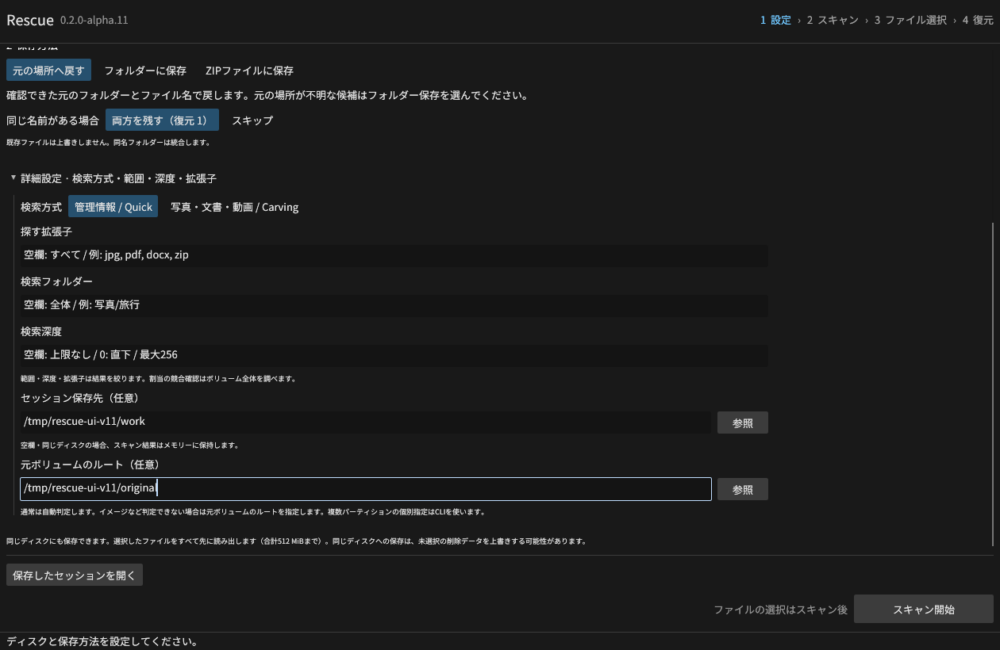
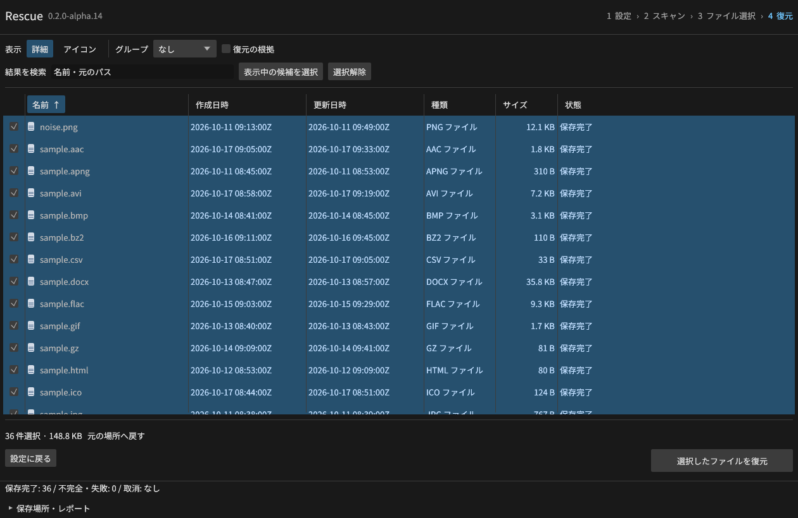
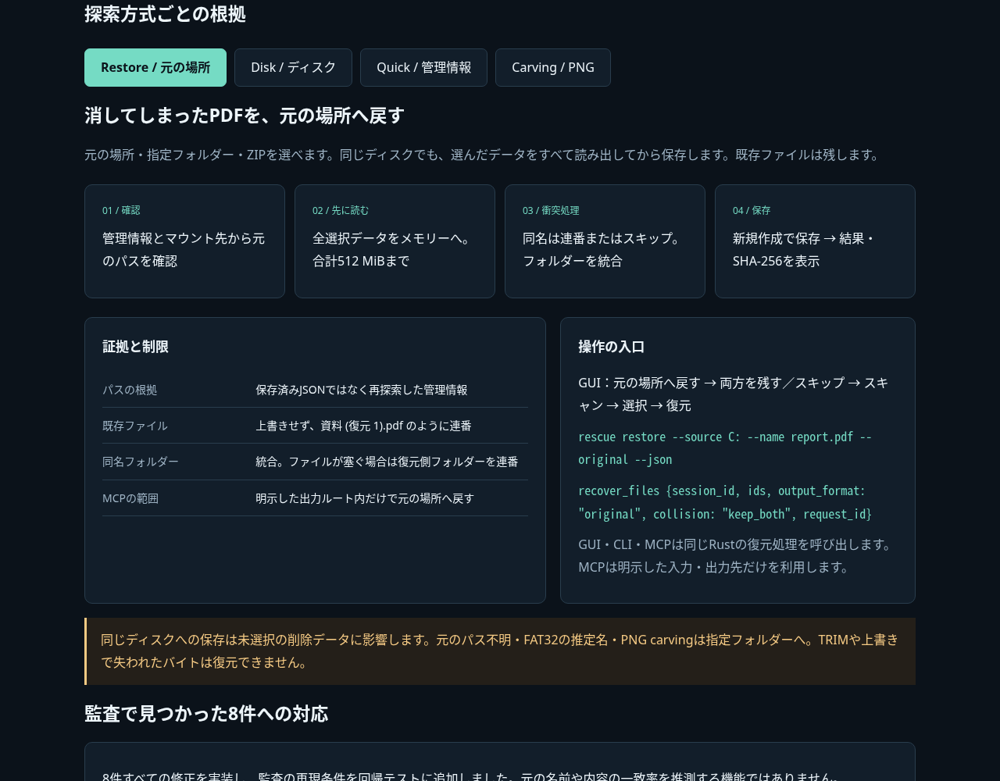

# Rescue v0.2.0-alpha.8

**「PDFを消してしまった → 元の場所へ戻す」に対応しました。** 同じディスクにも保存できます。GUI・CLI・MCPは共通の復元と衝突処理を使います。

## 変更

- 保存方式に「元の場所へ戻す」を追加。確認した元の階層・名前とマウント先を使います。指定フォルダーとZIP保存も利用できます。
- 既存ファイルは上書きせず、復元側を `資料 (復元 1).pdf` のように保存。同名フォルダーは統合します。スキップも選べます。
- ファイルがフォルダー名を塞いでいる場合は復元側フォルダーを連番にし、配下のファイルをまとめます。大文字・小文字だけが違う名前も衝突として扱います。
- 選択ファイルをすべて先に読み出してから保存。同じ媒体ではスキャン用の作業フォルダーやセッションを作りません。合計512 MiBまで。超過は出力作成前に停止します。
- CLIにセッション保存不要の `restore --source C: --name report.pdf --original --json` を追加。大きいジョブには別媒体への `recover --stream` も残しています。
- MCPの `recover_files` に `output_format: "original"`、`collision: "keep_both" / "skip"`、`volume_roots` を追加。明示した出力ルートの制限を維持します。

## 技術説明と検証

保存済みJSONのパス・サイズ・配置を信頼せず、ディスクの管理情報を再探索して選択データを読み出します。全読出しと入力の再検証が終わってから、排他的な新規作成で保存します。通常の保存にハードリンクは不要です。MCPは固定したディレクトリーハンドルでルート差替えや範囲外のリンクを拒否します。

- CLI／MCPの追加61項目でPDF、36ファイルの階層保存、衝突・スキップ、改変セッション、上限、ZIP CRCを確認。
- Linuxの実GUIで元の場所へ36ファイルを復元し、正解バイト・SHA-256が一致。既存PDFは無変更、復元PDFは連番。GUIのZIP保存でも36ファイル・36日時を照合。
- 4つのネイティブCIで、作成した仮想媒体に実際にPDFを保存・削除し、CLI／MCPで同じボリュームの元の場所へ復元する試験を必須化。WindowsはNTFS、Linux／macOSはexFAT。
- 従来のRustテスト、7つのCLI／MCP統合群、35形式・36ファイル、MBR／GPT、各OS864件のディスク試験、インストール／ポータブルの検証とGUI起動確認も継続。

実行結果は添付の `restore-native-*.json`、`restore-results-*.json`、`disk-results-*.json`、`verification-*.json`、`gui-flow-results.json` を参照してください。公開した配布物そのものの追加検証は完了後に別途追記します。

[通信不要の操作できる技術説明UI](https://github.com/Xenoah/rescue-deletedfiles_rust/releases/download/v0.2.0-alpha.8/intelligence.html)で、実画面と探索・元の場所への保存の根拠を切り替えられます。

## ダウンロード

| OS / CPU | インストール版 | ポータブル版 |
| --- | --- | --- |
| Windows x64 | `windows-x64-setup.exe` | `windows-x64-portable.zip` |
| Linux x64 | `linux-x64.deb` | `linux-x64-portable.tar.gz` |
| macOS Apple Silicon | `macos-arm64.pkg` | `macos-arm64-portable.zip` |
| macOS Intel | `macos-x64.pkg` | `macos-x64-portable.zip` |

添付ファイル名の先頭は `rescue-0.2.0-alpha.8-`。`SHA256SUMS.txt`で照合できます。Linuxはglibc 2.35以降。macOSは13以降、アドホック署名でDeveloper ID署名・公証はありません。

同じディスクへの保存は未選択の削除データに影響する可能性があります。元のパスが不明な候補、FAT32の推定した削除名、PNG carvingは指定フォルダーへ保存してください。実SSDのTRIM、上書き、物理故障で失われたバイトは復元できません。PNG以外のcarving、読取マップ・イメージ取得、RAID再構成、有料製品との比較は未完了です。

[仕様](https://github.com/Xenoah/rescue-deletedfiles_rust/blob/v0.2.0-alpha.8/docs/SAME-LOCATION.md) · [対応範囲](https://github.com/Xenoah/rescue-deletedfiles_rust/blob/v0.2.0-alpha.8/docs/ALPHA.md) · [検証](https://github.com/Xenoah/rescue-deletedfiles_rust/blob/v0.2.0-alpha.8/docs/VALIDATION.md)
