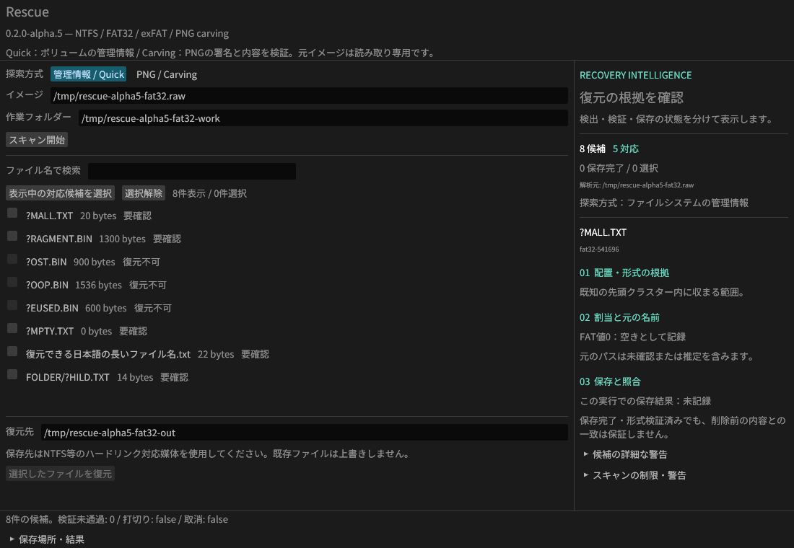

# Rescue v0.2.0-alpha.5

実装監査で見つかった8件をすべて修正しました。誤復元・MCPの出力先制約・PNG検証・セッション・GUIの修正版です。

実際のLinux / Xvfb GUIで、入力変更による候補の無効化と、PNG 3ファイルの保存・正解バイト一致を確認しました。
Windows GUIの手動操作を示す画面ではありません。

## 8件の修正

| 対象 | 修正した動作 |
| --- | --- |
| FAT32/exFATの誤復元 | 後から判明した使用中領域との競合を、由来ディレクトリーと子孫の候補へ反映 |
| MCPの出力先 | 許可ルート・出力フォルダーをハンドルで保持。保存先の実体が変わった場合は停止 |
| 壊れた使用中FATチェーン | 先頭・解析済みのクラスターを、解析失敗後も保護 |
| PNGの完全性 | zlib終端・Adler-32・入力消費量・展開長、パレットとインデックスを検証 |
| 大きなセッション | 保存・読込の上限を128MiBで統一。上限時は候補の省略とtruncatedを明示 |
| exFATの割当警告 | 使用中エントリーの解析失敗・未対応critical entry等をunknown判定と警告へ反映 |
| GUIの復元元 | 入力・方式変更時に古い候補を無効化。セッション読込時は入力表示を同期 |
| GUIの根拠表示 | FAT値、exFAT bitmap、空ファイルの割当なしを区別 |

FAT32の空き判定を「FAT値0」と表示します。出力SHA-256や形式検証成功は、削除前の内容との一致率ではありません。
詳しい修正と検証条件はZIP内のdocs/AUDIT-FIXES.mdに収録しています。

## 技術説明のインテリジェンスUI

添付の **intelligence.html** を保存しブラウザーで開くと、Quick / Carvingの手順・根拠・制限と監査への対応を確認できます。
通信不要の単体HTMLです。ZIPにはHTML、実画面、技術説明・修正記録を同梱しています。
GitHub本文にはスクリーンショットを掲載し、操作可能なUIは添付HTMLで配布します。

## 検証

監査の再現条件をWindows/Linux CIに追加しました。

- 監査回帰16ケース：両FSの探索順・子孫、壊れた使用中チェーン、exFATの解析失敗、MCPの保存先差替え、深い階層の7,000ファイル。
- PNG統合30ケース・23ファイルの正解バイト一致：zlib末尾欠落・余剰データ・パレット不整合の7ケースを追加。
- Rust 19テスト：GUIの読込・入力変更・割当根拠の3テストを追加。
- 既存NTFS・圧縮/ADS・FAT32/exFAT・独立ツール由来メタデータの復元も継続検証。
- Windowsはdebug/release両方で5つの統合テスト群を実行し、成功後にこのリリースを公開します。

Windows x64用ZIPにはGUI・CLI・MCP、MITライセンス、依存通知を含みます。Microsoft Visual C++ v14 x64ランタイムが必要です。
ZIP・単体HTML・3枚の画像のSHA-256は添付のSHA256SUMS.txtで確認できます。

PNGは連続配置の静止画像が対象です。元の名前・階層・割当・削除状態は不明で、使用中ファイルや埋込画像も検出します。
APNG・断片再構成・PNG以外のcarving、実デバイス、RAID、EFS、TexFAT、属性リストの追加extentsは未対応です。
入力は読み取り専用の通常ファイル、復元先はNTFS等のハードリンク対応媒体を使用します。
有料ソフトとの性能比較・実媒体での復元率は引き続き未検証です。
