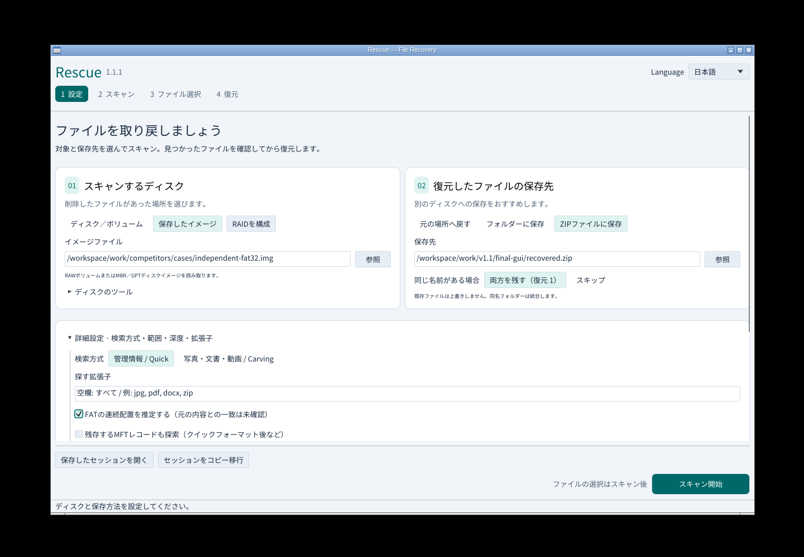
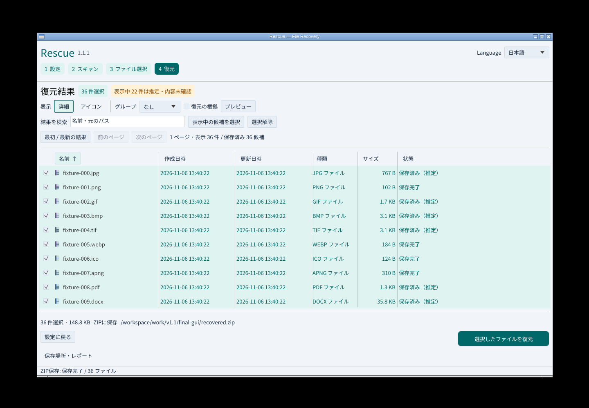
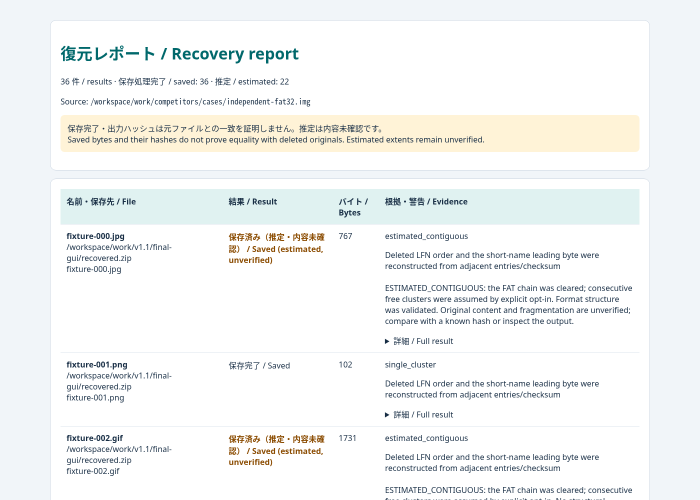

# Rescue v1.1.1

設定から復元までの画面を整理し、USB・SD向けのFAT復元と、読める復元レポートを追加しました。`v1.1.0-alpha.1`、`alpha.2`を経た安定版です。

`v1.1.0`は公開前のIssue確認で処理を停止しました。push済みタグは変更せず、修正版を`v1.1.1`として公開します。

## 追加修正（Issue #1–#3）

- 長い名前のバイナリ書き出しを、接尾辞込み255バイト以内に収めます。1件の失敗後も前後の結果を返し、書けたファイルと部分的な出力を記録します。元の名前全体もJSONに残します。
- 索引スキャンのFATミラー選択理由をチェックポイントへ保存し、強制終了・再開後も警告を保持します。
- 通常の「:」入り名とADSを区別し、GUI・アイコン・新規索引で同じ種類判定を使います。古い索引の種類キーは新規スキャンで再生成してください。

[再現・回帰試験](https://github.com/Xenoah/rescue-deletedfiles_rust/blob/v1.1.1/docs/release-fixes-v1.1.json)では9項目・9出力のバイト一致を確認しています。

## 変更

- 読み取る場所と保存先をカードで分離。現在のステップ・主操作・選択件数を強調し、狭い画面は縦配置に。形式ごとの色と拡張子をアイコンに表示します。
- FAT12/16の固定ルート、長い日本語名、サブディレクトリー、残存する断片化チェーンに対応。
- チェーンが消えたFAT12/16/32は、明示的に有効化した場合だけ連続配置を推定。割当競合や不正な構造を拒否し、保存後も推定・内容未確認と表示します。
- GUIからHTML/CSVレポートを保存。CLIは `export-report` で既存の復元JSONを変換できます。警告・欠損・名前・出力ハッシュを保持し、既存ファイルは上書きしません。
- 添付をインストーラー/ポータブル8点と共通 `SHA256SUMS.txt` の9点に整理。画像や検証JSONの添付、過去資料のパッケージ一括同梱を終了しました。

## ダウンロード

Windows x64はsetup.exe、Linux x64はDEB、macOSはCPUに合うPKGを選んでください。インストール不要なら対応するportableを1つ選びます。GitHubの自動生成ソースコードは添付9点とは別枠です。

[インストール手順](https://github.com/Xenoah/rescue-deletedfiles_rust/blob/v1.1.1/docs/INSTALL.md) · [使い方と制限](https://github.com/Xenoah/rescue-deletedfiles_rust/blob/v1.1.1/README.md)

## 実画面

## 検証

Rust 74テスト、31統合群、Clippy。Windows・Linux・macOS Intel/ARMの全ネイティブ検証を公開条件とします。Windowsは通常権限でUIA・実キー・Microsoft日本語IMEを検証。公開後には実際の配布物を再取得して再検証し、結果リンクを追記します。

最終GUIで新規スキャン・検索・選択保持・ZIP復元・HTML/CSV保存・日英切替・720×520表示を実施。36件・152,325バイトが元SHA-256と一致し、推定22件の表示と全入力の不変を確認しました。同じ固定FAT32比較イメージは標準14/36件、推定有効36/36件でした。

FAT12/16は20項目・60ファイル、独立したmkfs/mtoolsの実削除は8ファイル一致。推定の20項目では10件一致に加え、意図的な未知形式の断片化1件が誤った推定として未確認表示を保つことも検証しました。HTML/CSVは14項目で全情報保持、HTML埋め込み文字・CSV数式の対処、無効入力と上書き拒否を検証しました。

[受入台帳](https://github.com/Xenoah/rescue-deletedfiles_rust/blob/v1.1.1/docs/V1_1_ACCEPTANCE.md) · [実操作と画面ハッシュ](https://github.com/Xenoah/rescue-deletedfiles_rust/blob/v1.1.1/docs/gui-v1.1-results.json) · [FATの範囲・実測](https://github.com/Xenoah/rescue-deletedfiles_rust/blob/v1.1.1/docs/FAT-v1.1.md)

## 制限

推定は初期状態で無効、1ファイル64 MiBまでです。構造の正しさ・保存完了・出力ハッシュは元内容との一致を証明しません。固定イメージの値を一般的な復元率とは扱いません。APFS/ext4/ReFS直接解析、実媒体の広範な性能・復元率は対象外です。

Windowsは発行元署名なし、macOSはアドホック署名・Apple公証なしです。
