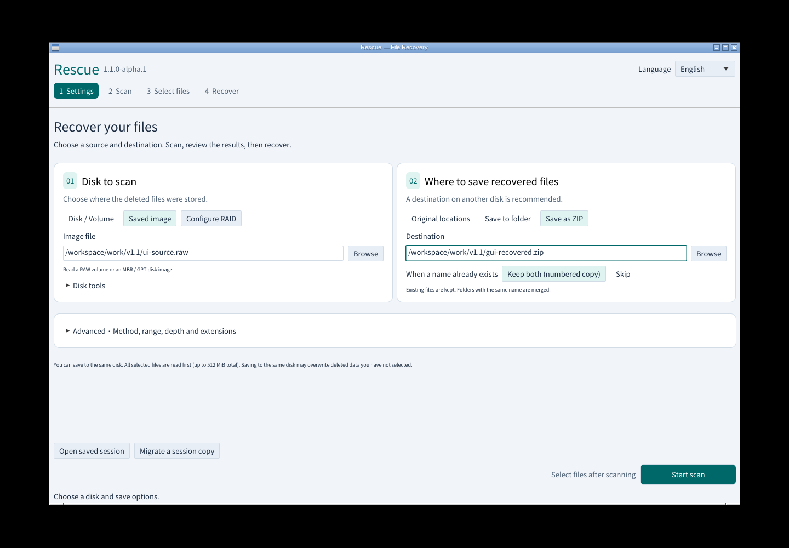
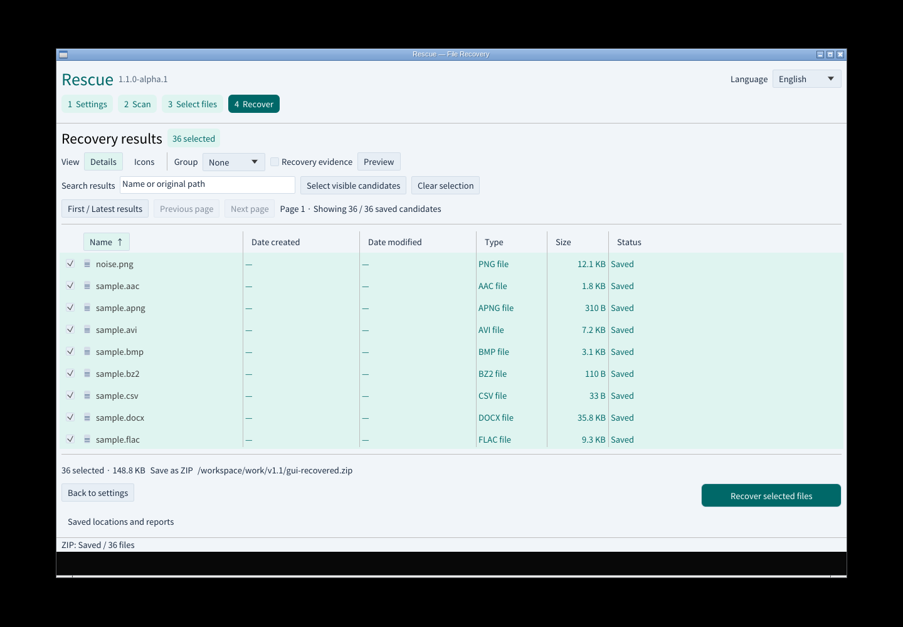

# Rescue v1.1.0-alpha.1

v1.1へ向けた最初の先行版です。設定画面とダウンロード一覧を整理しました。

## 変更

- 読み取る場所と復元後の保存先をカードで分離。広い画面では2列、狭い画面では縦に並びます。
- 明るい配色、現在のステップ、目立つ主操作、選択件数・一部の結果の表示を追加。
- ディスク取得・読取マップ・消失領域探索を「ディスクのツール」に集約。
- 添付はWindows／Linux／macOS Intel・Apple Siliconのインストーラーとポータブル版8点、共通のSHA256SUMS.txtの計9点です。GitHubが自動表示するソースコードは別枠です。
- パッケージ内もインストール・利用案内とライセンス中心にし、過去のスクリーンショットや試験資料の一括同梱を終了しました。

## 実画面

[現行GUIの実操作記録](https://github.com/Xenoah/rescue-deletedfiles_rust/blob/v1.1.0-alpha.1/docs/gui-v1.1-results.json)と[UIの変更・検証](https://github.com/Xenoah/rescue-deletedfiles_rust/blob/v1.1.0-alpha.1/docs/UI-v1.1.md)を参照してください。各OSの詳細な検証資料はリリースを生成したActions実行のnative-*アーティファクトに保存します。公開後の再検証もActionsへ保存し、結果へのリンクをこのページに追記します。

## 対応範囲

この先行版の復元エンジンの対応範囲はv1.0と同じです。チェーン情報が消えたFAT32の複数クラスタはまだ推定しません。比較試験の14/36件という制限は残っています。FAT12/16と推定復元、HTML/CSVレポートは次の段階で追加します。APFS/ext4の直接解析は未対応です。

Windowsは発行元署名なし、macOSはアドホック署名でApple公証なしです。プレビュー版は別途バックアップしたイメージで確認してください。
