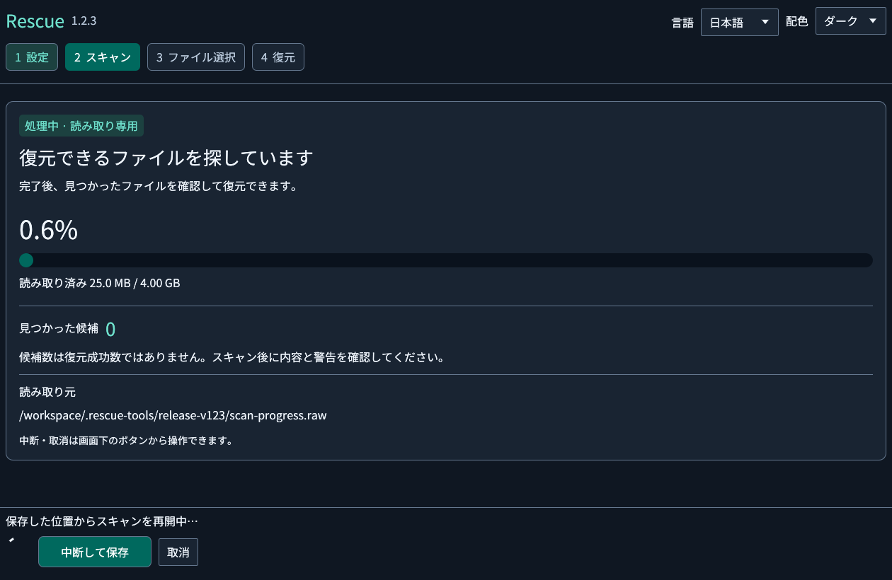
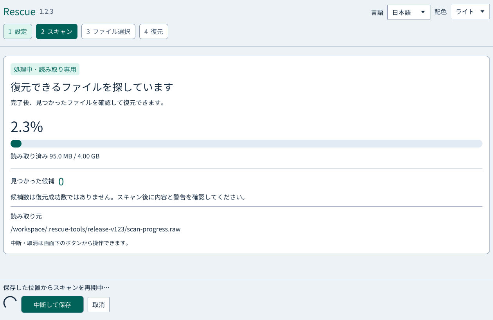
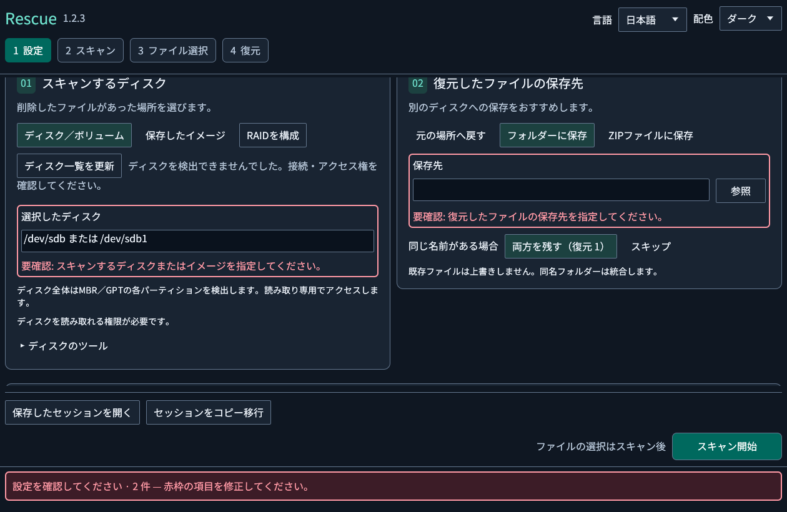
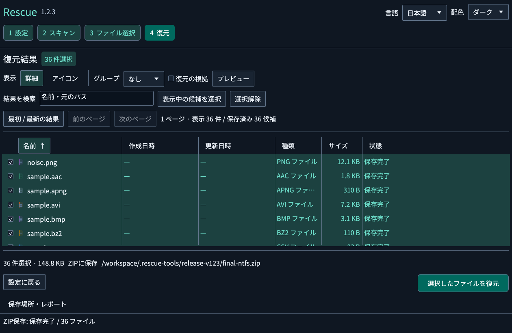

# Rescue v1.2.3

文字・操作ボタン・進捗表示を見やすくし、ダークモードと入力欄ごとのエラー表示を追加しました。GUI・CLI・MCPをWindows x64、Linux x64、macOS Intel / Apple Silicon向けに提供します。

## 変更内容

- 本文16px・補足14pxを基本に、文字のコントラストと入力欄の境界を強化。主操作ボタンを高さ44pxにしました。
- 画面右上の「配色」からライト・ダーク・システム連動を選択できます。処理中も切り替え可能で、次回起動時も選択を保持します。
- スキャン中は進捗率、読み取り量または解析レコード数、候補数、入力元を中央のカードに表示します。中断・保存と取消は画面下部に表示します。
- 必須項目の未入力、不正な数値・範囲・拡張子、入力や保存先のパス不備を、該当欄の赤枠と具体的な説明で示します。開始時には最初のエラー欄までスクロールし、詳細設定のエラーも展開します。
- レポート欄を展開した場合も、保存ボタンが候補一覧の下に隠れないようにしました。小さいウィンドウでも結果とレポートを操作できます。

セッション・索引・読取マップの形式は変更していません。復元エンジンの対応形式と制限も従来どおりです。

## v1.2.3の実画面

Linux上の実GUIを操作して新規撮影しました。スキャン中の2枚は、同じv1.2.3バイナリで進捗が25 MiBから95 MiBへ増える間に配色を切り替えて撮影し直しました。画像の訂正記録は `docs/verification/v1.2.3-screenshot-correction.json` に保持しています。

### ダークモードのスキャン

### ライトモードのスキャン

### 設定不備の赤枠と説明

### 復元結果

## 検証

ローカルではRust 93テスト、Clippy（警告をエラー扱い）、fmt、配布契約6テストを確認しています。GUIの回帰試験には日英表示、キーボード操作、720×520からのリサイズ、配色の文字コントラスト、入力不備の修正、エラー欄へのスクロール、配色の保存・読込を含みます。

同じv1.2.3 GUIで、合成NTFSの36ファイル、CP932短名の8ファイル、破損exFATの8ファイルをZIPへ復元し、元バイト列と照合しました。HTML/CSVの36件は元の復元結果と一致し、HTMLのChromium表示では外部リクエスト0件を確認しました。既知ハッシュ照合は一致2件・一覧にない6件・照合不能0件で、元の復元記録を保持したJSONの保存も確認しています。

所有する読取ヘルパーを停止して1秒の読み取り期限を超えさせ、失敗4 MiB・未読60 MiBを保持しました。GUIからの再開で64 MiB全体が元ソースのSHA-256と一致しました。

配布は4環境の既存ネイティブCI・統合テスト・パッケージ検証が成功してから行い、公開後はダウンロードした実物も再検証します。[GUIの検証記録](https://github.com/Xenoah/rescue-deletedfiles_rust/blob/v1.2.3/docs/gui-v1.2-results.json) · [配色と入力チェックの使い方](https://github.com/Xenoah/rescue-deletedfiles_rust/blob/v1.2.3/docs/UI-APPEARANCE.md)

## ダウンロードと動作条件

OS/CPUに対応するインストーラーまたはポータブルを1つ選んでください。添付は8配布物と共通SHA256SUMS.txtの9点です。スクリーンショットは上記の本文とリポジトリに掲載しています。

Windowsは発行元署名なし、macOSはアドホック署名・公証なし。Linuxはglibc 2.35以降、macOSは13以降です。[インストール手順](https://github.com/Xenoah/rescue-deletedfiles_rust/blob/v1.2.3/docs/INSTALL.md)

実画面の試験は所有する合成イメージを使用しています。実SSD/HDDの一般的な復元率、APFS/ext4/ReFSの直接解析を示すものではありません。
