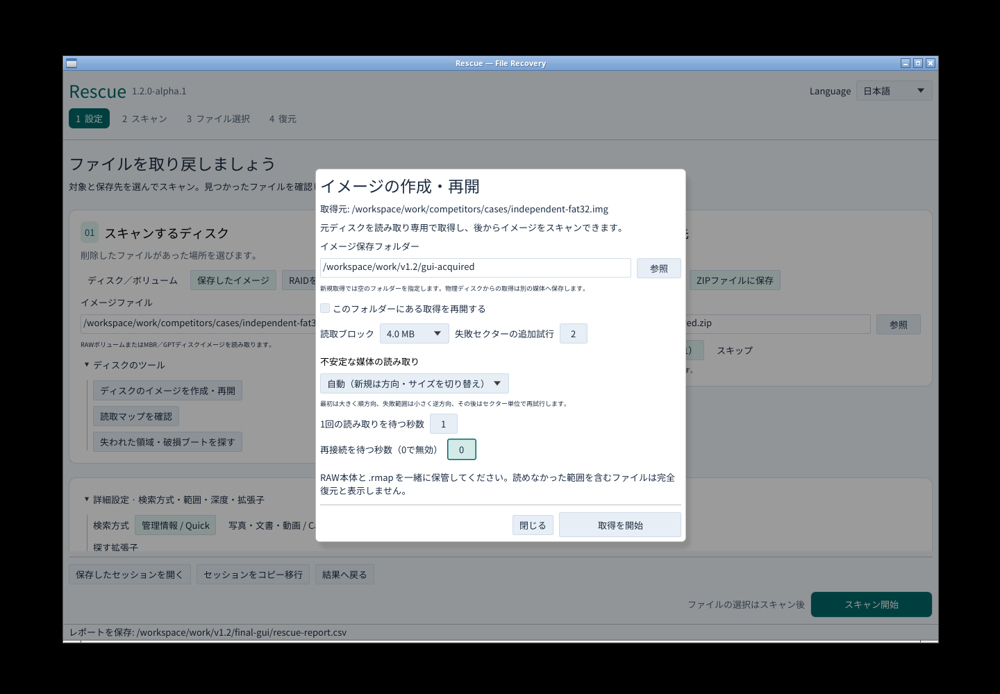
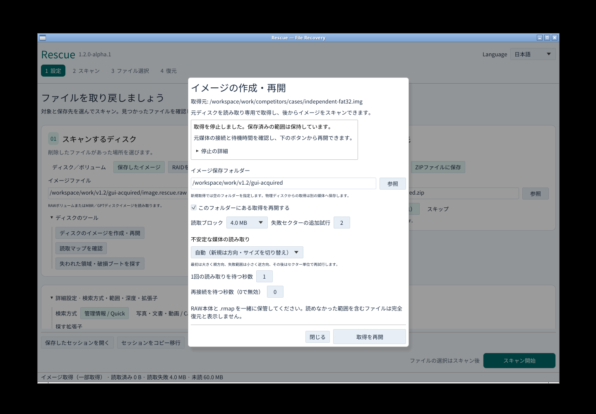

# Rescue v1.2.0-alpha.1

破損USB・SDの取得を強化する先行版です。初回の順方向読み取りに続き、失敗範囲を逆方向・小ブロック、その後セクター単位で再試行します。保存済み範囲は読み直しません。

- 読取専用の子プロセスで待機時間を制限。取消・期限超過後のデータは保存しません。
- タイムアウトや切断後は元のソースID・容量・セクターサイズ・更新時刻を確認して再接続。別の媒体は拒否します。
- 旧読取マップを従来の順序で再開。新しい方式はマップへ保存し、再開時に変わらないようにします。
- GUIに取得方法、読取待機、再接続待機を追加。進行中は方向・読取単位・再接続待ちを表示し、停止理由と再開方法を残します。
- CLI/MCPは今回のパスごとの取得量・失敗量・タイムアウト・再接続回数を出力します。

[取得の使い方](https://github.com/Xenoah/rescue-deletedfiles_rust/blob/v1.2.0-alpha.1/docs/IMAGING.md) · [実装範囲と受入台帳](https://github.com/Xenoah/rescue-deletedfiles_rust/blob/v1.2.0-alpha.1/docs/V1_2_ACCEPTANCE.md)

## ダウンロード

インストーラーまたはポータブルをOS/CPUに合わせて1つ選んでください。添付はWindows x64・Linux x64・macOS Intel/ARMの8配布物と共通SHA256SUMSの9点です。画面やテストJSONはリポジトリとActionsへ保存します。

## 実画面

## 検証と制限

実CLI/MCPの読取プロセスを意図的に停止し、期限超過、取消、同じファイルへの再接続、差し替え拒否、旧マップ互換、再開後のバイト一致を検証します。物理媒体の故障率や復旧率を測定した結果ではありません。

全4ネイティブ環境の回帰・配布物検証と、Windowsの通常権限GUI/UIA/キーボード/日本語IMEが公開条件です。公開後は実際のダウンロード物も全4環境で再検証します。

待機上限はアプリが子プロセスを待つ時間です。OS内部のI/Oや初回デバイス検出を即時終了できる保証はありません。子プロセスが終了しない場合、無制限に増やさず停止します。RAWと.rmapは一緒に保管してください。

CP932短名、exFAT破損耐性、既知ハッシュ照合は次の段階です。安定版は引き続きv1.1.2です。
