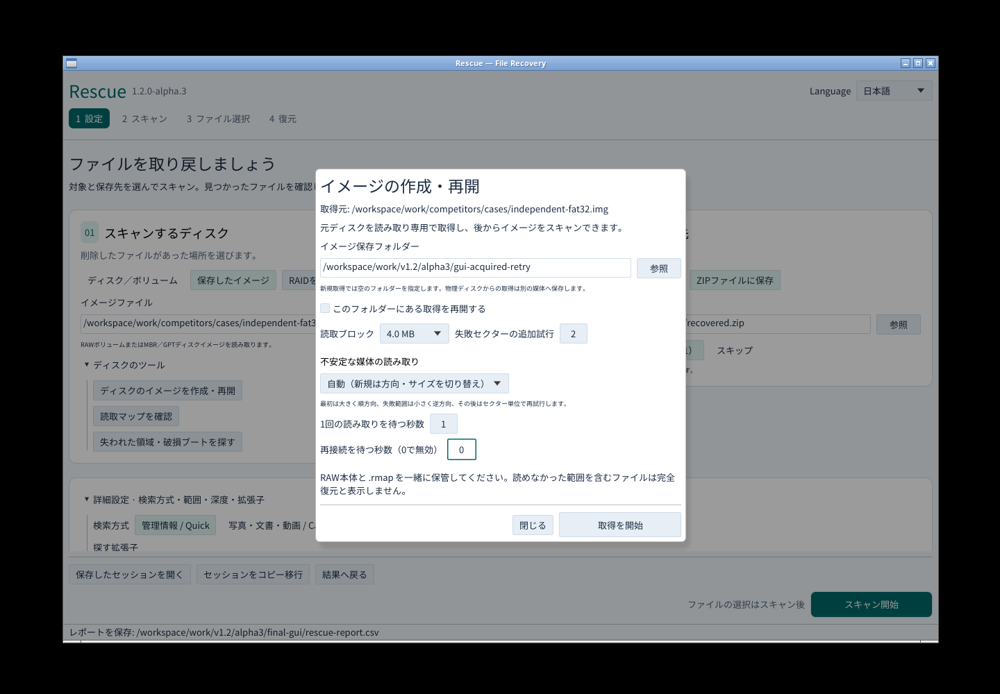
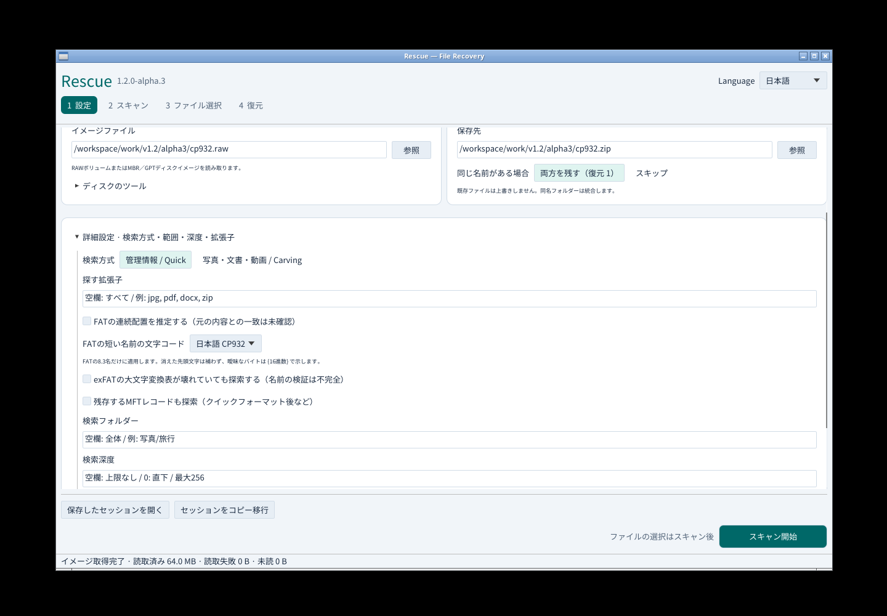
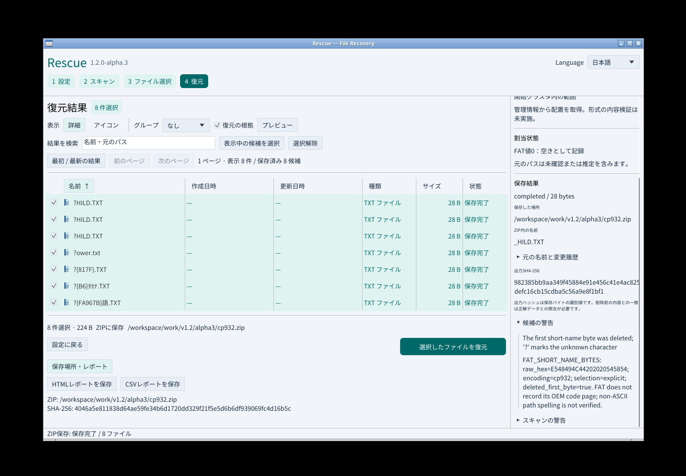
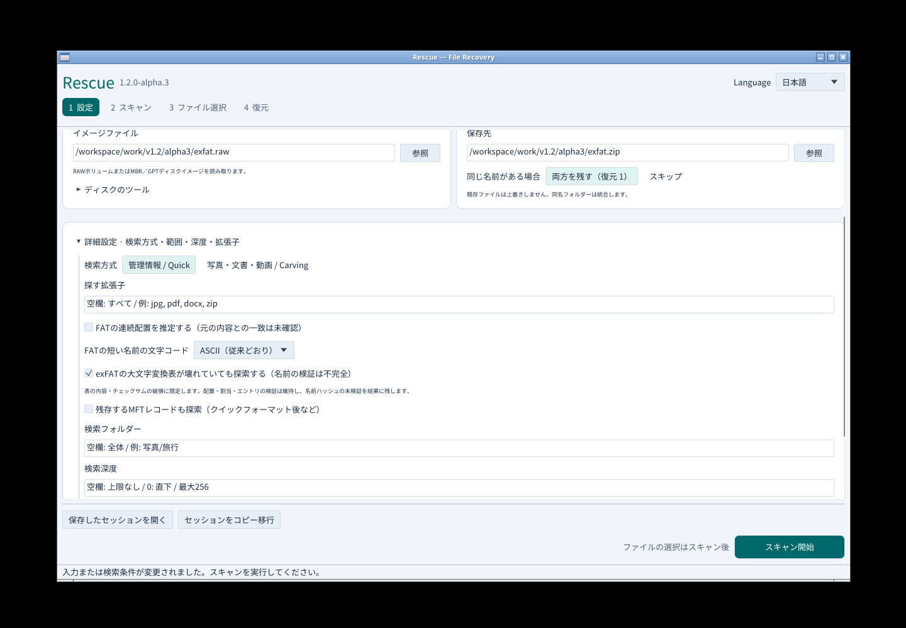
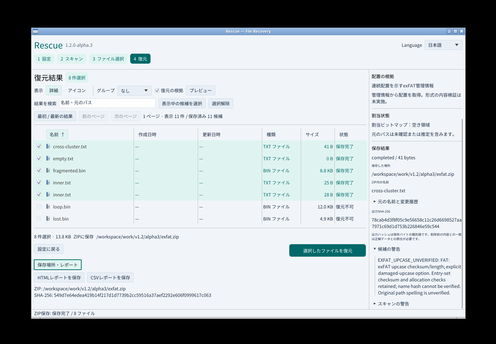

# Rescue v1.2.0-alpha.3

破損USB・SDの取得、FATの日本語短名、exFAT大文字変換表の限定的な破損継続を扱う先行版です。CP932を選んで8.3名を解釈し、元バイト・失われた先頭バイト・曖昧な文字境界を記録します。

前段階に続き、初回の順方向読み取りに続き、失敗範囲を逆方向・小ブロック、その後セクター単位で再試行します。保存済み範囲は読み直しません。

- 読取専用の子プロセスで待機時間を制限。取消・期限超過後のデータは保存しません。
- タイムアウトや切断後は元のソースID・容量・セクターサイズ・更新時刻を確認して再接続。別の媒体は拒否します。
- 旧読取マップを従来の順序で再開。新しい方式はマップへ保存し、再開時に変わらないようにします。
- GUIに取得方法、読取待機、再接続待機を追加。進行中は方向・読取単位・再接続待ちを表示し、停止理由と再開方法を残します。
- CLI/MCPは今回のパスごとの取得量・失敗量・タイムアウト・再接続回数を出力します。

[取得の使い方](https://github.com/Xenoah/rescue-deletedfiles_rust/blob/v1.2.0-alpha.3/docs/IMAGING.md) · [実装範囲と受入台帳](https://github.com/Xenoah/rescue-deletedfiles_rust/blob/v1.2.0-alpha.3/docs/V1_2_ACCEPTANCE.md)

## ダウンロード

インストーラーまたはポータブルをOS/CPUに合わせて1つ選んでください。添付はWindows x64・Linux x64・macOS Intel/ARMの8配布物と共通SHA256SUMSの9点です。画面やテストJSONはリポジトリとActionsへ保存します。

## 実画面

## 検証と制限

実CLI/MCPの読取プロセスを意図的に停止し、期限超過、取消、同じファイルへの再接続、差し替え拒否、旧マップ互換、再開後のバイト一致を検証します。物理媒体の故障率や復旧率を測定した結果ではありません。

全4ネイティブ環境の回帰・配布物検証と、Windowsの通常権限GUI/UIA/キーボード/日本語IMEが公開条件です。公開後は実際のダウンロード物も全4環境で再検証します。

待機上限はアプリが子プロセスを待つ時間です。OS内部のI/Oや初回デバイス検出を即時終了できる保証はありません。子プロセスが終了しない場合、無制限に増やさず停止します。RAWと.rmapは一緒に保管してください。

既知ハッシュ照合は次の段階です。安定版は引き続きv1.1.2です。

## CP932短名

- GUI詳細設定、CLI `--fat-short-name-encoding cp932`、MCPで明示的に選択。既定のASCIIとUTF-16のLFNは維持します。
- 日本語・半角カナ・NEC/IBM拡張、05→E5規則に対応。削除で失われた文字は補いません。
- 元11バイトと解釈根拠を候補・索引・復元レポートへ保持。不明な文字境界は`?{16進数}`で示します。
- CP932セッションはスキーマ10。旧版による無言の再解釈を防ぎ、再開時も同じ設定を使います。

[使い方と不確実性](https://github.com/Xenoah/rescue-deletedfiles_rust/blob/v1.2.0-alpha.3/docs/CP932.md)

## exFATの壊れた大文字変換表

GUI・CLI・MCPから明示的に許可した場合だけ、読めた変換表のチェックサム・展開内容が壊れていても探索します。表の配置・割当・エントリ集合のチェックサム・UTF-16名・ライブファイルとの競合確認は維持し、名前ハッシュが検証できないことを候補と各レポートへ残します。正常な表では名前ハッシュを従来どおり確認します。

31条件で72出力の全バイト一致を検証しました。表の欠落・重複・不正な長さ/チェーン・割当情報の欠損は継続対象ではありません。新しいセッションはスキーマ11で、旧版CLIによる拒否と同じ設定での中断再開も確認しています。

[使い方と適用範囲](https://github.com/Xenoah/rescue-deletedfiles_rust/blob/v1.2.0-alpha.3/docs/EXFAT-DAMAGE.md)

