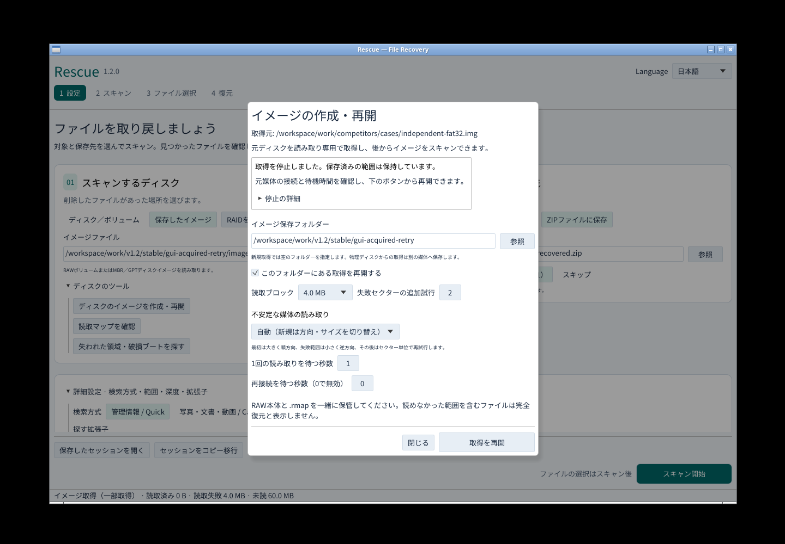
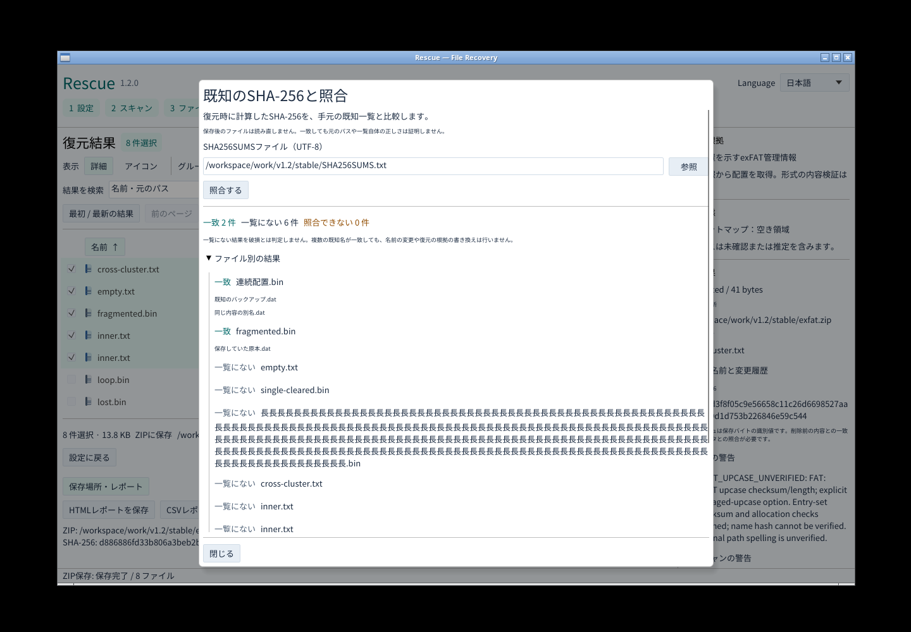

# Rescue v1.2.0

取得を中断しても読み取れた範囲を残して再開し、名前や内容の検証が欠ける部分を明示する安定版です。Windows・Linux・macOS Intel/Apple SiliconのGUI・CLI・MCPを提供します。

## 変更内容

- **段階的なイメージ取得**：順方向の大ブロック、失敗範囲の逆方向・小ブロック、セクター単位で再試行。取得済み範囲は読み直しません。
- **待機上限と再接続**：専用の読取プロセスで待機を制限し、遅い結果を保存しません。元ソースの識別・容量等が一致した場合に再接続し、停止理由と再開方法をGUIへ表示します。
- **FATのCP932短名**：明示的な文字コード選択で日本語・半角カナ・NEC/IBM拡張に対応。元11バイト、消えた先頭文字、曖昧な文字境界を記録します。
- **exFATの限定的な破損継続**：読めた大文字変換表の内容・チェックサムが壊れている場合に、明示的な設定で探索を継続。配置・割当・エントリ集合の検証を維持し、名前ハッシュの未検証を残します。
- **既知ハッシュ照合**：保存時のSHA-256を手元の一覧と照合し、一致・一覧にない・照合できない結果を分離。別のJSONに元の復元記録と警告も保存します。
- **インストーラーの版番号**：Windows・macOSで先行版から安定版へ内部番号が逆戻りしないよう修正。アプリの表示バージョンは1.2.0です。

[取得](https://github.com/Xenoah/rescue-deletedfiles_rust/blob/v1.2.0/docs/IMAGING.md) · [CP932](https://github.com/Xenoah/rescue-deletedfiles_rust/blob/v1.2.0/docs/CP932.md) · [exFAT破損表](https://github.com/Xenoah/rescue-deletedfiles_rust/blob/v1.2.0/docs/EXFAT-DAMAGE.md) · [既知ハッシュ](https://github.com/Xenoah/rescue-deletedfiles_rust/blob/v1.2.0/docs/KNOWN-HASHES.md)

## ダウンロード

OS/CPUに合わせてインストーラーかポータブルを1つ選んでください。添付は8パッケージと共通SHA256SUMSの9点だけです。画面・テストJSONはリポジトリとActionsへ保存します。GitHubが自動生成するソースアーカイブは別枠です。

Windowsは発行元署名なし、macOSはアドホック署名・公証なし。Linuxはglibc 2.35以降、macOSは13以降です。[インストール手順](https://github.com/Xenoah/rescue-deletedfiles_rust/blob/v1.2.0/docs/INSTALL.md)

## 実画面

## 検証と互換性

Rust 82テスト、35統合テスト群、Clippy、fmt、配布/版番号の3契約テストを実行。追加の取得13条件、CP932 34条件・168出力、exFAT 31条件・72出力、既知ハッシュ18条件・32復元出力を検証します。各出力数は同じ正解付きデータを異なる経路で検証した合計で、一般的な復元率ではありません。

全4ネイティブ環境の回帰・インストーラー/ポータブル検証と、Windows通常権限のUIA・実キー・実日本語IMEが公開条件です。公開後は配布済みポータブルを再取得し、全4環境で同じ実物を検証します。[受入台帳](https://github.com/Xenoah/rescue-deletedfiles_rust/blob/v1.2.0/docs/V1_2_ACCEPTANCE.md)

旧読取マップと従来のセッションは維持します。新しいadaptiveマップはスキーマ2、CP932セッションは10、破損exFAT設定は11を使い、対応しない旧版による誤解釈を防ぎます。旧版CLIの実物による拒否も確認しています。

## 適用範囲

待機上限はアプリが専用読取プロセスを待つ時間です。OS内I/Oや最初のデバイス検出を即時取消できる保証はありません。終了しない読取プロセスを無制限に増やさず、取得済み範囲を残して停止します。RAWと.rmapは一緒に保管してください。

exFATの表の欠落・重複・不正チェーンや割当情報の欠損は継続対象ではありません。既知ハッシュ照合は復元時の記録を比較し、保存後のファイルは読み直しません。一覧や外部レポートの真正性、元パスの正しさを証明するものではありません。

取得障害・破損表の試験は所有する合成データや実プロセス停止を使用しています。物理USB/SDの故障時の復旧率、APFS/ext4/ReFSの直接解析、実SSD/HDDの一般的な復元率は対象外です。
