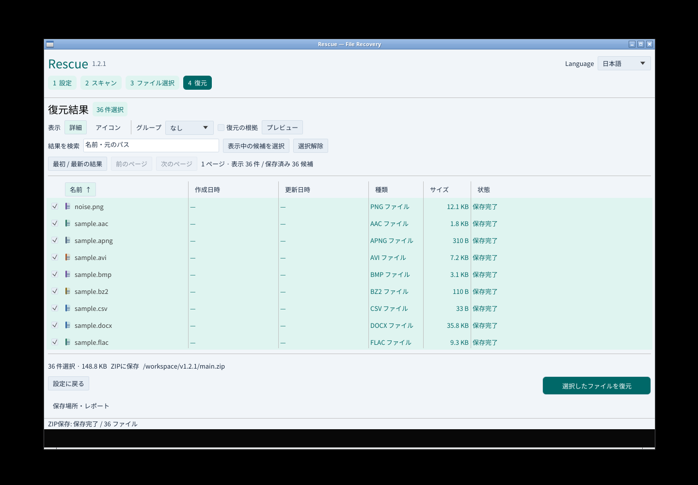
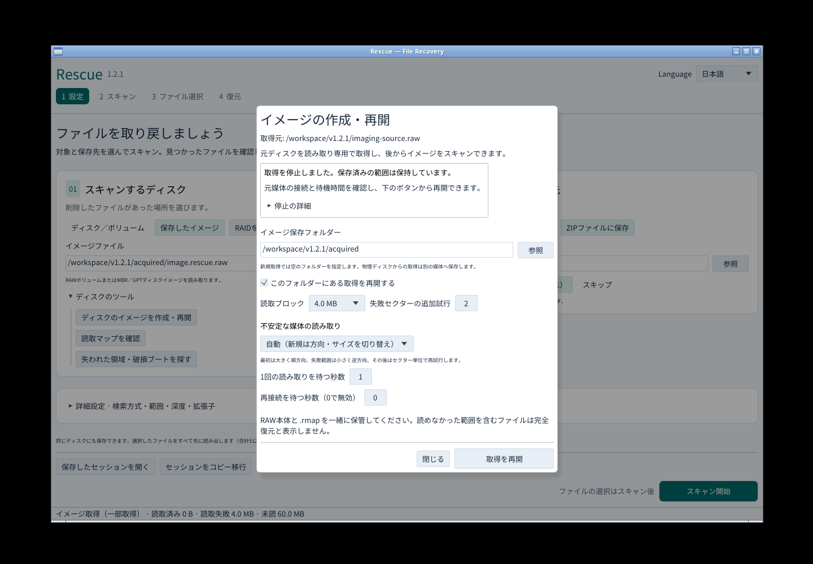
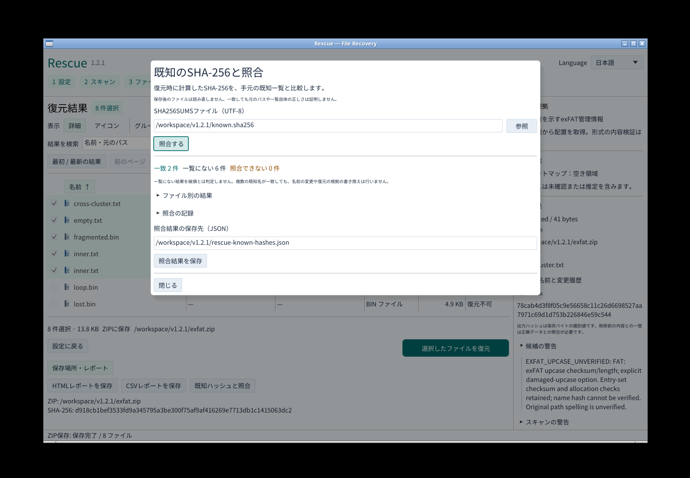

# Rescue v1.2.1

Windowsの日本語IMEで、Escによる取消後も未確定文字が入力欄に残る経路を修正したパッチ版です。GUI・CLI・MCPをWindows・Linux・macOS Intel/Apple Silicon向けに提供します。

## 修正内容

- IMEが変換中のEscを入力欄で処理し、取消処理より先にフォーカスが外れることを防ぎました。確定済みの文字は保持し、次の変換も行えます。変換していないときのEscによる移動は維持します。
- 実際のeguiフレームで、Escと取消通知の同時到着・順序の入替え・別フレーム到着を検証します。旧処理では新しい回帰テストが失敗し、修正後は成功することをWindowsで確認しました。
- Windowsの実IMEテストは未確定文字の表示を確認してからEscを送ります。取消結果が空であることを検証した後、次の変換に向けて入力欄へフォーカスを戻します。
- 通常権限のMicrosoft日本語IMEで、取消・再変換を同じGUI内で8回連続検証します。ネイティブCIと公開パッケージの再検証の両方で必須とし、各回の実画面をActionsに保存します。

修正候補の[Windows回帰試験](https://github.com/Xenoah/rescue-deletedfiles_rust/actions/runs/42489393103)は8回連続で成功し、選択した日本語名2ファイルの全バイト一致と元ソースの不変も確認しました。[旧処理の失敗ログ・実画面・候補版の記録](https://github.com/Xenoah/rescue-deletedfiles_rust/blob/v1.2.1/docs/verification/v1.2.1-ime-candidate.json)。過去の断続的失敗と同じ入力イベント列を採取したものではなく、再現できた取消経路の修正と連続ネイティブ試験を根拠とします。

## ダウンロード

OS/CPUに合わせてインストーラーかポータブルを1つ選んでください。添付は8パッケージと共通SHA256SUMSの9点です。スクリーンショットと検証JSONはリポジトリ・Actionsへ保存します。GitHubが自動生成するソースアーカイブは別枠です。

Windowsは発行元署名なし、macOSはアドホック署名・公証なし。Linuxはglibc 2.35以降、macOSは13以降です。[インストール手順](https://github.com/Xenoah/rescue-deletedfiles_rust/blob/v1.2.1/docs/INSTALL.md)

## v1.2.1の実画面

## 検証

v1.2.1の実GUIを操作して26画面を新規撮影しました。NTFSの36ファイル・152,325バイト、CP932の8ファイル・224バイト、破損exFATの8ファイル・14,135バイトが正解データと一致しました。元ソース、名前の不確実性、警告も確認しています。

取得GUIでは所有する読取プロセスを停止し、1秒の期限超過で失敗4 MiB・未読60 MiBを保持。GUIからの再開で64 MiB全量が一致しました。HTML/CSVの36件は元の復元結果と一致し、ブラウザー表示中の外部通信は0件。既知ハッシュ照合は一致2・一覧にない6・照合不能0で、元の証拠を含む別JSONの保存も確認しました。[実画面と検証記録](https://github.com/Xenoah/rescue-deletedfiles_rust/blob/v1.2.1/docs/UI-v1.2.md)

Rust 85テスト、35統合テスト群、Clippy、fmt、配布/版番号/IME証跡の4契約テストを公開条件とします。全4ネイティブ環境で回帰・インストーラー/ポータブルを確認し、公開後は配布済みポータブルを再取得して実物を検証します。[受入台帳](https://github.com/Xenoah/rescue-deletedfiles_rust/blob/v1.2.1/docs/V1_2_ACCEPTANCE.md)

## 互換性と適用範囲

v1.2.0の段階的取得・待機上限・再接続、CP932短名、限定的なexFAT破損継続、既知ハッシュ照合を維持します。セッションや読取マップの形式変更はありません。RAWと.rmapは一緒に保管してください。

取得障害や破損表の試験は所有する合成データ・仮想ディスク・実プロセス停止を使用しています。物理故障媒体の一般的な復旧率、APFS/ext4/ReFSの直接解析、第三者スクリーンリーダーによる人の評価は対象外です。既知ハッシュ照合は復元時の記録を比較し、保存後のファイルは読み直しません。
