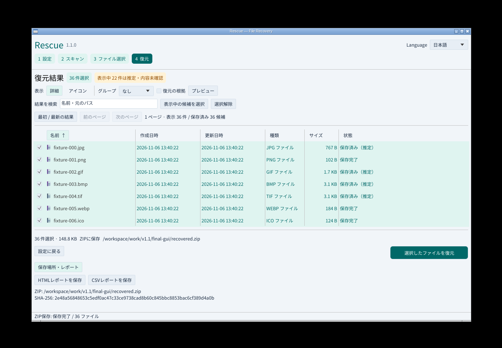
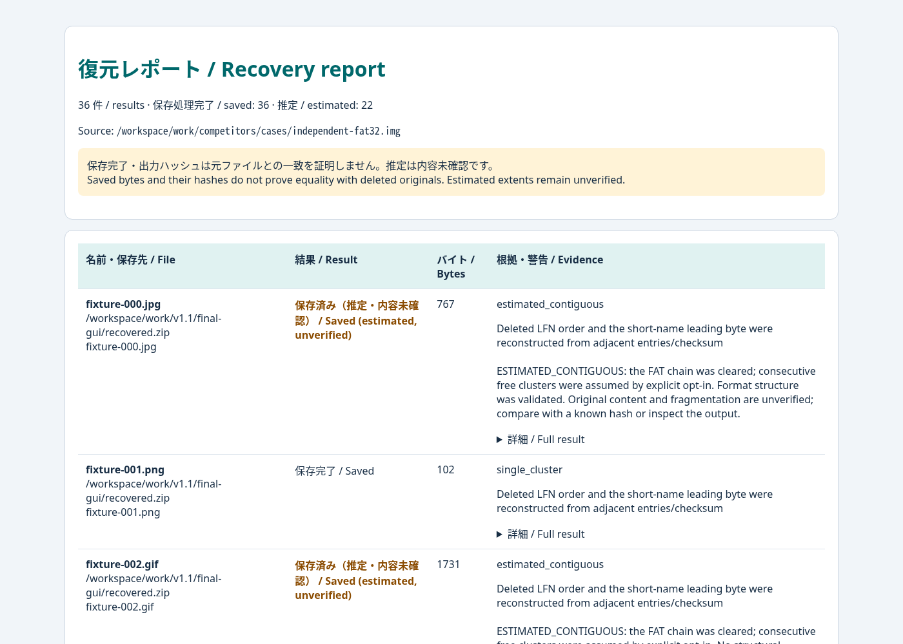

# HTML / CSV復元レポート

v1.1は復元結果をHTMLとCSVへ書き出せます。保存件数、名前・保存先、バイト数、ハッシュ、割当と配置の根拠、警告、エラー、欠損範囲、名前の変更、RAID読取範囲を保持します。保存完了や出力ハッシュは、削除前のファイルとの一致を証明しません。推定した配置は未確認として表示します。

## GUI

復元後に「保存場所・レポート」を開き、「HTMLレポートを保存」または「CSVレポートを保存」を選びます。保存先を入力するか「参照」で選択し、「保存」を押します。既存ファイルは上書きしません。結果は画面下に表示します。



HTMLはブラウザーで読めます。各行の「詳細」に元の結果を収録し、末尾に入力と識別情報を残します。JavaScriptや外部資源を必要としません。



## CLI / MCPで生成したJSONの変換

```sh
rescue export-report --input rescue-report-….json --format html --output report.html --json
rescue export-report --input rescue-report-….json --format csv --output report.csv --json
```

`recover`およびMCPの`recover_files`が保存するJSONレポートを入力にします。ZIPの場合は中の`rescue-report.json`を取り出して指定します。`report --session`が表示するスキャン概要とは別のレポートです。入力JSONや復元ファイルは変更しません。

CSVはUTF-8 BOM、CRLF、全セル引用符付きです。日本語、改行、引用符を保持し、数式として評価され得るセルには先頭のアポストロフィーを付けます。構造化された情報はJSONセルに、各行の全情報は`result_json`に保存します。機械処理の正本は元のJSONです。

入力は通常ファイル・16 MiB以下・schema_version 1・最大100,000結果、出力は128 MiB以下です。出力先フォルダーは既存のものを指定します。これらの上限を超える記録は元のJSONを使用してください。

## 検証

実際に復元した6ファイルのレポート変換、全フィールド照合、HTML埋め込み攻撃文字列、CSV数式、Unicode・引用符・改行、推定/欠損の保持、無効な入力、サイズ上限、既存出力の保全、ZIP内JSON、元入力の不変の14項目を各OSと公開パッケージで検証します。実GUIでは36件・推定22件をHTML/CSVへ保存し、ZIP内JSONと各結果を照合しています。
