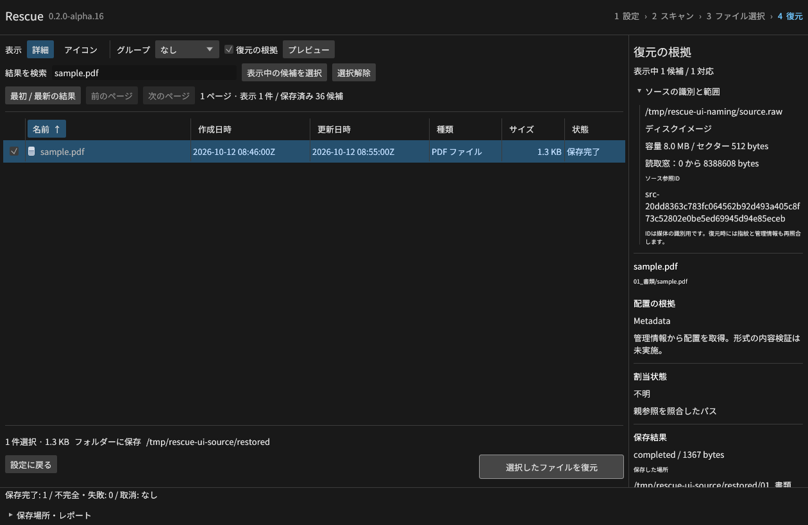
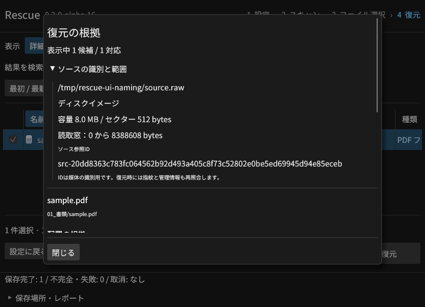

# ソースと候補の識別（alpha.16開発版）

`SourceInfo` は入力の種類、容量、セクターサイズ、読取範囲、識別情報を持つ。
CLIの `inspect`、保存セッション、GUIの「復元の根拠 → ソースの識別と範囲」、
MCPの `get_report`、復元レポートで確認できる。
[JSON Schema](../schemas/v1.json) の `SourceInfo` と `SourceReadMap` が形を定義する。

| 入力 | ソースIDの根拠 |
| --- | --- |
| 通常のRAWファイル | OSのファイルID。名前変更や同じファイルへのハードリンクで維持し、別のファイルへのコピーでは変わる |
| ディスク／ボリューム | OSが返すディスクと領域の識別情報。表示名やドライブ文字そのものをIDにしない |
| Rescueで取得したイメージ | 読取マップの取得UUID。RAWとマップを一緒にコピーした論理的な取得物は同じIDを持つ |
| 仮想RAID | 検証済みメンバーと構成を結び付けたRAID記録の識別値 |

`src-` から始まる値は種類と識別値から作る参照IDであり、内容全体のハッシュではない。
OSの識別値は機器交換や再利用で変わる／再利用される可能性がある。
復元時には従来どおりサンプル指紋、容量、選択領域、現在の管理情報、読取マップも再検証する。
IDが一致するだけで元データの完全性や真正性を保証しない。

容量は元ソース全体、`offset` / `length` はそのセッションで扱うバイト範囲を示す。
消失パーティションを選んでも元ソースのIDを保持し、範囲は検証済み領域に限定する。
取得物では元媒体の識別情報、取得済み／未試行／失敗の集計、マップのSHA-256も保持する。

候補一覧の各行は `session_id` と `id` を持つ。索引内部ではセッションIDをヘッダーに一度保存し、
公開応答に付けるため、1,000万候補の保存行を同じIDで膨らませない。
MCPの `recover_files.ids` は従来の文字列に加え、次の明示参照を受け付ける。

```json
{"session_id":"SESSION_UUID","ids":[{"session_id":"SESSION_UUID","id":"mft-20-7"}],"destination":"recovered","request_id":"restore-1"}
```

異なるセッションの参照は、ジョブや出力を作る前に `INVALID_REQUEST` で拒否する。
コピー移行ではセッションIDを新しくし、元ソースのIDと候補の管理情報は保持する。
新しい情報を持たない旧JSON・索引も読み込み、GUIには旧版の記録であることを表示する。

[専用統合試験](../scripts/e2e_source_contract.py)は10条件・10出力・49スキーマ検査を通過。
実CLI・MCPで、名前変更、ハードリンク、
別ファイルへのコピー、旧版、IDと範囲の改変、全ディスク、消失領域、取得物、候補参照を検査する。
Windowsの実VHD試験にも権限受渡し前後のソースID一致を追加した。ネイティブ結果は別途記録する。

[実GUIの検証](gui-source-results.json)では36候補からPDFを選び、1,367バイトを独立した正解と照合した。
ソースIDをCLIの値と照合し、1260×820と720×520で表示とスクロール領域を確認した。




