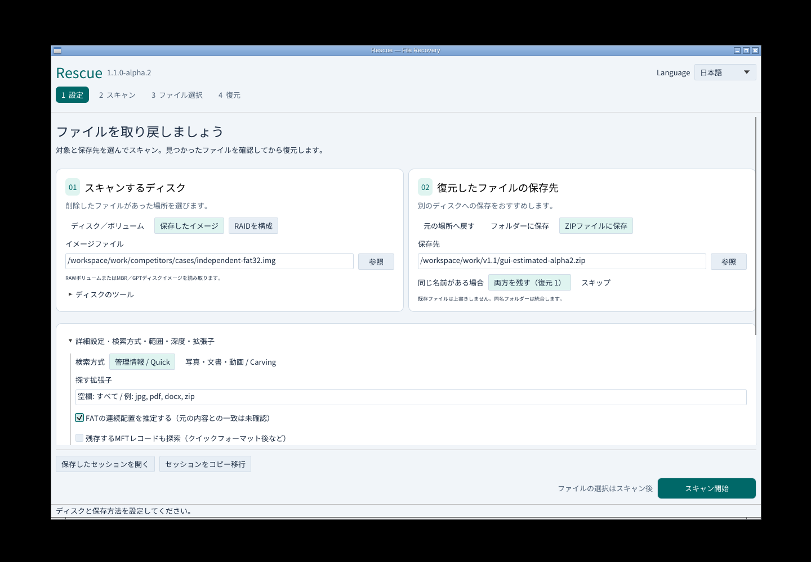
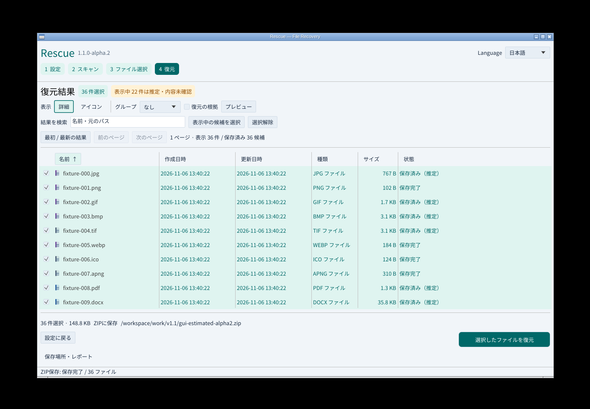
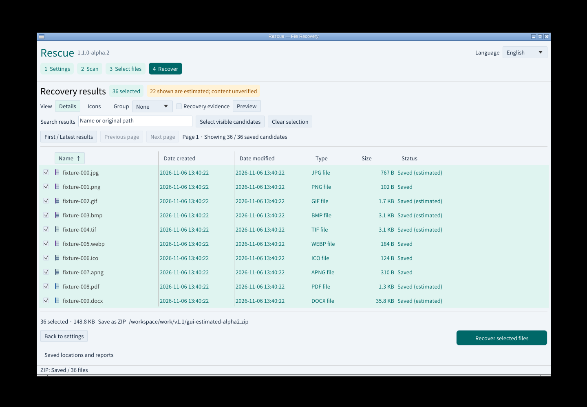

# v1.1のUI改善と実操作

2026-11-08 JST、`1.1.0-alpha.2` の実画面です。読み取る場所と保存先をカードで分け、現在のステップと主操作を強調しました。形式ごとの色と拡張子をアイコンに表示し、推定は文字と色の両方で区別します。

Linuxの実GUIをXvfb/Openbox上で起動し、マウスとキー入力でFAT32イメージとZIP保存先を設定。詳細設定の推定を有効化して新規スキャン、36件の選択、アイコン/詳細切替、ZIP復元、日英切替を実施しました。35形式・36件・152,325バイトを正解SHA-256と照合し、ZIP CRCと入力全体の不変を確認しています。22件は推定として保存しました。[機械可読記録](gui-v1.1-results.json)に画面・実行ファイル・入出力のハッシュがあります。

ローカルでRust 73テスト、CLI/MCPの29統合群、Clippyが成功しました。WindowsのUIA・実キー・Microsoft日本語IMEと4環境のネイティブ検証、公開実物の再検証はそれぞれのCIで必須です。

alpha.1で実施した検索・選択保持・狭幅720×520の記録は[元のタグ](https://github.com/Xenoah/rescue-deletedfiles_rust/blob/v1.1.0-alpha.1/docs/UI-v1.1.md)に残します。古い画像を現行バイナリの実画面として再利用しません。

リリース添付は8配布物とチェックサムだけです。検証資料はリポジトリとActionsアーティファクト（90日）に保存し、公開検証のリンクをリリースノートへ追加します。
