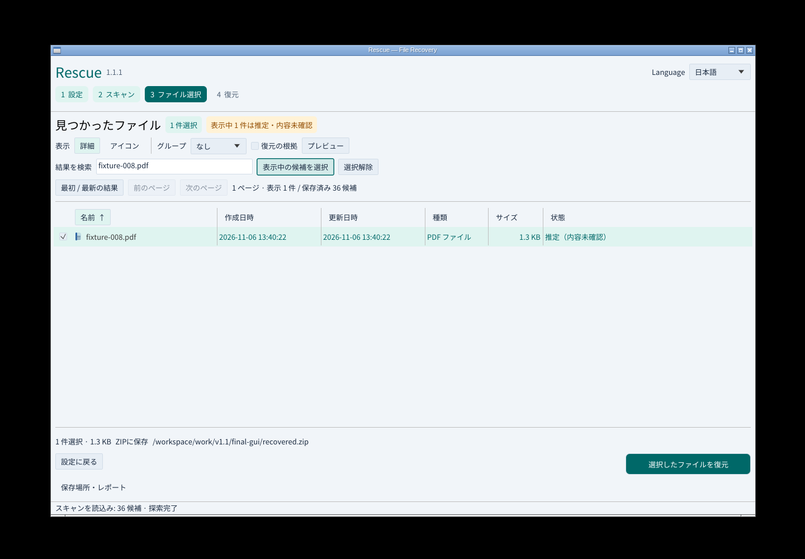
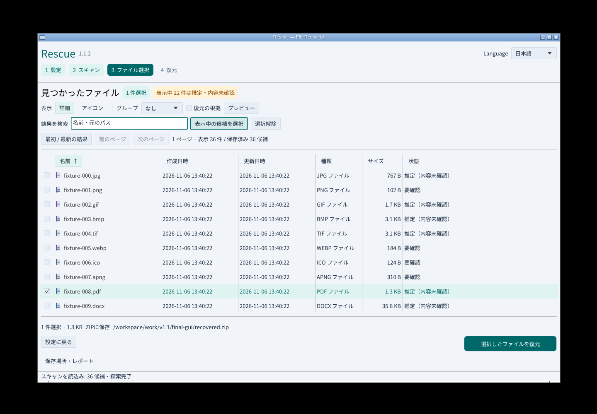
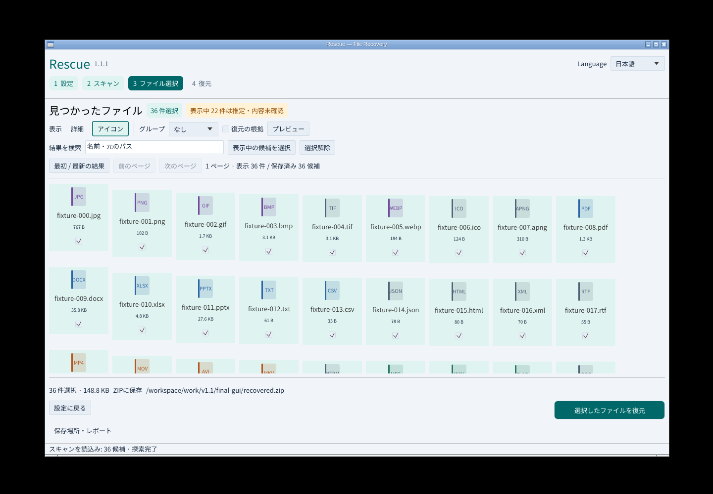
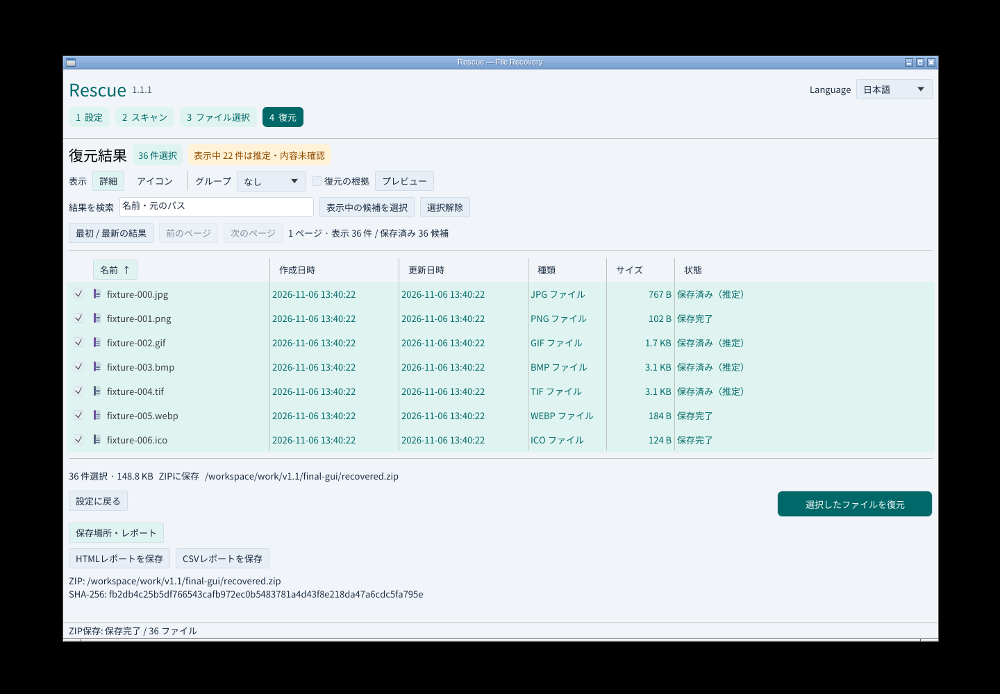
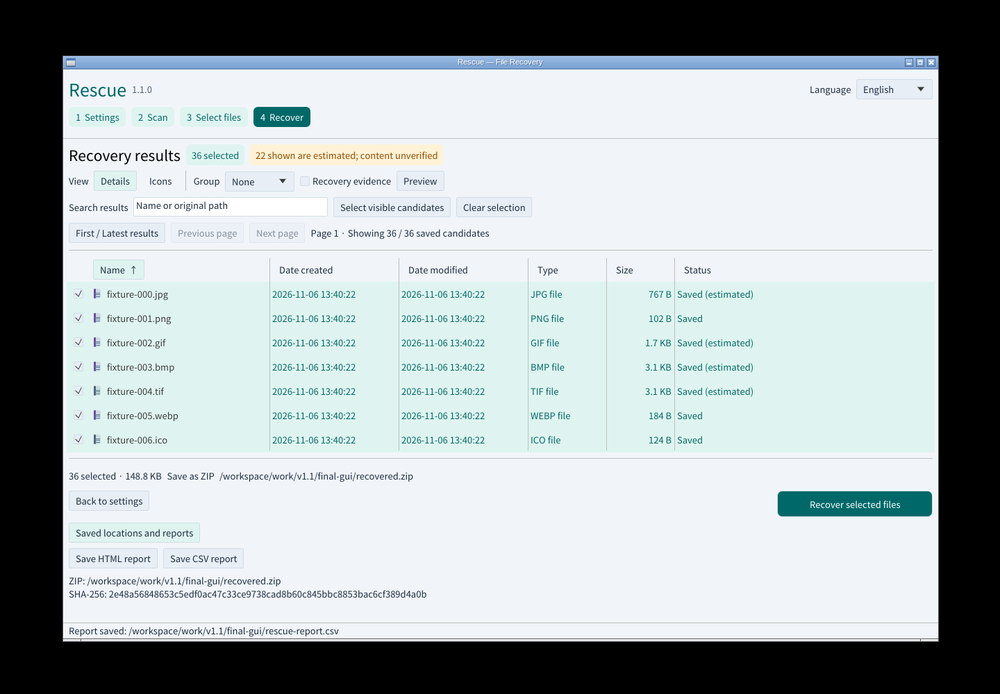
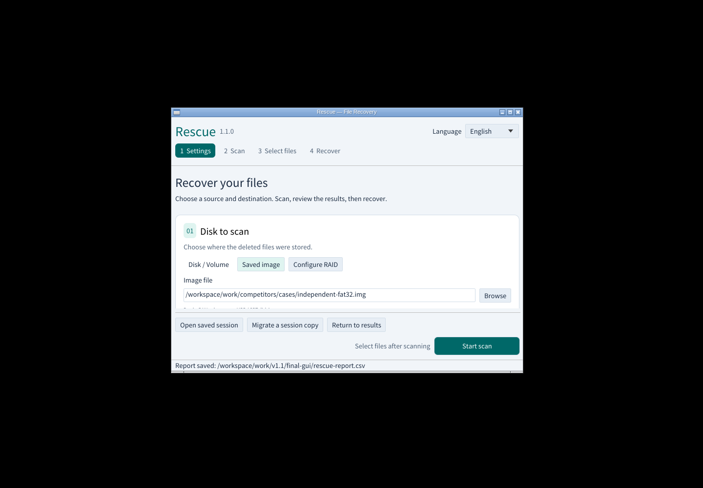
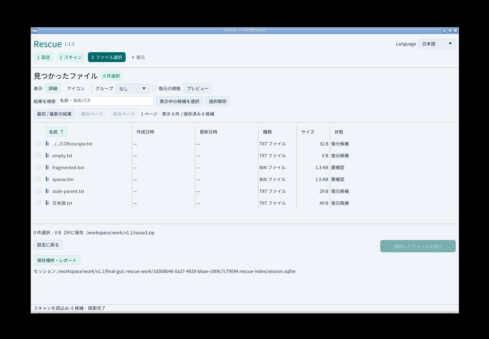
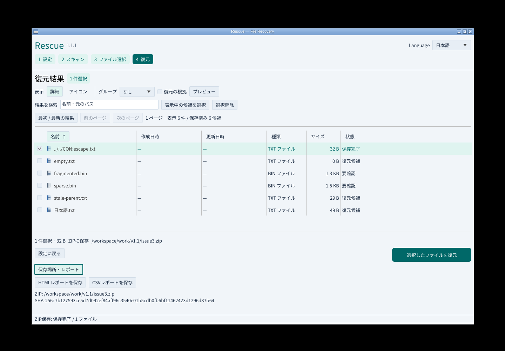
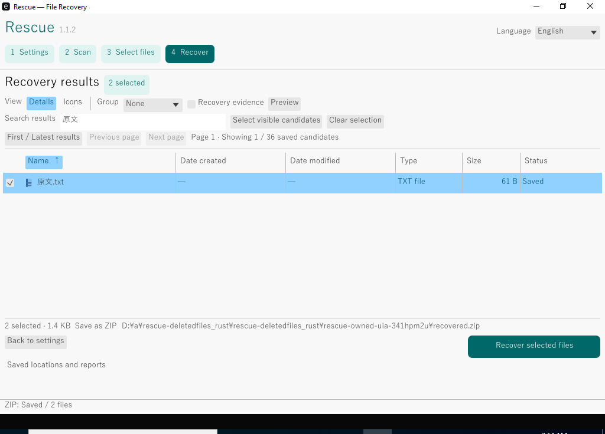

# v1.1のUI改善と実操作

2026-11-08 JST、安定版 `1.1.2` の実画面です。入力と保存先をカードで分け、現在のステップと主操作を強調。形式ごとの色と拡張子をアイコンに表示し、推定は文字と色で区別します。

Linuxの実GUIをXvfb/Openbox上で起動し、実際のマウスとキー入力でFAT32イメージとZIP保存先を設定。推定を明示的に有効化して新規スキャン、PDF検索・選択保持、36件の選択、アイコン/詳細切替、ZIP復元、HTML/CSV保存、日英切替を実施しました。35形式・36件・152,325バイトを正解SHA-256と照合し、ZIP CRCと入力全体の不変を確認しています。22件は推定として保存しました。HTML/CSVの各結果もZIP内JSONに一致し、HTMLはChromiumで実表示して外部通信がないことを確認しました。

[機械可読記録](gui-v1.1-results.json)に画面・実行ファイル・入出力のハッシュがあります。以前の画面を最終版の画面として再利用していません。設定に戻った際のレポート余白も修正し、狭幅で主操作が見えることを確認しました。

ローカルのRust 74テスト、CLI/MCPの31統合群、Clippyに加え、WindowsのUIA・実キー・Microsoft日本語IMEと4環境のネイティブ/公開実物テストをCIで必須としています。第三者スクリーンリーダー製品による人の評価は別の未実施項目です。

過去の先行版の画像・検証は[alpha.1](https://github.com/Xenoah/rescue-deletedfiles_rust/blob/v1.1.0-alpha.1/docs/UI-v1.1.md)、[alpha.2](https://github.com/Xenoah/rescue-deletedfiles_rust/blob/v1.1.0-alpha.2/docs/UI-v1.1.md)に残します。添付は8配布物とチェックサムだけにし、検証資料はリポジトリとActions（90日保存）に配置します。

## 名前にコロンを含む候補の修正

`../../CON:escape.txt`を実GUIでTXTとして表示し、その1件を選択してZIPへ保存、元の32バイトと照合しました。元イメージも不変です。

## Windowsの日本語IME操作後の実画面

同じ`v1.1.2`タグのWindows診断環境で撮影しました。非昇格・中整合性のGUIにMicrosoft日本語IMEのローマ字キーを入力し、変換・取消・「原文」の確定を実行。選択した日本語名2ファイルのZIP復元と元データの全バイト一致を確認しています。

[診断の出典・画面ハッシュ](verification/v1.1.2-windows-diagnostic.json)と[実行結果](verification/v1.1.2-windows-ime.json)を保存しています。初回CIのIME入力状態に依存する失敗を切り分けるための別実行であり、公開条件のネイティブCI・公開パッケージ検証とは区別しています。
