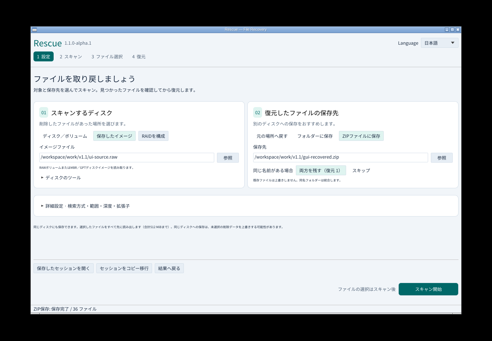
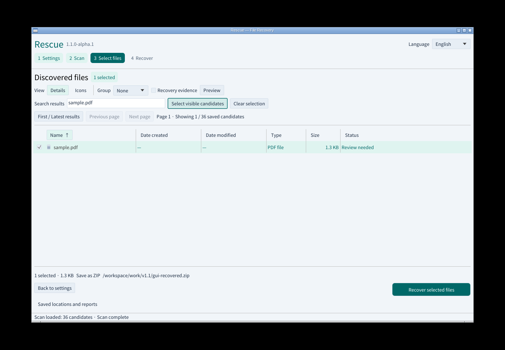
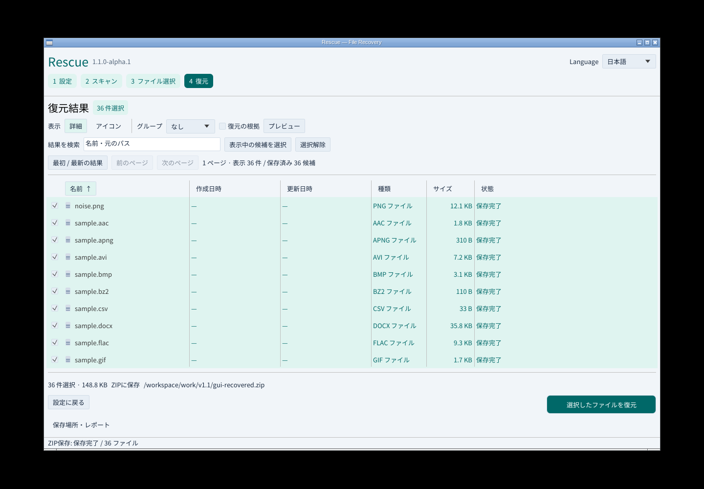
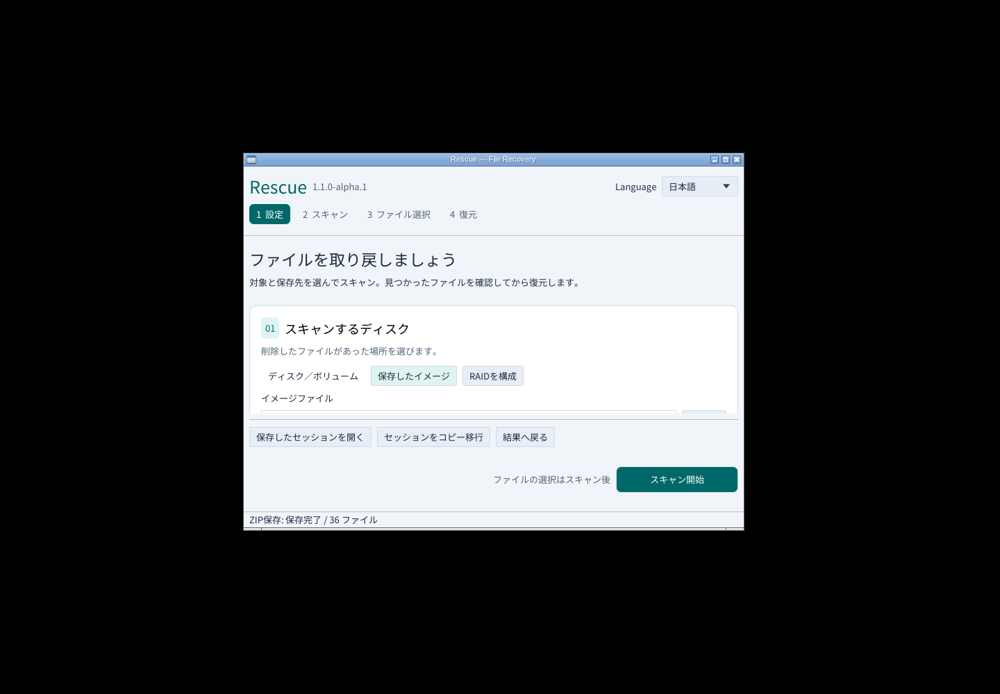

# v1.1のUI改善と実操作

2026-11-08 JST。先行版 `1.1.0-alpha.1` の実画面です。

読み取る場所・保存先をカードで分け、広い画面では横に並べました。狭い画面は縦に切り替わり、フォームをスクロールしても下部の主操作が残ります。現在のステップ、選択件数、一部の結果を文字と色で表示します。ディスク取得・読取マップ・消失領域探索は「ディスクのツール」から開きます。

## 実施した検証

- Linuxの実GUIをXvfb/Openbox上で起動。マウスとキー入力で設定→新規スキャン→PDF検索→選択保持→36件選択→アイコン/詳細切替→ZIP復元を実施。
- 35形式・36ファイル、152,325バイトを正解コーパスとSHA-256で照合。ZIP CRCと元イメージ全体のSHA-256不変を確認。
- 復元後の日本語切替で名前・選択・結果を保持。720×520の実ウィンドウで主操作を確認。
- Rust 73テスト（コア46・GUI27）、CLI/MCPの27統合群、Clippy、配布対象の限定チェック2件が成功。
- Linuxポータブル/DEBを生成。DEBの展開物とポータブルの実行ファイルを照合し、同梱CLI/MCPの60項目と同梱GUIの描画開始を確認。

[機械可読の実操作記録](gui-v1.1-results.json)に画面・実行ファイル・入力・出力のハッシュを収録しています。WindowsのUIA・キーボード・実Microsoft日本語IME、4環境のネイティブ検証と公開実物の再検証はそれぞれのCIで必須です。ローカル検証だけをその代わりとはしません。

## 配布と証拠

リリース添付は8つのインストーラー/ポータブルと `SHA256SUMS.txt` だけです。過去の画像、試験コーパス、検証JSONを添付に並べません。パッケージ内もインストール・利用ガイドとライセンス中心です。検証資料はリポジトリとActionsアーティファクト（90日）へ保存し、公開後の検証へのリンクをリリースノートに追記します。

v1.0以前の画面や性能測定は元の版の記録として残します。現行UIの新規記録と区別し、古い画像をv1.1の画面として扱いません。
