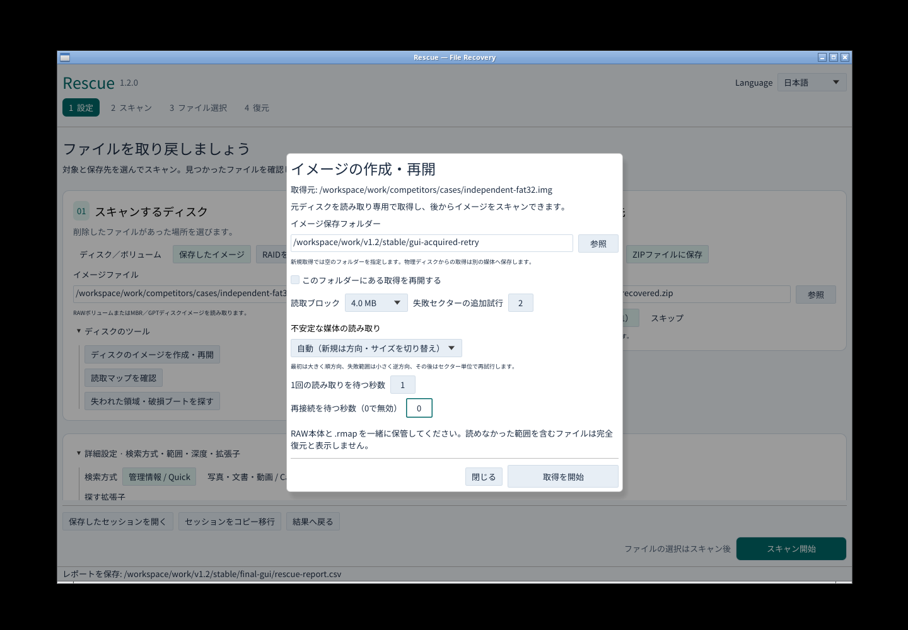
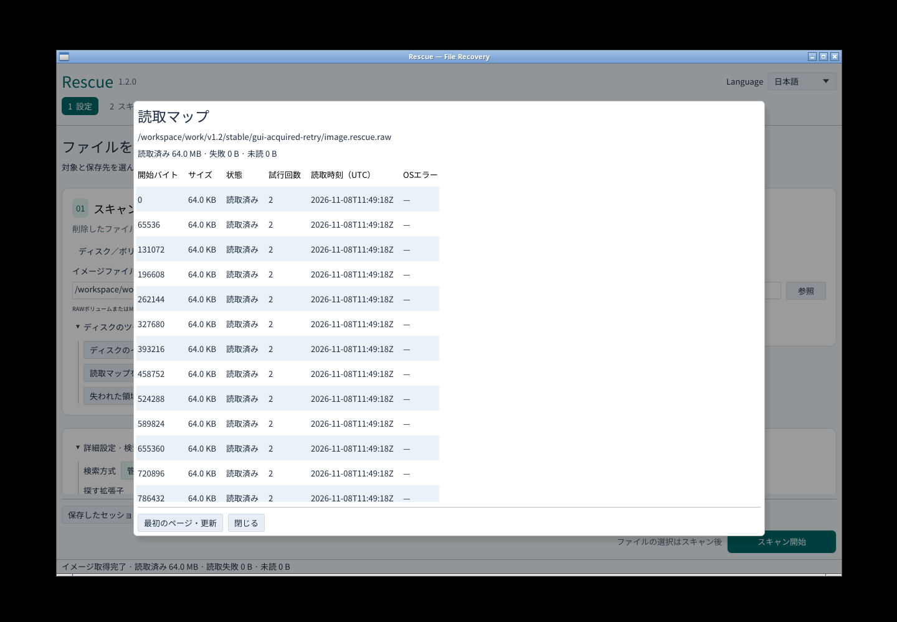
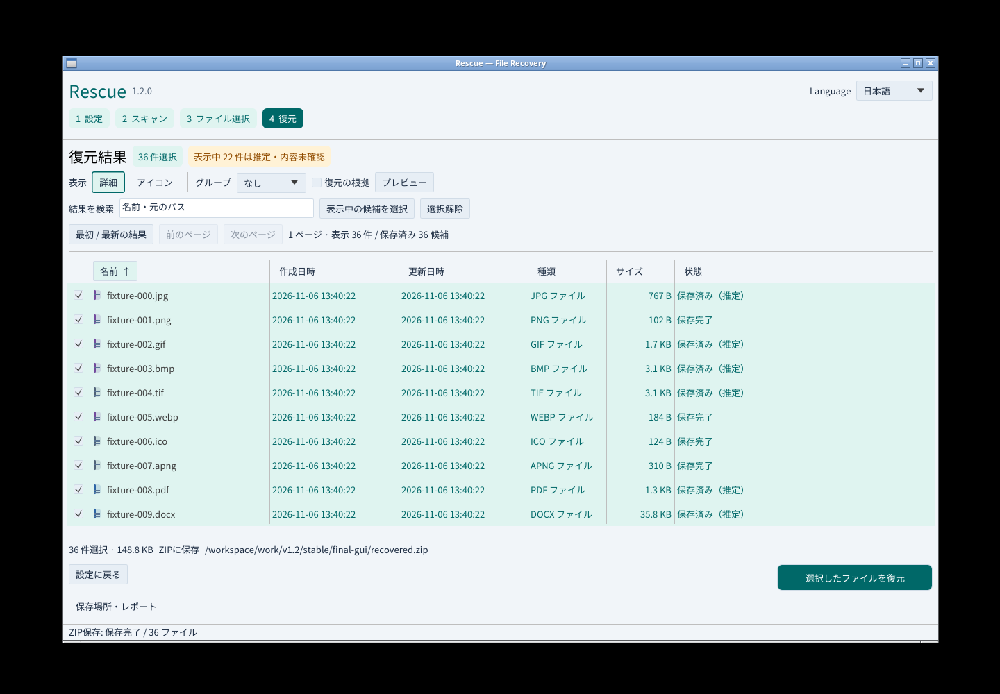
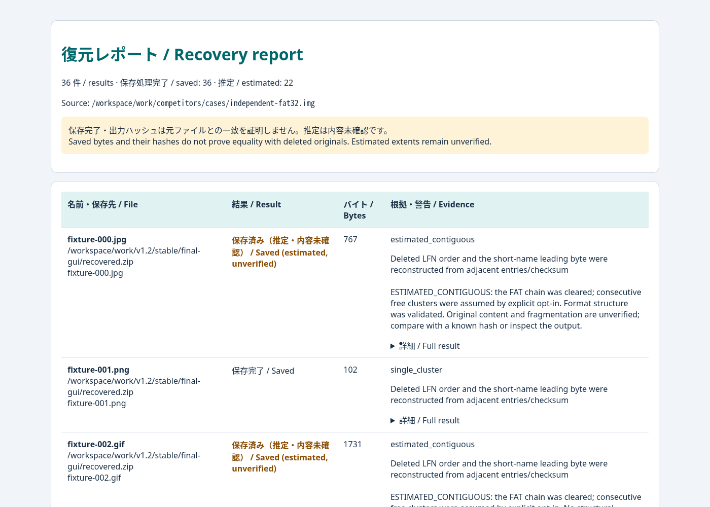
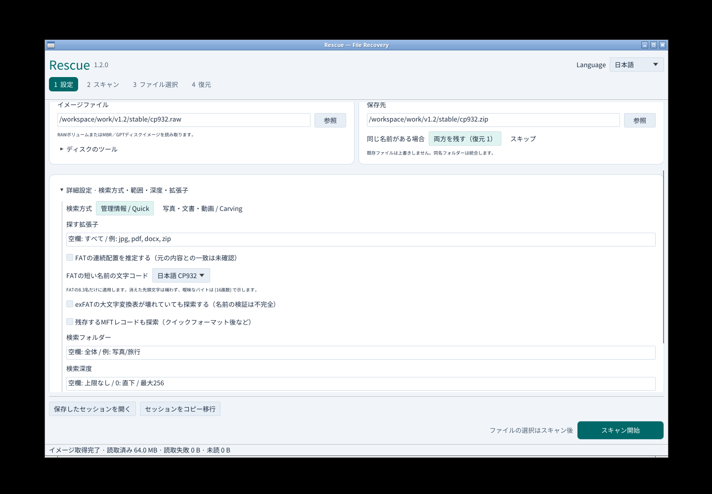
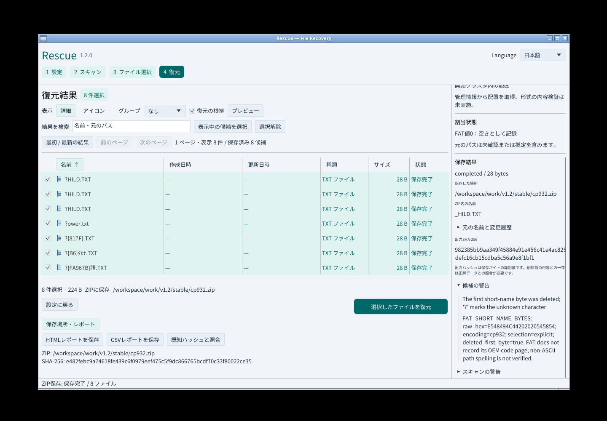
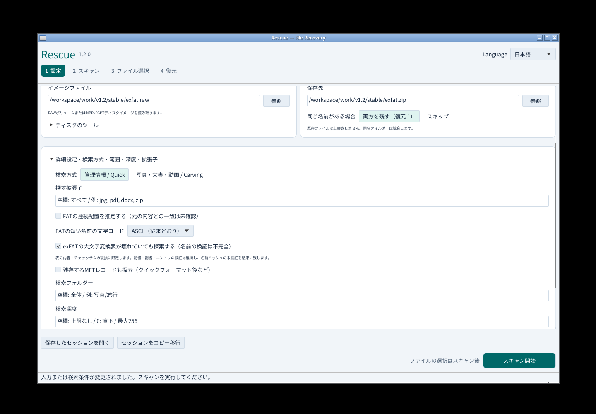
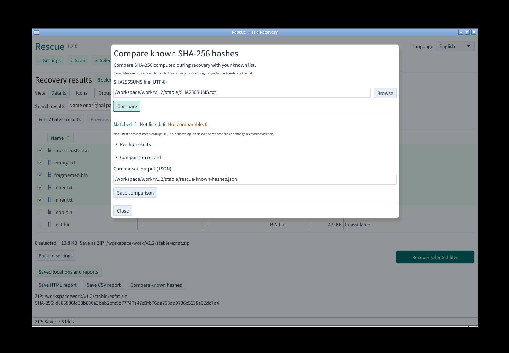

# v1.2.0の実画面

Linuxの実GUIをマウスとキーボードで操作し、同じビルドの画面を撮影した。[検証JSON](gui-v1.2-results.json)に実行バイナリ・出力・画像のSHA-256を保存している。Windowsの通常権限UIA/実キー/日本語IMEは別途ネイティブCIと公開実物で必須検証する。

## 取得と再開

所有する読取ヘルパーだけをSIGSTOPで停止し、1秒の待機上限を超えさせた。RAWには遅い結果を保存せず、4 MiBの失敗と60 MiBの未読を保持した。停止後は元ソースを示した再開ダイアログが開く。

「取得を再開」を実際に押し、同じ元イメージから64 MiBすべてを取得。元ファイルとSHA-256が一致した。最初に失敗した4 MiBは逆方向の64 KiB単位で成功し、読取マップの試行回数は2となる。

## 復元とレポート

新規スキャン、検索、選択保持、アイコン切替、36ファイルのZIP復元、HTML/CSV保存、日英切替、720×520表示を実施。36ファイル・152,325バイトが元ハッシュと一致し、22件の連続推定ラベルを保持した。

[取得手順と制限](IMAGING.md)。ここでのプロセス停止は合成障害であり、物理USB/SDの切断や故障を測定したものではない。

## CP932短名

詳細設定で「日本語CP932」を明示的に選び、所有するFAT16テストイメージをスキャンした。8ファイル・224バイトをZIPへ復元し、すべて元データと一致した。7件の短名には元11バイトと解釈根拠を残し、UTF-16の長い名前は保持した。

削除で失われた先頭文字を補わず、曖昧なバイトを波括弧の16進数で示す。名前の不確実性と内容のバイト一致は別々に記録している。

alpha.1の画面と検証記録は[元タグ](https://github.com/Xenoah/rescue-deletedfiles_rust/tree/v1.2.0-alpha.1/docs)に保持している。

## exFATの破損大文字変換表

所有する合成exFATイメージの変換表を壊し、GUIで限定的な継続を明示的に選んだ。11候補すべてに名前検証の欠落を記録し、復元できる8ファイル・14,135バイトが元データと一致した。配置を証明できない3件は復元対象に含めない。

[対象となる破損と維持する検証](EXFAT-DAMAGE.md)。alpha.2の実画面・検証記録は[元タグ](https://github.com/Xenoah/rescue-deletedfiles_rust/tree/v1.2.0-alpha.2/docs)に保持している。

## 既知のSHA-256との照合

復元結果の「既知ハッシュと照合」から、利用者が用意したSHA256SUMSを読み込んだ。破損exFATから復元した8件のうち2件が一致し、6件は一覧にないと表示した。同じ内容に複数の既知名がある場合も両方を残し、元の名前や警告を変更しない。

別JSONへの保存、元の復元記録と警告の保持、日英表示、720×520のスクロールを確認した。照合対象は復元時に記録したSHA-256であり、保存後のファイルの再読み取りではない。

[照合方法と範囲](KNOWN-HASHES.md)。先行版の画面・結果は各タグに保持する。
