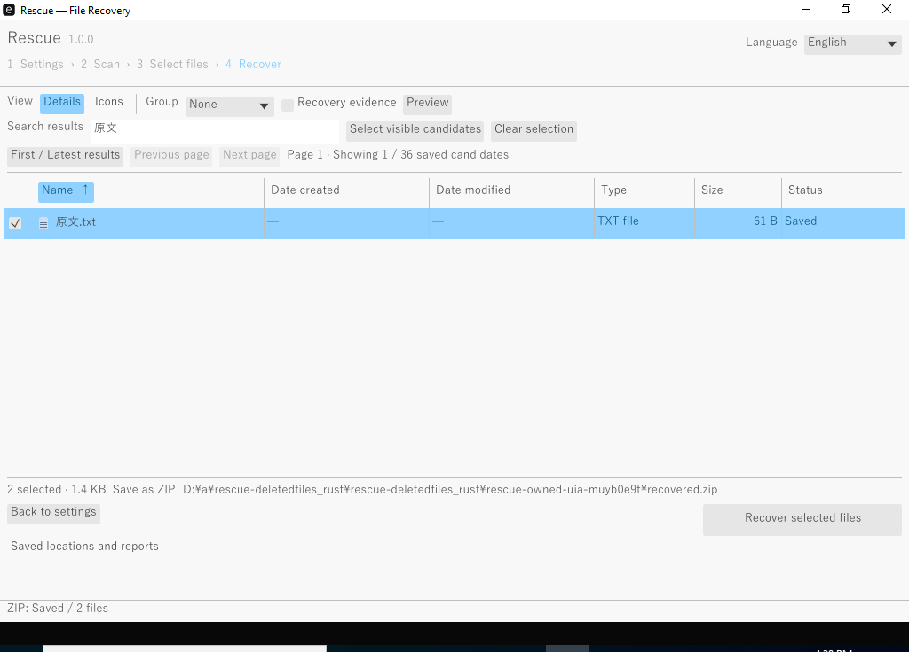

# GUIの配置と操作の基準

調査日: 2026-11-05 JST。公式資料を読み、以下をRescueの受入基準にする。
WCAGはWeb向けの基準であり、ここではデスクトップUIの測定可能な下限として採用する。
これだけでWindowsのスクリーンリーダーやIMEの実機適合を宣言しない。

## 参照した公式資料

- [Microsoft: Responsive design techniques](https://github.com/MicrosoftDocs/windows-dev-docs/blob/docs/hub/apps/design/layout/responsive-design.md)
- [Microsoft: Screen sizes and breakpoints](https://github.com/MicrosoftDocs/windows-dev-docs/blob/docs/hub/apps/design/layout/screen-sizes-and-breakpoints-for-responsive-design.md)
- [W3C: WCAG 2.2 Target Size (Minimum)](https://github.com/w3c/wcag/blob/main/understanding/22/target-size-minimum.html)
- [W3C: WCAG Focus Visible](https://github.com/w3c/wcag/blob/main/understanding/20/focus-visible.html)

Microsoftは画面サイズに応じたreposition/resize/reflow/show-hide/replaceを示し、
単に画面全体を縮小する設計を避けている。W3Cは操作対象の大きさと間隔、
キーボードのフォーカスが視覚的に分かることを求めている。

## Rescueへの適用

| 規則 | 具体的な配置・挙動 | 確認方法 |
| --- | --- | --- |
| 目的と次の操作を一貫させる | 設定→スキャン→選択→復元のステップ表示。画面下の固定領域に主要操作、戻るは左、進む/復元は右 | 設定のスクロール中も主要操作が見える |
| 基本と詳細の情報量を分ける | ディスク・保存方式・保存先を先に表示。検索範囲/方式/深度/拡張子は詳細領域へ | 初期画面から保存先とスキャンへ到達できる |
| 幅に合わせて再配置する | 狭い幅では情報パネルを折畳み、フォームとツールバーを折り返す。文字の縮小で収めない | 最小ウィンドウ、通常幅、150%/200% DPIで重なりを確認 |
| 押し間違いを減らす | 操作対象は24論理px以上。主要操作は高さ36px以上、隣接操作間は8pxを基本とする | レイアウト計測と実画面 |
| 入力の意味を残す | 入力欄に常時見えるラベルを付け、例は補助情報にする | 値を入力した後も項目の意味を識別できる |
| キーボードで操作する | Tab/Shift+Tabの順序を画面の順序と一致させ、フォーカスを表示。Enter/Spaceで対象操作 | 実ウィンドウでディスク選択から復元まで操作 |
| 進行と取消を見失わない | 進捗と取消を固定領域に表示。取消待ちと停止完了を区別する | 長時間ジョブと取消の試験 |
| 一覧の比較を助ける | 名前・作成/更新日時・種類・サイズ・状態の詳細列、列ソートとグループ、選択IDの維持 | 並替え/絞込み後も選択対象が同じ |
| 不確実性をそのまま伝える | 日時・名前・削除状態・検証未実施は不明として表示し、色だけに依存しない | 不明候補と破損候補の画面 |

このファイルは実装の完了報告ではない。実装後の画面・操作結果を受入台帳とリリースへ記録する。

## alpha.16の操作レビュー

実GUIで見つけた無名の列幅変更Tab停止を除去し、名前のある列見出しの左右キーで幅を変更できるようにした。
チェックボックスやファイル名のフォーカスをプレビュー対象へ反映する。
検索欄とグループ選択には常時表示するラベルをアクセシビリティツリー上でも関連付けた。
入力欄にはAccessKit/UIAのSetValueを実装し、操作中の無効なフォームへの書換えを拒否する。

`accessibility.rs` は実際のeguiツリーとイベント処理で、Tab/Shift+Tab、チェックボックス選択、
列幅変更、UnicodeのSetValue、IMEの未確定文字・確定・取消を検証する。
IMEイベントを直接送るモデル試験は、WindowsのIME製品を操作した証拠とはしない。
`e2e_gui_windows.py` はWindows UIAから設定・スキャン・日本語検索・2件のZIP復元を行うネイティブ試験で、
結果ツリーと独立したバイト照合を保存する。合格記録が得られるまでは実OS対応の完了としない。

[実GUIの検証記録](gui-keyboard-results.json)では、同じイメージを新規スキャンし、
Ctrl+F、Tab、SpaceでPDFを選択・復元して1,367バイトの一致と元媒体の不変を確認した。
列見出しの右キー3回で48px、境界のドラッグで32px幅を変更し、選択を保持した。
720×520のスクロール領域は白枠でフォーカスを示し、右キー3回で96px移動した。
復元中に主ボタンが無効になるため、完了時は保存レポートへフォーカスを移し、Spaceで開けるようにした。
レポートは復元操作の後のTab順序とし、本文の表示高を制限して主要操作を画面内に保つ。

スクロール領域とバーは名前、向き、現在値、範囲を公開する。
矢印・Page Up/Down・Home/Endに加え、バーのAccessKit RangeValue操作を検証した。
詳細表示とアイコン表示の両方で、チェックボックスの名前とプレビュー対象を照合した。

## v1.0のWindows実ウィンドウ

[通常権限GUIの記録](gui-limited-windows-v1.json)と[ネイティブキー入力の記録](gui-keyboard-windows-v1.json)では、
GUI自身の非昇格・中整合性・Administrators無効を検査し、設定から日本語検索、選択、2件のZIP保存まで実行しました。
キー入力試験はページ読込完了後のTab/Shift+Tab、Space、Ctrl+A、Unicode入力を含み、
出力1,428バイトと元イメージのSHA-256不変を照合しています。
Windowsでは最大化して起動し、1024×768でも最下部の操作と完了表示を作業領域内に収めます。

Unicodeキー注入の試験とは別に、[実Microsoft日本語IMEの記録](gui-ime-windows-v1.json)を残します。
WindowsにインストールされたTSFプロファイルを有効にし、実ローマ字キーで`torikeshi`を入力して
予測候補と未確定文字をEscapeで取り消し、続けて`genbun`を「原文」に変換・確定します。
前の未確定文字が残らないこと、日本語の2件のZIP復元、元媒体の不変、入力設定の復元を照合します。

この試験で、egui-winit 0.33がWindowsの空PreeditをDisabledへ変換し、TextEditに未確定文字が残る問題を修正しました。
未確定文字を所有する入力欄だけに取消を補い、別の欄の選択や既存の確定文字を消しません。
Windows実IME試験と、取消後の次の変換・確定や入力欄変更を含む回帰試験を必須化しています。
スクリーンリーダー製品の手動評価やOS全体のDPI変更試験とは区別します。

