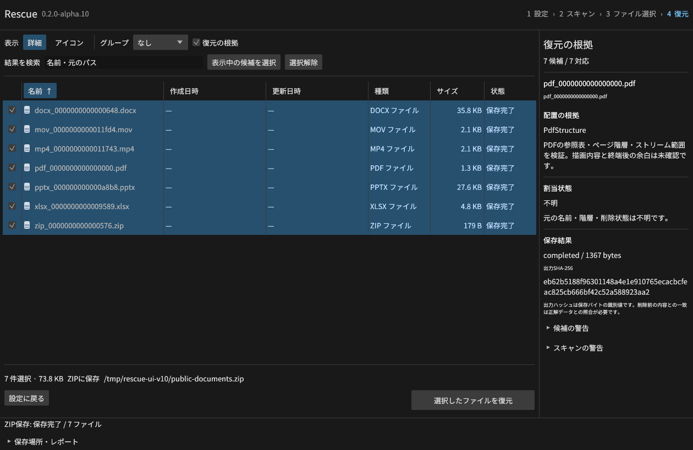
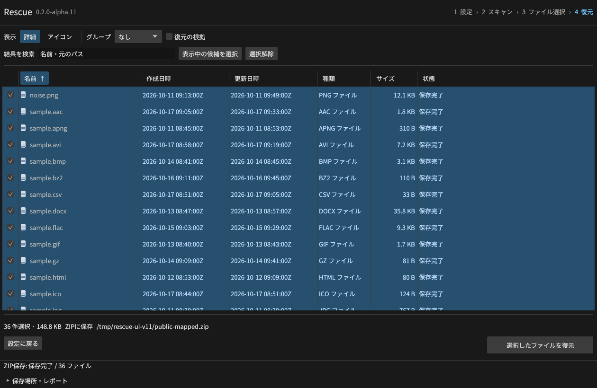

# Alpha の検証記録

## v0.1のローカル環境

Linux x86_64、Rust 1.99.1。これはWindows実行時の検証とは区別する。

| 検証 | 結果 |
| --- | --- |
| ワークスペース全体のビルド | 成功 |
| Rustテスト | 9件成功。短い入力、runlist境界、負の差分、疎領域、fixup、不正属性等 |
| CLI/MCP統合 | 23項目に加えてLinuxのSIGINT終了を検証。6種類の正解ファイル、変更拒否、範囲制限、ページ取得、重複要求、取消等 |
| ntfs-3gで生成したメタデータ | 非residentの25,600バイトが正解と一致。元イメージのハッシュも不変 |
| GUI（Linux/Xvfb） | 日本語表示、入力、スキャン、候補選択、復元を操作。出力の正解一致を確認 |
| Windows MSVC向け | 全crate・test targetの型検査成功。リンク・実行は含まない |
| 配布通知 | Windowsのnormal/build依存170パッケージのライセンス本文を収集 |

ntfs-3gテストは、独立ツールで作った正規のNTFSメタデータについて、削除フラグだけを
テスト用イメージ内で変更したもの。Windowsによる実際の削除操作や媒体故障を検証したものではない。
テスト用イメージは毎回新しく作った通常ファイルに限定する。

## 再実行

    cargo test --workspace --locked
    cargo build --workspace --locked
    python scripts/e2e.py --binary target/debug/rescue
    python scripts/e2e_streams.py --binary target/debug/rescue
    python scripts/e2e_fat.py --binary target/debug/rescue
    python scripts/independent_ntfs.py --binary target/debug/rescue
    python scripts/independent_fat.py --binary target/debug/rescue
    cargo check --workspace --all-targets --target x86_64-pc-windows-msvc --locked

independent_ntfs.pyにはmkntfs、ntfscp、ntfsinfoが必要。
independent_fat.pyにはmkfs.fat、mcopy、mdel、mkfs.exfatが必要。
Windows上の統合テストでは実行ファイル名をrescue.exeにする。

## 別途確認する項目

v0.1.0-alpha.2のWindowsでのビルド、debug/release実行ファイルの統合テストは
[GitHub Actions](https://github.com/Xenoah/rescue-deletedfiles_rust/actions/runs/41660787133)で成功。
公開ZIPをダウンロードし、公開SHA256SUMS.txtとの一致とGUI/CLI・MIT・依存通知の同梱を確認した。
alpha.1の公開CIはWindowsのライセンス通知生成で停止した。alpha.2では通知生成のUTF-8を明示し、
上流ライセンスを改行変換しないGit属性を設定した。期待SHA-256は変更せず、照合を維持する。
Windows GUIの手動操作・IME・アクセシビリティ、実媒体、性能目標、有料製品比較は未検証。
未対応機能と既知の制約は[ALPHA.md](ALPHA.md)を参照する。

## v0.2.0-alpha.1 追加検証

- LZNT1の重なり参照、短い入力、展開上限、破損入力群、4KiBクラスターの圧縮単位境界。
- scripts/e2e_streams.py: Linuxで13ストリームの正解一致、圧縮/非圧縮/疎領域の混在、
  断片化、resident/non-resident/圧縮ADS、日本語・パス記号の名前、MCPからの復元。
- セッションv1互換、改変されたストリーム名の拒否、暗号化ADSと通常ストリームの区別、
  壊れた圧縮データの未完了扱い。
- WindowsではRtlCompressBufferで生成する3種類の入力を追加し、16ストリームを照合。
  [Windows/Linux CI](https://github.com/Xenoah/rescue-deletedfiles_rust/actions/runs/41664246239)は成功し、
  公開済みZIPのSHA-256一致も確認した。
- ntfs-3g由来の通常DATA（25,600バイト）と名前付きDATA（2,500バイト）の復元。

これは合成イメージとAPI由来の圧縮データの検証であり、Windowsの実ボリュームでの削除・復元、
破損媒体や有料ソフトとの比較を検証したものではない。

## v0.2.0-alpha.2 追加検証

- FAT32/exFATのCLI/MCP統合15項目、13ファイルの正解バイト一致。
  残存チェーン、連続配置、切断・循環、FATミラー／active FAT、割当競合、名前の推定、
  断片化したディレクトリー境界、日本語、254文字の名前、削除ディレクトリーを含む。
- 不正なブート・LFN・エントリー集合・名前ハッシュ・upcase・ビットマップの検出、
  巨大data lengthの拒否、セッションのオフセット改変拒否、スキャン／復元再探索の取消。
- mkfs.fatとmcopyで作りmdelで実際に削除した3ファイル（日本語名を含む）の正解一致。
- mkfs.exfatが生成したブート・FAT・ビットマップ・圧縮upcase表を使い、削除エントリーを
  明示的に合成したファイル10,040バイトの正解一致。exFATの削除操作自体はエミュレーション。
- 既存NTFSのRust 13テスト、CLI/MCP 24項目、圧縮/ADS 13ストリームもローカルで成功。
- FATのレコード／候補上限と事前取消のテストを追加し、Rust全体は14件成功。
- Linux/XvfbのGUIでexFATをスキャンし、名前クリック・一括選択・復元を操作。
  8ファイルの正解一致を確認。長い名前の表示を省略し、全文はツールチップで保持。
- [Windows/Linux CI](https://github.com/Xenoah/rescue-deletedfiles_rust/actions/runs/41730155697)も成功し、alpha.2を公開済み。

## v0.2.0-alpha.3 追加検証

- 使用中ファイルとディレクトリーの交差参照をFAT32/exFATで検出し、ファイル内の偽エントリーを候補にしないこと。
- exFATのビットマップが空きと示しても、使用中ファイルから参照される範囲の復元を拒否すること。
- 使用中範囲の索引を独立したクラスター集合と照合。連続配置の大きな使用中ファイルは範囲として保持する。
- FAT32/exFAT統合は17項目、Rustは15件。

2026-11-03、[公開タグのWindows/Linux CI](https://github.com/Xenoah/rescue-deletedfiles_rust/actions/runs/41731219100)は成功。
Windows debug/releaseのFAT32/exFAT・NTFS・圧縮/ADS・MCP統合と、Linuxの独立ツール検証を通過。
最終版のLinux/Xvfb GUIでもexFATの8ファイルを正解と照合した。

公開したrescue-0.2.0-alpha.3-windows-x64.zipをダウンロードし、SHA256SUMS.txtとの一致、
ZIP内のCRC、GUI/CLIのx64 PE形式、MIT・依存通知・文書を含む9ファイルを確認した。
ZIPサイズは3,439,643バイト。SHA-256:

    da23044a75971a92585c2a61d00e4284a159c082d41bc2fccf80c2fbe2678479

Windows GUIの手動操作、実媒体、有料製品との比較は引き続き未検証。

## v0.2.0-alpha.4 ローカル検証（2026-11-04）

- Rust 16テスト、Linux clippy/build、Windows MSVC全ターゲットのclippy（型検査）成功。
- `scripts/e2e_carve.py`：23項目、23ファイルのバイト一致。Python struct/zlibで生成したPNGの
  全合法色形式・ビット深度、Adam7、5種類のフィルター、分割IDAT、1MiB読取窓の境界を含む。
- CRC・Adler-32不一致、短い画素データ、不正フィルター、IDATの順序、巨大サイズ、APNG、
  未知のcriticalチャンク、重複IHDRの拒否。セッションのオフセット・ハッシュ改変を拒否し、
  偽のサイズ・名前は保存範囲と出力名に採用しない。空入力、同一PNGの異なる位置も検証。
- サンプル照合範囲外のPNGをCRCが合うように変更し、ソースの更新日時を戻した場合も、
  復元時のPNG全体ハッシュ再照合が拒否することを確認。
- 既存CLI/MCP 24項目、圧縮/ADS 13ストリーム、FAT32/exFAT 17項目・13ファイル、
  ntfs-3gおよびmkfs.fat/mtools/mkfs.exfatによる独立検証も成功。
- Linux/Xvfbの最終GUIでPNG探索・一括選択・保存を操作し、3ファイルの正解バイト一致を確認。
  4件の署名候補のうち、CRC不一致の1件は選択・保存対象から除外。
  実スクリーンショットを`docs/images/intelligence.png`に保存。
- `docs/intelligence.html`をChromiumで表示し、両方式の切替・aria-pressed状態・390px幅の
  横はみ出しなし・JavaScriptエラーなしを確認。1280px幅の実表示を`docs/images/technical-ui.png`に保存。
- 依存ライブラリの通知は引き続き170パッケージ。PNG/CRCのバージョンは既存のCargo.lockから変更なし。

2026-11-04、[タグのWindows/Linux CI](https://github.com/Xenoah/rescue-deletedfiles_rust/actions/runs/41767420831)は5分52秒で成功。
Windows debug/releaseの4統合テスト群と配布処理を通過し、v0.2.0-alpha.4を公開した。

公開ZIP・単体HTML・2枚の画像をダウンロードし、全4ファイルのSHA256SUMS.txtとの一致を確認。
ZIPのCRC、12ファイルの構成、GUI/CLIのx64 PE形式、MIT・依存通知・文書・画像の同梱を検証。
単体HTMLもChromiumで両方式の切替・画像表示・外部通信ゼロ・JavaScriptエラーなしを確認した。
リリース本文に2枚の画像と技術説明が掲載されていることも確認。
ZIPは3,871,853バイト。SHA-256:

    36eaff3d9192488dbaa47a6c619ca1a1f66c9e5eeae73818165554fe471ae370

画面の入力は `python3 scripts/make_carve_fixture.py /tmp/<new-name>.raw` で独立生成できる。
GUIでPNG / Carvingを選び、対応候補3件を保存して正解バイト列と照合する。
Windows GUIの手動操作・実媒体・有料製品比較は未検証。

## v0.2.0-alpha.5：監査8件の修正（2026-11-04）

修正の対応表は[AUDIT-FIXES.md](AUDIT-FIXES.md)に収録した。

- Rust全体19テスト成功（既存core16件＋GUI3件）。Linuxのworkspace build/clippy成功。
- Windows MSVC全ターゲットのclippy成功。これはWindowsでの実行とは区別する。
- 新しい`e2e_audit.py`の16ケースがLinuxで成功。探索順反転・子孫、壊れた使用中チェーンの
  先頭と途中、exFATの4種の解析失敗、MCP出力先の差替え、深い階層7,000ファイルを含む。
- `e2e_carve.py`は30ケース・23ファイルの正解一致。PNGチャンクCRCが正しくても、zlib終端欠落、
  Adler-32欠落、余分な画素やzlibストリーム、PLTE不整合・範囲外インデックスを拒否する。
- NTFS CLI/MCP 24項目、LZNT1/ADS 13ストリーム、FAT32/exFAT 17項目・13ファイルも成功。
- ntfs-3g、mkfs.fat/mtools、mkfs.exfatの独立メタデータ検証も成功。
- Linux/Xvfbの最終GUIで、PNGスキャン・一括選択後に入力を変えると候補が消え、復元ボタンが
  無効になることを確認。再スキャンしてPNG 3ファイルを保存し、正解バイト列・SHA-256と照合した。
- FAT32のGUIで、根拠が「FAT値0」と表示されることを確認。
- 最終GUI・FAT根拠・技術説明UIの実画面を更新。技術説明UIはChromiumで両方式、
  aria状態、390px幅で横にはみ出さないこと、JavaScriptエラーなしを確認。
- Windows配布用のnormal/build依存172パッケージのライセンス本文を収集できた。

2026-11-04、[alpha.5タグのWindows/Linux CI](https://github.com/Xenoah/rescue-deletedfiles_rust/actions/runs/41812660512)は4分46秒で成功。
Windows debug/releaseで監査回帰16ケース、PNG30ケース、既存NTFS・圧縮/ADS・FATの統合を通過した。

公開ZIP・単体HTML・3枚の画像をダウンロードし、5点すべてのSHA256SUMS.txtとの一致を確認。
ZIPのCRC、14ファイルの構成、GUI/CLIのx64 PE、MIT・依存通知172パッケージ、監査修正記録・実画面の同梱を検証した。
公開HTMLもChromiumで実画像、両方式の切替、8件の監査説明、外部通信ゼロ・JavaScriptエラーなしを確認。
リリース本文に修正表と3枚のスクリーンショットが掲載されていることを確認した。
ZIPは4,125,152バイト。SHA-256:

    f91525437802b142e9a31eadd79ed70ea170a41f841b78f65f853683ad459630

Windows GUIの手動操作、実媒体、有料製品比較は未検証。

## v0.2.0-alpha.6：詳細ビュー・検索設定・ZIP・各OS配布

ローカルLinuxでfmt/clippy、Rust 25項目（core 19、GUI 6）、既存のNTFS 24・圧縮/ADS 13・FAT 17・PNG 30・監査16ケースを通過。
新しい`e2e_features.py`の60項目は、35形式36ファイルのZIP出力、独立zipfileのCRC・バイト一致・ハッシュ、上書き防止、旧セッション互換、フォルダー境界・深度0・拡張子、carvingの厳密な範囲、NTFS SI優先・FAT/exFATのタイムゾーン、MCPを含む。
ZIPの取消と出力先差替えはRustで回帰検証する。

Linuxの全形式試験も972観測・768一致で通過した。この総計には意図した未対応・データ喪失条件が混在するため、一般的な復元率として扱わない。
管理情報が残る8条件は576/576一致。独立FSと実削除FAT32の条件・制限は[CLOUD-TESTS.md](CLOUD-TESTS.md)を継続する。

新しい実GUIでは設定からZIP復元まで操作し、36ファイルの正解SHA-256、CRC、36件の作成・更新日時、入力全体の無変更を確認した。
詳細・アイコン間の選択保持、グループの折り畳み、サイズの昇降順を操作した。
[機械可読結果](ui-flow-results.json)と[再現手順](UI-FLOW.md)に実行ファイル・出力・画面のSHA-256を記録。

ローカルで作成したLinux DEBを展開し、ポータブルtar.gzと実行ファイル・依存通知のバイト一致を確認。
両配布物のCLIを実行してバージョンと追加60項目を再検証した。DEBの実システムへのインストールと、この展開検証は区別する。

Windows/MSVC、Linux/glibc 2.35、macOS x64/arm64はそれぞれネイティブCIで検証する。
全ターゲットと公開物の完了結果は下記「alpha.6の公開と公開ファイル照合」に記録した。Windows/macOSの手動GUI、実媒体、有料製品比較は未検証。

4ターゲットの移植検証では、Windowsの出力先ハンドルがディレクトリー差替え自体を拒否する動作を確認した。回帰テストは差替え検出とOSによる差替え阻止を区別し、ハンドルを解放した後には同じrenameが成功することも確認する。
LinuxはGUI実行に必要なlibxkbcommon-x11等を実行依存へ追加し、ネイティブCIでDEB・ポータブルとGUI起動の検証を通過した。
WindowsクラウドではOpenGL 1.1しか提供されず旧描画方式が起動できなかったため、Windowsの描画をDirect3D 12のwgpuへ変更した。OSにあるFXCを使い、追加のDXC DLLは配布しない。復元エンジンと画面の操作は共通のまま維持する。

WindowsのDirect3D版は描画初期化・インストール／削除検証まで成功した。macOS Intelのコールド起動で固定3秒の判定が早すぎる事例があり、起動確認を最大30秒の初期化待ちと、その後3秒の生存確認に分けた。未初期化や途中終了は引き続き失敗とし、計測時間も検証JSONに記録する。

## alpha.6の公開と公開ファイル照合

2026-11-04、[リリースタグの全ネイティブCI](https://github.com/Xenoah/rescue-deletedfiles_rust/actions/runs/41837157548)が成功し、[v0.2.0-alpha.6](https://github.com/Xenoah/rescue-deletedfiles_rust/releases/tag/v0.2.0-alpha.6)を公開した。
Windows x64・Linux x64・macOS Intel/Apple Siliconのインストール版とポータブル版、計8点がダウンロード可能。

公開された38添付ファイルを再取得し、すべてSHA256SUMS.txt / PUBLISHED-SHA256SUMS.txtと一致した。
ポータブル内の8実行ファイルのPE/ELF/Mach-OとCPUを確認し、ネイティブCIが実行・検証したバイナリのSHA-256とも一致した。
WindowsはVCランタイムの静的リンクもPEのimportで確認。ZIPのCRC、Linux DEBの実ペイロードとポータブルの一致、macOS PKGのXARチェックサム・Payload/PackageInfo/Bom、.appの最低OSと版も確認した。
公開Linux CLIでも検索・日時・ZIP・MCPの追加60項目を再実行して成功した。

| OS / CPU | 管理情報が残る8条件の正解一致 | 実際に初期化した描画 |
| --- | --- | --- |
| windows x64 | 576 / 576 | Rescue renderer: Dx12; device: Cpu; adapter: Microsoft Basic Render Driver |
| linux x64 | 576 / 576 | Rescue renderer: OpenGL |
| macos x64 | 576 / 576 | Rescue renderer: OpenGL |
| macos arm64 | 576 / 576 | Rescue renderer: OpenGL |

この表は固定コーパス・限定条件の照合数。実媒体の一般的な復元率ではない。
macOSの署名でCLIハッシュが変わるため、公開署名後の実ファイルでも全8条件を再実行し576/576一致を確認した。署名前と署名後の検証記録は区別して保持した。
公開のインストーラー検証内容、バイナリの全ハッシュは[公開物照合JSON](public-release-v0.2.0-alpha.6.json)に収録した。
単体HTMLは3枚の画面を内包し、GUIの36ファイルZIP検証と画面ハッシュも照合した。macOSはアドホック署名のみで未公証。Windows/macOSの手動操作、実媒体、有料製品比較は未検証。

署名・梱包後の公開CLI検証は[追加ネイティブCI](https://github.com/Xenoah/rescue-deletedfiles_rust/actions/runs/41840193814)でも56秒で成功した。リリースへ4環境のJSON、統合JSON/Markdown、PUBLISHED-SHA256SUMS.txtを追加し、元の32ファイルとSHA256SUMS.txtは変更していない。
公開された単体HTMLもChromiumで3画面・2方式・390px幅・外部通信ゼロ・JSエラーなしを確認。[ブラウザー記録](public-browser-v0.2.0-alpha.6.json)、[公開GUIでの36ファイル保存記録](public-gui-v0.2.0-alpha.6.json)も収録した。

## v0.2.0-alpha.7 ディスク対応

[タグCI 41879142077](https://github.com/Xenoah/rescue-deletedfiles_rust/actions/runs/41879142077)が4環境で成功し、インストール版・ポータブル版を公開した。Windows 2022、Ubuntu 22.04、macOS 26 Intel／Apple Siliconを使用。macOSの配布最小OS設定は13。Rust共通28テストとWindows／macOS各1テスト、debug/releaseの6統合スイート、形式別・独立ツール・パッケージ・GUI描画初期化を検証した。

各環境でMBR・512/4096セクターGPTの648バイト照合に加え、新規読み取り専用loop/VHD/hdiutilの3パーティションで216照合が成功。作業領域・フォルダー復元・ZIP・MCPの同一媒体への出力を作成前に拒否した。元fixture全体のSHA-256も不変。管理情報のある8条件576件とMBR/GPT144件、独立ツール由来の条件は`format-results-*.json`、ディスク試験は`disk-results-*.json`へ記録した。実SSDのTRIMや一般的な復元率の測定ではない。

公開37添付ファイルを再取得してSHA-256を照合し、8配布物の構造・実行ファイルを検査した。記録は[公開配布物JSON](public-release-v0.2.0-alpha.7.json)。公開Linux GUIのSHA-256 `72f6c0f9877eef18d00938215b654cf4cf1349fbffa9bd0b53550ac23963a9bd`はパッケージの検証値と一致。実GUIからGPTイメージをスキャンして36件を選択・ZIP保存し、独立したPythonで全バイト・SHA-256・36日時が一致した。[GUI JSON](public-gui-v0.2.0-alpha.7.json)と実画面を保持する。これはイメージ補助モードのGUI操作で、デバイスAPIは別途CIの仮想媒体で検証した。

公開`intelligence.html`もブラウザーで4画面・3方式の切替、390px幅、JavaScriptエラー・外部通信なしを確認した。[ブラウザーJSON](public-browser-v0.2.0-alpha.7.json)。

## alpha.8 元の場所・同名処理（ローカル）

2026-11-04、Rust29テスト、clippy全workspace/all-targets、7つのCLI/MCP統合群を通過。追加61項目はPDFの元パス・36件の階層保存・既存保護・大小文字・リンク・JSON改変・512 MiB上限・ZIP CRC・MCP出力範囲を検証した。GUIでも元の場所へ36件、既存PDF保持、ZIP36件と日時36件、入力無変更を照合済み。技術説明HTMLは5画面・4方式・390px幅を外部通信/JSエラーなしで確認。

各OSのネイティブ実削除・同じボリュームへの復元と、公開した配布物の確認はそれぞれ完了後に記録する。GUIはLinux/Xvfb上の実操作で、Windows/macOSの手動GUI検証ではない。[保存仕様](SAME-LOCATION.md)、[追加結果](restore-results.json)、[GUI元の場所](gui-original-results.json)を参照。

Windowsの実NTFS仮想媒体で、空の非resident DATAがhighest VCN=-1を持つことを確認。alpha.8で空ストリームとして正しく解析する。データ・割当がある偽のsentinel、空のMFTは引き続き拒否し、回帰テストを追加した。

最終Linux debug GUI（SHA-256: 4e6f1c249fe3b9d022d08b338d1706c149729ac2d45b6e59beb239f528a78e0b）で元の場所へ36件・既存PDF保持・ZIP36件・36日時を再照合した。実画面と機械可読記録を更新済み。

## alpha.8 4環境ネイティブ検証

[最終CI](https://github.com/Xenoah/rescue-deletedfiles_rust/actions/runs/41931322681)は8分23秒で成功。Windows x64、Linux x64、macOS Intel/Apple Siliconの4環境でRust29テスト・debug/releaseの7統合群・35形式・ディスク864件・実削除したPDFの元の場所へのCLI/MCP復元を通過した。WindowsはNTFS、Linux/macOSはexFAT。スキャン時に元ボリュームへ作業先を作らないことも確認。各インストール／ポータブルの8配布物の検証、GUI初期化、48添付ファイルの組立とSHA-256照合が成功。公開ダウンロードの検証とは区別する。

## alpha.8 公開版の実ファイル検証

[タグCI](https://github.com/Xenoah/rescue-deletedfiles_rust/actions/runs/41932655121)は14分25秒で成功し、[alpha.8](https://github.com/Xenoah/rescue-deletedfiles_rust/releases/tag/v0.2.0-alpha.8)を公開。8配布物と48一次添付、追加6検証レポートのチェックサムを実取得で照合した。Windows PE、macOS両CPUのMach-O、署名後のCLI/GUIハッシュ、PKGのXAR内容、DEBとポータブルの実行ファイル一致も確認。

[公開後CI](https://github.com/Xenoah/rescue-deletedfiles_rust/actions/runs/41934558749)も4ネイティブ環境で成功（1分36秒）。実際の公開CLIをダウンロード・照合して実行し、各環境で35形式、ディスク864件、ZIP/日時/検索60項目、元の場所・衝突処理の追加試験、新規仮想ボリュームのPDF実削除・CLI/MCP復元2件を通過した。Macはアドホック署名後の実ファイルである。CI実行ID・SHAを含む追加JSONはリリースに添付済み。

公開Linux GUI（SHA-256: 2777e20c298b135e0a22925bbd38f68f32a582d459066851421eea0308e643ae）でも元の場所へ36件、既存PDF保持、36件スキップ、ZIP36件と表示日時36件、入力イメージの全体無変更を再確認。6画面を実撮影した。公開HTMLも5画面・4方式・390px幅でJSエラー／外部リクエストなし。[公開配布物](public-release-v0.2.0-alpha.8.json)・[元の場所](public-gui-original-v0.2.0-alpha.8.json)・[GUI ZIP](public-gui-v0.2.0-alpha.8.json)・[HTML](public-browser-v0.2.0-alpha.8.json)が機械可読記録。

実デバイス試験は新規の仮想媒体に限る。実SSDのTRIM、物理故障、未対応FS、商用製品との復元率比較、Windows/macOS GUIの手動操作は検証したと主張しない。

## 2026-11-05 JST / alpha.9 JPEG

Rust 31項目、fmt、workspace/all-targets clippy（警告をエラー扱い）、8統合群をローカルで通過。追加JPEG58項目は32枚＋埋込サムネイル33候補のCLI/MCP全バイト一致、破損33条件の拒否、PNG混在、範囲、拡張子同義語、ZIP、衝突、改変セッション、元ファイル変更の再検証を含む。独立エンコーダーの正解は tests/jpeg。35形式の900観測中730件が正解一致し、未対応・上書き済みケースは期待どおり未復元。これは一般的な復元率の分母ではない。

Linux実GUIでJPEG33候補のZIP、既存35形式36ファイルの元の場所／ZIP、既存PDF保持、36日時を照合。入力イメージ全体のSHA-256は不変。ネイティブ4環境と公開実行ファイルの検証はCIの機械可読記録に分けて記載する。

[ネイティブCI](https://github.com/Xenoah/rescue-deletedfiles_rust/actions/runs/41938746415)の4環境すべてで追加JPEG58項目・既存8統合群・35形式・ディスク864件・仮想媒体の実削除PDF復元・配布物とGUI起動の検証が成功。4環境でJPEG33候補が一致し、破損33条件を拒否。公開後の実バイナリー試験は別記録にする。

alpha.9公開照合：タグCI41939770021成功。[実配布物CLIの4環境CI](https://github.com/Xenoah/rescue-deletedfiles_rust/actions/runs/41940947569)で各JPEG33候補／58項目、破損33条件、管理情報576件、ディスク864件、ZIP／日時等60項目、実削除PDF2件が成功。macOSはアドホック署名後のCLIハッシュと一致を確認。公開55一次ファイル＋6追加レポート（チェックサム一覧2点を含む総添付63）を全照合。公開Linux GUIもJPEG33件のZIP、CRC／SHA-256、入力無変更を確認。単体HTMLは6画面・5方式を390px幅を含め動作確認し、JavaScriptエラー・外部通信なし。[機械可読の記録](public-release-v0.2.0-alpha.9.json)。

## 2026-11-05 JST / alpha.10 文書・動画とGUI配置

LinuxローカルでRust33項目、fmt、workspace/all-targets clippy、9統合群が通過。新しい69ケースは正常23変種、破損/未対応30条件、CLI/MCPの30出力が正解一致。決定的な改変・切断1,024種も検査。35形式900観測中755件が正解一致（管理情報576件、連続carving11/36、断片carving2/36を含む）。

実GUIで元の場所36件と既存PDF保持、ZIP36件と36日時、JPEG33件、文書/動画7件を照合。Ctrl+Fで結果検索へ移動し、絞込み後も選択7IDが保たれることを実操作。最小720×520の横はみ出しを発見・修正し、3幅×3倍率×3画面状態の主要ボタン位置を回帰検査。Windows/macOSの手動アクセシビリティ試験とは区別する。ネイティブVM/公開実物の結果は完了後に追記する。

最終変更後もRust33項目・文書69ケース・Linux/Windowsターゲットのall-targets clippyを通過。GUIの4復元シナリオは最終debugバイナリーで再実行し、各JSONのハッシュを更新済み。上書き済みデータの試験は、Quickが現在のバイトを保存する一方で削除前の正解とは0件一致であることを確認するもので、内容の完全性を検出したとの意味ではない。

[alpha.10のネイティブCI](https://github.com/Xenoah/rescue-deletedfiles_rust/actions/runs/41971886923)は4環境すべて成功（8分57秒）。debug/releaseの9統合群、文書69ケース、35形式、各864件の仮想ディスク、実削除PDF、GUI起動、8配布物の検証と全体アセンブルを通過。公開実物の検証は別途追記する。

## alpha.10 公開実物の再検証（2026-11-05）

タグCI [41973595452](https://github.com/Xenoah/rescue-deletedfiles_rust/actions/runs/41973595452)、
公開バイナリCI [41974636495](https://github.com/Xenoah/rescue-deletedfiles_rust/actions/runs/41974636495) が成功。
8インストーラー/ポータブルを含む63主要資産、6追加レポート、2チェックサム一覧の計71資産を公開URLから取得・照合した。
公開CLIの4ネイティブ環境で35形式・864ディスク観測・実削除PDFの元の場所復元・JPEG・文書69ケースを再実行。
macOSは署名後のバイナリSHA-256を照合した。Linux公開GUIから7文書/動画をZIPに復元し、全バイトとCRC、元イメージ不変を確認。
配布HTMLの8画面/6方式、390px表示をブラウザーで実行し、外部通信・JavaScriptエラーは0。

[配布実物の記録](public-release-v0.2.0-alpha.10.json) · [GUIの記録](public-gui-v0.2.0-alpha.10.json) · [HTMLの記録](public-browser-v0.2.0-alpha.10.json)

## alpha.11 ローカル取得・読取マップ（2026-11-05）

Rust38項目と10統合群、Linux/Windowsターゲットのall-targets clippyを通過。
新しい15条件は強制終了後の再開、CRC末尾の切捨て、ソース変更、出力改変、欠損の物理/論理位置、
マップ必須、MCP取消・再送・生成イメージの探索・ページ取得・出力制限を確認。
coreの障害注入で恒久/一時読取不良、試行回数、保存失敗、マップの中間破損、ロック、範囲上限を検証した。
最後のレビューで欠損位置計算の中間オーバーフローを回避し、大きな論理オフセットの回帰条件を追加した。

Linux実GUIで512 MiB全体取得、128範囲、読取マップ2ページ、再開照合、取得後の36ファイルZIPを検証。
GUIの既存4フローも元の場所36件/ZIP36件/JPEG33件/文書7件の全バイト一致・CRC・入力不変を確認。
[GUI取得の記録](gui-imaging-results.json) に実行バイナリーと画像のSHA-256を保存した。
4ネイティブVMの容量不足・権限拒否・デバイス取得と、公開実物の結果は完了後に追記する。

alpha.11の [4環境のネイティブCI](https://github.com/Xenoah/rescue-deletedfiles_rust/actions/runs/41979409874) が全成功（7分8秒）。38 Rust項目、debug/releaseの10統合群、35形式、864ディスク観測、実削除PDF、GUI起動、8配布物と組立を通過。新規の容量不足/権限拒否/空き解放後の再開、読取専用実仮想ディスクの全体取得、取得後の108ファイル復元を4環境で確認。前回CIの形式一覧に残っていた「imageは未実装」という古いテスト条件も更新した。公開実物の確認は別記録にする。

## alpha.11 公開実物（2026-11-05）

[タグCI41980373634](https://github.com/Xenoah/rescue-deletedfiles_rust/actions/runs/41980373634) が成功（10分38秒）。
[公開CLIの4環境CI41981560219](https://github.com/Xenoah/rescue-deletedfiles_rust/actions/runs/41981560219) も成功（2分50秒）。
8パッケージを含む75一次資産・6追加レポート・2チェックサム一覧、計83資産を取得・照合した。
各環境の配布CLIで取得15条件、実仮想ディスクの取得と108ファイル復元、容量不足/空き解放後の再開/権限拒否を再確認。
macOSは署名後の実バイナリを実行した。

公開Linux GUI（SHA-256 d5902168b827e4a93ec503368f6aeb17e220c3dc92f3dbbdc3ce1c9b596fbcb2）から
512 MiBを全バイト一致で取得し、128範囲・2ページ・再開後マップ不変・36ファイルのZIP/CRCを照合。
取得元と取得イメージは同じ全体SHA-256を維持した。公開HTMLは11画面/7方式/390px幅で外部通信・JSエラーなし。
[配布記録](public-release-v0.2.0-alpha.11.json) · [GUI記録](public-gui-v0.2.0-alpha.11.json) · [HTML記録](public-browser-v0.2.0-alpha.11.json)

## 2026-11-05 — alpha.12 NTFS拡張（ローカル）

Rust40項目・11統合群・Linux/Windowsクロスclippyを通過。NTFS22条件はresident/nonresident属性リスト、分割MFT、参照の再利用/誤所有者/属性ID/名前/VCN/物理重複/過剰参照、疎領域、圧縮、Bitmap3状態、別名検索を含む。境界テストは4,096変異入力・16,384エントリ上限・u64末尾オーバーフローを含む。

ntfs-3gが作成した4レコードに分かれる21個の異なるストリームをCLIと実GUIで全バイト照合。削除フラグはエミュレートしたものであり、Windows実削除試験とは区別する。GUIで別名report.pdfから1候補を選択し、同じデータを重複保存しないことも確認。`gui-ntfs-results.json`に正解ハッシュと実画面のハッシュを記録。

従来の実GUIシナリオ（元の場所36・ZIP36・JPEG33・文書/動画7・取得512 MiBと再開/2ページ/36件復元）も現バイナリで再実行。各出力の全バイト・ZIP CRC・元イメージSHA-256を確認した。技術説明HTMLの13画面/8方式、390px幅、JSエラーなし・外部通信なしを確認（`browser-v12-results.json`）。

alpha.12のWindows実削除試験では、非resident属性リスト2,336バイトの全ゼロ化を検出した（CI 41987080224）。TRIM通知を無効にした再試験でも同じ状態になったため、原因をTRIMと断定しない。個別ファイルのfsyncだけではメタデータの保存を保証できない可能性を切り分けるため、試験専用ボリュームをFlushFileBuffersで同期し、削除前の属性リストが非ゼロであることを確認する検証を追加した。全ゼロの管理情報は復元可能と表示せず、欠落理由を返す。

macOS Intelのデバッグビルドで128 MiB上限に近い長いパスのセッションを復元する試験が30秒の試験制限に達した。スキャンと同じ90秒の制限をその大容量セッション復元だけへ適用する。通常の統合試験は30秒を維持し、これは性能受入の達成記録とはしない。

削除前のボリューム同期後、Windowsの属性リストは非ゼロで保存されていた。最後のハードリンク削除前の更新を同期し、削除時に進むFILEシーケンスを全参照で一貫して照合する修正を追加。合成26条件とworkspace clippyを通過。新しいWindows実削除試験を継続する。

## 2026-11-05 — alpha.12 ネイティブ受入

[CI 41995682532](https://github.com/Xenoah/rescue-deletedfiles_rust/actions/runs/41995682532)は
Windows Server 2022、Ubuntu 22.04、macOS 26 Intel/ARMの全4 VMで成功（8分12秒）。
NTFS27条件、Rust40項目、11統合群、仮想ディスク、パッケージ検証を通過した。
Windows実削除では外部属性リストの21本のresidentストリームをCLI/MCPで全バイト一致で復元。
別のnon-residentプロファイルは削除前後のDATAヘッダーを読み、長さ・runlistが消える条件を検証した。
TRIM通知有効/無効の双方を実行し、消失記述から0バイトの成功を生成しない。
試験専用の新規VHDだけを使い、VMのNTFS通知設定は各試験後に元へ戻した。
ローカル最終追加試験も27条件成功、CLI SHA-256は704a56eaab50f813c5ebea49ffcccb208ca758c004e6b4c759d2309963b4c272。
公開・署名後の実物検証は別に記録する。

## 2026-11-05 — alpha.12 公開実物

タグCI [41997014049](https://github.com/Xenoah/rescue-deletedfiles_rust/actions/runs/41997014049) と
公開後QA [41999924773](https://github.com/Xenoah/rescue-deletedfiles_rust/actions/runs/41999924773) が全4環境で成功。
初回QAの1環境はHTTP 504で取得が中断したため、転送だけに限定した再試行を追加し、同一の公開パッケージを再検証した。
8インストール/ポータブル版を含む85主要資産と6追加レポート、2マニフェスト（計93資産）を取得し照合。
署名・梱包後の実行ファイルでNTFS27条件、実削除、既存全形式、イメージ取得を実行した。
公開Linux GUIでも21ストリームと別名検索の1データをZIP復元して正解と照合。
公開単一HTMLは13画面・8方式・390px幅を検証し、JSエラー・外部通信はなかった。
詳細は public-release-v0.2.0-alpha.12.json、public-gui-v0.2.0-alpha.12.json、public-browser-v0.2.0-alpha.12.json。

## 2026-11-05 — alpha.13 消失領域・残存MFT

[CI 42004653478](https://github.com/Xenoah/rescue-deletedfiles_rust/actions/runs/42004653478) は全4ネイティブVMで成功（10分13秒）。
Rust42項目、13統合群、8パッケージの組立・内容・GUI起動検証を通過した。
消失領域20条件（64出力一致）、残存MFT12条件（Linux52出力、Windows追加LZNT1を含む）を実行。
Linuxでは独立mkntfsによる実クイックフォーマット後、旧100件をCLI/MCPでそれぞれ照合した。
新しいGUI操作は消失領域6件、残存レコード14件のZIP復元。720×520の選択画面とキーボードで閉じる操作も実行。
従来のGUI各フローも現版で再実行し、7つのgui結果JSONと画面ハッシュを照合した。技術説明HTMLは16画面・10方式・390px幅・通信なしを検証。
初回Windowsでテストが中断したため、診断出力と新規セッション読込のUTF-8を明示した。製品の復元ロジックや正解判定は変更していない。
公開実物の検証は配布後に別途記録する。

## 2026-11-05 — alpha.13 公開実物

タグCI [42007357292](https://github.com/Xenoah/rescue-deletedfiles_rust/actions/runs/42007357292) と
公開後QA [42010127782](https://github.com/Xenoah/rescue-deletedfiles_rust/actions/runs/42010127782) が全4環境で成功。
最初の公開後試験も成功したが、添付処理の変数名重複で各OSのレポートが同名になったため、
レポート名を修正し同じ公開バイナリーで再検証した。誤名の添付を除去し6つの正しいレポートを照合した。
8インストール/ポータブル版を含む103主要資産と6追加レポート、2マニフェスト（計111資産）を取得し照合。
署名・梱包後の実行ファイルで消失領域20条件、残存MFT12条件、既存全形式・ディスク・実削除を検証。
Linuxでは実クイックフォーマット後の100ファイルをCLI/MCPそれぞれでバイト照合した。
公開Linux GUIでは消失領域6件と残存MFT14ストリームのZIP・CRC・SHA-256・元媒体不変を確認。
公開単一HTMLは16画面・10方式・390px幅を検証し、JSエラー・外部通信はなかった。
[配布物](public-release-v0.2.0-alpha.13.json)・[GUI](public-gui-v0.2.0-alpha.13.json)・[HTML](public-browser-v0.2.0-alpha.13.json)。

## 2026-11-05 — alpha.14 RAID・操作検証

LinuxのRust45項目、14統合群、Windows MSVC向けworkspace clippyを通過。
全35形式900観測の755バイト一致を維持し、RAID22条件・44論理像・73復元ファイルを照合。
独立した多項式演算によるRAID6正解、欠損全位置、パリティ不一致、4 KiBセクター、
FAT32/exFAT、MCP許可境界、構成改変、再送、取消を検査した。
実GUIではデータ2台欠損のRAID6から36件を復元し、使用/欠損/PQスロットと入力不変を確認。
全既存GUI経路も現版で再実行。512 MiB取得・再開では128マップ範囲のダイジェスト不変と36復元を確認。
開いたRAIDダイアログの縮小で操作が切れる不具合を修正し、720×520の実画面と
100/150/200%の配置試験（縮小後の最初のフレーム）を通過。
HTMLは19画面・11方式・390px幅でJSエラーと外部通信なし。
3 OSのネイティブ試験と公開後検証は完了後に別途記録する。

RAIDコードの[CI 42013561650](https://github.com/Xenoah/rescue-deletedfiles_rust/actions/runs/42013561650)は全4 VMで成功（15分38秒）。
Linuxカーネルmdadmの5配列、欠損条件を含む12論理像と72ファイルを照合。
初回の試験スクリプトではsysfs component_sizeを512バイト単位と誤解していたため、
カーネルのsize_show実装に従いKiB単位に修正した。復元実装と正解バイトの判定は変更していない。
全形式試験に残っていたRAID未実装の旧前提も、実装済みコマンドの存在確認へ更新した。

スクリーンショット・技術説明・全証跡を統合した[最終組立CI 42015825600](https://github.com/Xenoah/rescue-deletedfiles_rust/actions/runs/42015825600)も全4 VMとrelease組立で成功（16分21秒）。
タグ公開時にも同一コミットで全検証を再実行し、配布物のチェックサムを作成する。

## 2026-11-05 — alpha.14 公開実物

タグCI [42018369639](https://github.com/Xenoah/rescue-deletedfiles_rust/actions/runs/42018369639) と
公開後QA [42019897888](https://github.com/Xenoah/rescue-deletedfiles_rust/actions/runs/42019897888) が全4環境で成功。
8インストール/ポータブル版を含む115主要資産と6追加レポート、2マニフェスト（計123資産）を取得し照合。
署名・梱包後の実行ファイルでRAID22条件・44論理像・73ファイルを各環境で照合し、既存全形式・実削除試験も通過。
Linuxではmdadmで実際に作った5配列・12論理像・72ファイルを照合した。
公開Linux GUIではデータ2スロット欠損RAID6から36ファイルを復元し、ZIP・CRC・SHA-256・使用メンバー/パリティ記録・元媒体不変を確認。
公開単一HTMLは19画面・11方式・390px幅を検証し、JSエラー・外部通信はなかった。
[配布物](public-release-v0.2.0-alpha.14.json)・[GUI](public-gui-v0.2.0-alpha.14.json)・[HTML](public-browser-v0.2.0-alpha.14.json)。
